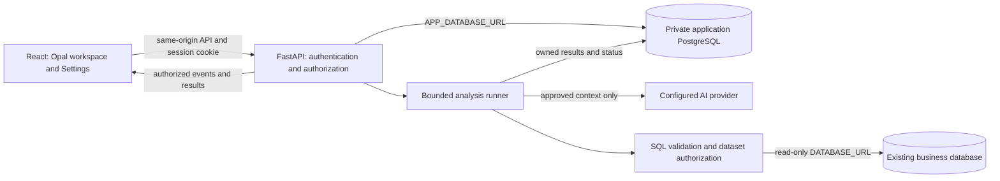

# AQUA — complete Codex implementation handoff

Prepared October 16, 2026. This single file contains the approved frontend/backend scope, all 14 implementation phases, detailed technical specifications, security test gates, code standards and acceptance checks. Place it at the AQUA repository root as `AQUA_CODEX_HANDOFF.md`.

## Instructions to the implementing Codex

**Start P00 now when the user asks you to implement this handoff.** Inspect the real repository, reproduce the isolated baseline, establish contracts/checks and prepare the P00 change for review. Do not stop after proposing another plan or rewriting these specifications. Do not attempt all phases in one change. Preserve the review/commit/PR breaks requested by the user.

1. Locate the current repository root, read applicable `AGENTS.md`/`CLAUDE.md` and current human instructions, inspect Git status and preserve existing work. Expected application markers are `backend/main.py`, `frontend/package.json` and `docker-compose.yml`. Known remote: `https://github.com/drewUTSA/Aqua.git`. Reviewed baseline: commit `499f91955d5e6f463f644d3ab2ac82ac33d810ab`, branch `Frontend-work`. These are historical facts, not instructions to reset or switch the checkout. If this file is outside the source checkout, locate the actual project before editing.
2. This is a self-contained specification. Original `.md` names below refer to the embedded parts in this file; those separate files are not required. Source references are relative to the repository root. `REPO_ROOT` means the current checkout, not a fixed Windows folder. Optional historical audit logs, manifests, screenshots and Figma state ledgers are not bundled; their absence must not prevent implementing from this complete text. Reproduce verification rather than claiming missing evidence was checked.
3. Read this entry section, the implementation order, audit, security and code-quality parts first. Then read the detailed parts needed by P00 or the next authorized phase. Use the **P00–P13 master order**. Historical roadmap phases and data workstream labels are cross-references, not competing execution plans.
4. Design approval is recorded. Do not restart Figma exploration or request approval again for the accepted opal/charcoal direction, both login methods, conditional visual pane or nine Settings categories. Use included tokens, responsive rules and interaction requirements as the implementation starting values and validate accessibility. Preserve the existing brand mark unless a replacement is explicitly approved; proposed logo details do not reopen the approved layout/theme. Figma links provide additional visual reference when available. Never claim to have inspected unavailable frames; record any unresolved visual detail and use the written requirements for independent work.
5. At each phase implement, run meaningful functional tests and the applicable red/blue security checks, fix failures, add regression tests, and retest. Review readability and useful comments. Produce changed-file, verification, migration/configuration, rollback and PR-description evidence. Required security failures or unrun required tests block phase completion. Independent preparation may continue, but never label a blocked feature complete.
6. **Stop at the human review/commit/push/PR checkpoint after the phase.** The inspected repository leaves commits, pushes, PR creation and shared database DDL to humans. Do not auto-deploy, alter public Google signup, grant business-data access or modify shared/Tiger databases. Prepare migrations and test them against disposable local databases. Follow any subsequent explicit human instructions that validly change these boundaries.
7. Security exercises default to allowlisted isolated fixtures with fake providers/email, numeric traffic/resource caps, stop conditions and cleanup. Do not aim scanners/load at production, shared databases, Google, external AI providers or real recipients. Live staging/production testing requires a defined authorized target/window/limits first. An unavailable safe test dependency blocks that test and its completion gate, not unrelated preparation; never substitute a live service. No security test has been performed merely by writing this handoff.
8. Resolve routine choices using the documented conservative defaults. Do not ask again about decided design choices. Record deployment-dependent decisions such as email delivery, database capacity, retention and recovery targets before enabling those capabilities; keep working on safe independent preparation while they remain open.
9. This is a dated design and audit baseline. Statements in embedded documents such as “this planning pass,” “not implemented,” or “next step when implementation starts” describe the October 16 handoff, not an instruction to remain in planning mode. Verify present code and update the progress record as work actually completes. Never copy an old passing test result into a new phase report as if it were newly run. The reported 47-test count is historical; run and report the current suite, whose count may change.

## Required product outcome

- Modern business UI: opal-black canvas, charcoal surfaces, subtle static background specks, accessible typography and restrained accents.
- Google OAuth plus normal email/password, verification/recovery, safe linking, canonical accounts and revocable sessions.
- Separate private application storage for users, sessions, owned history, recents, personal prompts, projects, preferences and results. The AI analytical reader cannot access this store.
- Full-width conversation at login/New Chat. Only requested/needed visuals open the split: **conversation LEFT, visuals RIGHT**. Close/reopen preserves results; old responses never overwrite newer visuals. Mobile follows the same conditional behavior.
- Real Plotly charts, correct financial values, bounded delivery, authorized conversation context, progress/cancellation and truthful freshness/errors.
- Complete safe customization through all nine Settings categories; account/security/privacy actions backed by real server capabilities.
- Production-quality frontend and backend: readable code/comments, bounded algorithms and resources, security checks every phase, tested recovery and deliberate deployment gates. No zero-breach guarantee or certification is implied.

## Reading map

1. [Implementation order and PR checkpoints](#implementation) — includes `CODEX_IMPLEMENTATION_PLAN.md`
2. [Frontend design and interactions](#frontend) — includes `Frontend.md`
3. [Settings and safe customization](#settings) — includes `Settings.md`
4. [Backend architecture and API contracts](#backend) — includes `backend.md`
5. [Identity and application database design](#identity) — includes `IDENTITY_DATABASE_DESIGN.md`
6. [Data, AI and performance engineering](#performance) — includes `DATA_PERFORMANCE_PLAN.md`
7. [Frontend acceptance matrix](#acceptance) — includes `FRONTEND_ACCEPTANCE_MATRIX.md`
8. [Per-phase penetration, red/blue and limiter testing](#security) — includes `SECURITY_TESTING_PLAN.md`
9. [Readable production code and review standards](#quality) — includes `CODE_QUALITY_STANDARDS.md`
10. [Source audit and verification limits](#audit) — includes `CODEBASE_AUDIT.md`
11. [Complete product and launch checklist](#roadmap) — includes `CODEX_ROADMAP.md`
12. [Project decisions and history](#memory) — includes `PROJECT_MEMORY.md`

## Live implementation checkpoint

Maintain this table or an equivalent repository progress log during implementation. Do not mark a phase complete based on its documentation.

| Field | Verified checkpoint — October 26, 2026 |
| --- | --- |
| Current phase | P07 complete; P00–P07 complete and deployed |
| Code checkpoint | `1d08364`, P07 PR #48 merged after all required checks |
| Deployment | Durable bounded analysis live on schema 5 with tested backend/Opal assets; password login, registration, recovery and branded mail active; scheduled worker verified |
| Last accepted design | Opal home, dual login, on-demand right visuals, complete Settings |
| Historical verification | 47 existing frontend tests passed during audit; not a current security or backend result |
| Phase evidence | P07 PR/main CI each passed all 25 steps; 1,243 backend tests, 236 frontend units, 103 synthetic and 39 real-DB browser checks per shell, red/blue security/proxy, encrypted backup, migration and production checks passed; see [P07 release](docs/implementation/P07_DURABLE_ANALYSIS.md) |
| Findings/blockers | No unresolved P07 release blocker; configured legacy formatting exclusions are recorded in the evidence |
| Review checkpoint | P07 independently reviewed, merged, deployed and verified; private data/socket volumes and activation settings preserved |
| Next phase | P08 — Plotly and conditional visuals; await the user's next phase request |

---

<a id="implementation"></a>

## Part 1 — Implementation order and PR checkpoints

Embedded specification: `CODEX_IMPLEMENTATION_PLAN.md`. Original review date: October 16, 2026.

### AQUA implementation plan and PR checkpoints

Updated October 16, 2026. Planning baseline: application commit `499f91955d5e6f463f644d3ab2ac82ac33d810ab`, branch `Frontend-work`, remote `https://github.com/drewUTSA/Aqua.git`. **The Opal frontend and Settings design are accepted. Implementation has not begun in this pass.** This plan is the execution order; supporting workstream labels do not create a second order.

#### Start here

Application: `REPO_ROOT`. Planning documents: `ORIGINAL_PLANNING_WORKSPACE`. They are different directories. Inspect current Git status and instructions in the application before editing; never assume the design workspace is the application checkout. Reconcile changes since the baseline without overwriting anyone's work.

Read these documents together:

| Document | Purpose |
| --- | --- |
| [CODEBASE_AUDIT.md](#audit) | Verified source facts, current gaps and test limitations |
| [Frontend.md](#frontend) and [Settings.md](#settings) | Accepted visual direction, interactions, complete customization and Figma links |
| [backend.md](#backend) | Proposed architecture, API contracts, execution lifecycle and deployment boundaries |
| [IDENTITY_DATABASE_DESIGN.md](#identity) | Accounts, passwords, sessions, ownership, schema/indexes, migration and recovery |
| [DATA_PERFORMANCE_PLAN.md](#performance) | Data/AI safety, workload complexity, query/cache/streaming design and benchmarks |
| [FRONTEND_ACCEPTANCE_MATRIX.md](#acceptance) | Feature-to-code mapping and detailed frontend acceptance coverage |
| [SECURITY_TESTING_PLAN.md](#security) | Mandatory P00–P13 penetration/abuse tests, red/blue evidence, limiter stress and release gates |
| [CODE_QUALITY_STANDARDS.md](#quality) | Required readable code, useful comments, review, automated checks and production-quality criteria |
| [CODEX_ROADMAP.md](#roadmap) | Long-lived product checklist, including both supplied launch images |

Existing safeguards are retained: server-verified Google sign-in, Origin/CSRF checks, explicit financial-data access, SQLglot validation, read-only database roles, bounded rows and statement timeouts, the real/mock client boundary and stale-response protection. Add the approved interface and durable backend around these protections.

#### Outcomes and scope

- Business-appropriate opal-black background with subtle static specks, charcoal sidebar/composer, readable responsive components and accessible states.
- Google OAuth **and** email/password with verification, recovery, safe linking and real revocable sessions. Public signup grants access to an account, not private financial records.
- Persistent users, owned chats/messages, recents, optional projects, saved/frequent prompts, settings, results and required jobs on the server.
- Full-width conversation after login and New Chat. When requested/needed: **conversation left, visuals right**; no empty chart space at entry. Real follow-ups update the right result; close/reopen preserves it.
- All nine Settings categories and their documented safe customization. Sensitive account/privacy operations have working server capabilities and their own confirmations; imports cannot change permissions.
- Measured efficiency: indexed bounded lists, safe scoped caching, bounded AI work and meaningful chart aggregation. No blanket Big-O claim substitutes for actual plans, workload measurements and correctness.
- Reviewable phases, reproducible verification, migration/rollback instructions, and explicit human commit/push/PR checkpoints.
- Mandatory scoped security testing in every phase: attacker-oriented checks, defensive detection/containment/recovery, fixes and retests, including deliberate rate-limit bypass/resource-abuse attempts.
- Readable production code across frontend/backend, with clear names, cohesive modules, typed boundaries and comments explaining security invariants and non-obvious decisions.

This pass delivers planning files. It does not create live databases, send emails, change Google audience settings, deploy, commit, push or open a PR. The application repository's current `CLAUDE.md` leaves commits/pushes/PRs and shared/Tiger database DDL to humans. Preparation and isolated tests can proceed within an authorized implementation phase; infrastructure/public rollout follows its reviewed deployment gate.

#### Decisions and conservative defaults

Do not block unrelated preparation on these decisions. Record the final choice and rationale in application `docs/decisions.md` before its dependent capability is enabled.

| Decision | Working default | Resolve by |
| --- | --- | --- |
| Application database | Private PostgreSQL on existing Ubuntu host; dedicated database/schema/runtime and migration roles, separate from analytical data | P02, after capacity/backup/network review |
| Migration tooling | One versioned SQL ledger unless an established tool is deliberately adopted; no automatic destructive startup migrations | P02 |
| Signup entitlement | No private dataset access; retain explicitly approved existing access with verified identity provenance | P03, public launch gate |
| Email transport | Free/open-source-compatible adapter and fake test delivery; live sender/domain/delivery must be verified | P04 before public password access |
| Frequents | Approved shared starter questions plus private saved/pinned prompts; personal use counters only, no cross-user mining | P06; defer ranking algorithm until meaning is agreed |
| Projects | Private user-owned grouping, matching the existing sidebar; no team sharing or organization tenancy implied | P06 |
| AI provider data policy | Only approved metadata/results, current grants, allowed providers/fallbacks, and no application tables in prompts | P01/P07 before provider use expands |
| Light/system themes and extra languages | Ship complete tested presets/translations only; accepted Opal dark is the starting theme | P09 |
| Notifications | In-app feedback supported first; optional sound/browser/email channels off until the corresponding implementation is verified | P10 |
| Retention, export scope, deletion and contact | Operator supplies truthful retention/support/policy decisions; no invented guarantees | P11/P13 |
| Recovery and capacity | Agree RPO/RTO, off-host backup destination and measured concurrency; daily backup alone does not imply near-zero data loss | P02/P12/P13 |

Optional MFA/passkeys, shared organizational projects, billing, arbitrary theme code, arbitrary model tools, paid services and a new analytics platform are not silently added. Preserve unrelated repository research/evaluation backlog separately. Optional capabilities need complete designs and implementation before being advertised.

#### Release structure

Each phase is a **review boundary**, not a promise that all its work fits in one PR. Split large phases into ordered suffixes (for example P04a registration, P04b recovery) while keeping each change testable and compatible. Never combine password security, a frontend rewrite and a production migration in one unreviewable change.

| Phase | Deliverable | Depends on | Checkpoint intent |
| --- | --- | --- | --- |
| P00 | Current baseline, contracts, isolated verification and CI | — | Establish trustworthy checks |
| P01 | Current data/AI boundary and abuse fixes | P00 | Reduce current risks before expansion |
| P02 | Private application DB, roles, migrations and recovery setup | P00–01 | Persistent foundation |
| P03 | Internal users, Google cutover, revocable sessions and grants | P02 | Secure identity foundation |
| P04 | Password registration, verification, login and recovery | P03 | Both login methods work |
| P05 | Opal shell, full-width entry, routes and dual-login UI | P03–04; static components can start after P00 | Approved design becomes usable |
| P06 | Owned chats/messages/projects/prompts and recents | P03, P05 | Restart-safe workspace |
| P07 | Durable analysis lifecycle, progress, follow-ups and cancellation | P01, P06 | Correct backend-to-UI connection |
| P08 | Plotly and conditional right-hand visual pane | P05, P07 | Real synchronized analysis UI |
| P09 | Settings shell, preferences and safe customization | P03, P05–08 | Complete customization path |
| P10 | Account/security controls and supported notifications | P04, P09 | Real account controls |
| P11 | Private exports, deletions, retention and privacy UI | P06–10 | Truthful data-control features |
| P12 | Capacity measurements and targeted optimization | P01–11 | Evidence that scale remains bounded |
| P13 | Deployment hardening, public-site checks and restricted/public rollout | All required earlier phases | Production release decision |

P05 components may be prepared in parallel with backend foundations against explicit fixtures, but do not release inactive authentication controls as functioning. P09 security/privacy placeholders stay unavailable until P10/P11. Public activation is a separate gate even when code has merged. Recommended new branch names use `codex/aqua-pNN-topic`; preserve the user's existing `Frontend-work` branch and choose the actual PR base with the human maintainer instead of assuming `main`.

#### The checkpoint required after every phase

1. Review the changed files and scope against the phase; remove accidental generated files, secrets and unrelated edits. Keep meaningful migrations and contract docs with the relevant change.
2. Run the phase's focused unit/contract/integration/browser tests. Backend tests use fake models/email and isolated databases. Never let dotenv/test fixtures select shared databases implicitly. Repeat broader tests only when the changed surface warrants them.
3. **Execute the phase-specific security gate** in [SECURITY_TESTING_PLAN.md](#security): red-side abuse/penetration attempts, blue-side prevention/detection/containment/recovery checks, and paired fix/retest evidence. Every implementation phase participates; test existing reachable boundaries when that phase adds no endpoint. Repeat affected core isolation/session/limiter regressions. A missing required test is not a pass. Exercise high-load and destructive failure cases only in the scoped isolated environment; a real deployed target needs its own bounded test scope.
4. Review code against [CODE_QUALITY_STANDARDS.md](#quality), including useful comments, maintainable modules, explicit ownership/resource lifetimes, dependency/secret/static checks and truthful failure handling. Resolve release-blocking findings and rerun their regression checks before claiming completion.
5. Update API/schema documentation, `docs/decisions.md`, phase status and remaining limitations. Save redacted security evidence, attack outcomes, defensive observations, fixes/retests, and before/after screenshots where UI changes. Screenshots and scanner scores alone do not prove safety.
6. Prepare a human-readable PR title/body with the problem, final behavior, verification results, migrations/configuration, security/quality gate results and rollback. For a large format-only cleanup, keep it separate from behavior changes and prove no behavior change.
7. **Stop for the human to review, commit, push and open/merge the PR under current repository instructions.** Do not auto-advance across this checkpoint. After merge or explicit continuation, verify the actual base/commit and resume the next phase. A failed required test or unresolved isolation flaw blocks rollout, not all independent preparation.

Record each checkpoint using the resume template at the end of this document. Do not mark a phase implemented because its specification exists.

The user's October 16 requirement makes these security and readability gates mandatory throughout P00–P13, including frontend-only work. Scope tests to what exists; never invent a passed password/stream/database test before that capability is built. Full prelaunch penetration testing remains required in P13 in addition to the per-phase checks. This is a risk-reduction and evidence process, not a promise that no breach can ever occur. Authenticated APIs remain reachable to legitimate clients; the security goal is preventing unauthorized access, data exposure and uncontrolled resource use.

#### P00 — Baseline, contracts and isolated checks

**Prepare:** keep this single handoff in a durable repository documentation location without overwriting existing instructions. Its embedded parts replace the separate planning/spec files; extracting them is optional, not a prerequisite. Record current branch/commit, public API shapes, auth/allowlist behavior, configuration names, frontend transport normalization and known failures. Inspect actual deployment versions separately from repository assumptions. Inventory environment variable names only; never copy secret values into docs.

**Code/files:** `CLAUDE.md`, `docs/architecture.md`, `docs/decisions.md`, backend tests/configuration, frontend `checks/`, package scripts and a proposed `.github/workflows/` check. Verify an appropriate lock/constraints strategy for Python; frontend already has a lockfile. Keep the $0 budget and repository conventions.

**Verification:** run the current frontend suite and compare with the historical 47-pass baseline; install dependencies in an isolated approved environment and run existing backend tests with no live DB/model/email calls, then frontend build. Add CI for the agreed tests/build and lint only after recording the baseline. Existing guidance requests formatting cleanup: separate that mechanical change from behavior work and report baseline failures accurately. Integration jobs use disposable local PostgreSQL fixtures.

**Exit/rollback:** a reproducible baseline and captured current contracts; failures are fixed or explicitly triaged before dependent work. CI/configuration change is reversible without data changes. **Pause for PR review.**

#### P01 — Current security and data boundaries

**Prepare:** map allowed datasets, qualified relations and provider-visible metadata. Preserve the current query API. Remove raw DB/provider errors from client responses and repair prompts; use safe error codes. Define safe schema dictionaries instead of indiscriminate text-value sampling. Fix cache normalization that changes question meaning and add a versioned authorization-context key interface before introducing private context. Review retrieval fallback so an authorization failure cannot widen schema access.

**Code/files:** `backend/nl2sql/{validate,execute,schema,generate,pipeline,response,cache}.py`, `backend/main.py`, related tests, and deployment rate-limit/proxy documentation. Add auth/action throttling design with trusted client identity; deploy proxy changes only after actual trusted-hop inspection. Keep SQL validation and database privileges as separate controls.

**Verification:** test-first adversarial SQL cases, qualified-schema confusion, cache literal collisions, safe provider payloads, redacted errors and denied fallback. Existing allowed queries and exact answer semantics remain valid. Compare old/new results on synthetic reference queries. Test negative access with actual restricted roles in disposable PostgreSQL.

**Exit/rollback:** no expanded reader privilege, no secret/error disclosure path in tested cases, preserved allowed results. Toggle new provider features off if needed; do not restore a known unsafe error/schema path as rollback. **Pause for PR review.**

#### P02 — Private application database

**Prepare:** inspect host capacity, port/network conflicts, filesystem persistence and off-host backup options. Select deployment and migration mechanism. Prepare separate owner/migrator/runtime roles, explicit app schema and initial identity/session/grant/preferences tables from the identity design. Add typed application-storage configuration and bounded connections; keep analytical credentials and bootstrap scripts untouched.

**Code/files:** proposed `backend/storage/`, `backend/migrations/` or one selected equivalent, `backend/nl2sql/config.py` as appropriate, Compose/deployment docs and example configuration names. Add liveness/readiness separation and migration-version health diagnostics without exposing private data. Prepare backup/restore instructions and required operator actions.

**Verification:** create/migrate a disposable empty DB; test repeat execution, interrupted migration, constraints, least-privilege runtime, invalid settings, dependency outage and connection exhaustion. Prove analytical reader cannot access app tables/schema and app runtime cannot query financial tables. Test pool cleanup across transaction errors.

**Exit/rollback:** reviewed migration/role scripts, private networking plan, persistent volume and executable restore procedure. Human applies shared/server DDL. Use additive schema changes; rollback application/configuration while retaining data. **Pause for migration and PR review.**

#### P03 — Canonical identity and revocable Google sessions

**Prepare:** implement canonical internal account IDs, verified issuer/subject mapping, session digest store, auth epoch, idle/absolute expiry and durable single-use challenges. Extend auth/me with internal `user.id` and capabilities; retain the current client facade. Separate general storage/session readiness from Google configuration. Resolve existing explicit access grants from freshly verified identities with provenance; no mass grant to all registrations.

**Code/files:** `backend/auth/{google,router,sessions,security}.py`, new account repositories/services, `auth_config.py`, auth tests, `frontend/src/services/authClient.js`, `useGoogleAuth.js` and `App.jsx` contract adaptations. The current strict normalizer and account-state key use `user.sub`; migrate both to canonical `user.id` before password activation without fabricating Google subjects. Keep Secure/HttpOnly/SameSite/Origin/CSRF protections and no-store responses.

**Verification:** concurrent first login yields one account; copied/parallel challenge replay fails; copied cookie fails after logout, reset/disable/epoch change; malformed/expired sessions fail; login cannot fixate a session; unauthenticated vs authenticated/no-dataset states differ correctly. DB outage fails protected operations closed. Existing Google audience/issuer/nonce/email-authority rules remain tested.

**Exit/rollback:** deliberate legacy-cookie rejection with reauthentication and migration notes. Do not roll back to unrevocable cookie acceptance; use forward fix or maintenance mode. **Pause for PR and cutover review.**

#### P04 — Password registration, verification and recovery

**Prepare:** implement pending registration, normalized unique email policy, maintained Argon2id hashing, password-manager-friendly policy, verified ownership, generic public acknowledgements, throttling and single-use reset/verification tokens. Add reliable bounded email outbox and fake transport. Keep the Google path. Prevent account precreation, automatic email linking, duplicate-account races and reset-created passwords for Google-only accounts. Specify allowed explicit link/add/change/unlink flows for P10.

**Code/files:** auth route/service/repository modules, challenges/email/outbox adapters, storage migrations and configuration; add maintained free dependencies deliberately. Add a Google-independent pre-authentication bootstrap for anonymous credential/recovery actions with appropriate Origin/CSRF/challenge/abuse protection; these actions cannot require an existing logged-in session. Split registration/login and recovery into separate PRs if needed. Review email links, HTTPS origin, referrer policy and token redaction.

**Verification:** known/unknown-account response policy; correct/incorrect/long/Unicode passwords without truncation; hash work admission under flood; concurrent verification/reset consume; expired/used links; email failures/retries; password-only login during Google unavailability; reset revokes all sessions and does not auto-login. Unit tests send no real email.

**Exit/rollback:** complete local flows and reviewed live sender prerequisites; password feature remains off until delivery works. Disable new registration/recovery availability safely if necessary, preserve existing users/credentials and Google login. **Pause for PR review.**

#### P05 — Opal shell, full-width home and both login methods

**Prepare:** implement accepted Figma tokens/components in React. Retain subtle static specks, readable charcoal surfaces, full composer and responsive sidebar. Add explicit routes for login/access flows, authenticated workspace, Settings shell, legal pages and 404. Separate identity gate from dataset query access. Connect real Google and password forms, clear validation/loading/expired/retry states, and account dots menu.

**Code/files:** `frontend/src/App.jsx`, `pages/SignInPage.jsx`, components/navigation/chat, styles, auth hooks and service adapters. Read actual source before selecting a router/state library; prefer existing patterns unless route needs justify a small dependency. Keep Figma asset details that remain provisional clearly identified.

**Verification:** desktop/mobile screenshots against approved frames; keyboard/screen-reader labels and focus; Google/password/verification/recovery paths against isolated backend; logged-in/no-dataset can use account UI; no empty visual pane on entry; composer survives failed requests. Pending logout must not unmount/discard workspace before confirmed revocation. Production demo mode is off.

**Exit/rollback:** functional, accessible login/home, not just screens. UI feature flag can restore prior shell while keeping secure auth contracts; do not hide password access from existing password-only users. **Pause for PR review.**

#### P06 — Persistent workspace, recents and personal prompts

**Prepare:** add chats, messages, projects, saved prompts and request/result ownership fields through additive migrations. Build owner-scoped CRUD and cursor lists. Include bounded authorized chat-title search, clearly labeled as title search; choose the index/query strategy from representative plans and require a separate reviewed design before extending search to all message content. Persist first submitted message/chat transactionally, stable sequence numbers and idempotent request references. Recents derive from chat activity; private projects only. Use approved starter templates separately from personal prompts.

**Code/files:** proposed `backend/workspace/` repositories/services/routes, storage migrations/tests; `useChat.js`, Sidebar and `aquaClient.js`/`apiClient.js`. Preserve unsent drafts during navigation; server stores submitted history. Do not upload anonymous prior browser histories without verified provenance and an explicit import design.

**Verification:** two-user direct API isolation for lists/search/IDs/child links; simultaneous sends/order; duplicate retries; rename/archive/delete; keyset ties and deep pages; bounded search including empty/no-match cases; restart/session switch history; query counts avoid N+1; old account state is cleared on confirmed logout/switch. Deleting a chat cannot leave readable orphan charts.

**Exit/rollback:** durable private workspace across refresh/restart, useful recents and personal saved prompts. Keep data during rollback; disable mutations requiring unsupported schema instead of reverting to a misleading local-only save. **Pause for PR review.**

#### P07 — Bounded analysis, real follow-ups and progress

**Prepare:** add the reviewed versioned request lifecycle with server-owned chat/request/result IDs. Save input/request atomically, release DB transactions before model calls, execute within total deadline and admission limits, persist terminal state once. Add bounded context selection, scoped cache keys/grant checks and allowed provider fallback. Implement cancellation and safe progress events with status polling fallback. Durable DB leases are appropriate if work survives disconnect/restart; do not introduce Redis or extra services without a measured need.

**Code/files:** query route/service, `nl2sql/{llm,pipeline,db,execute,cache,response}.py`, request storage/worker adapter, frontend real transport/hooks and Nginx stream-route configuration. Preserve legacy query shape during transition through the same protected services, never a weaker parallel path. Fence worker attempts with monotonically increasing lease tokens and conditional final commits. Revalidate session/account/dataset access during active and replayed streams before sensitive delivery, not only on reconnect. Do not stream internal reasoning or unvalidated SQL/data.

**Verification:** meaningful follow-up uses bounded correct context; idempotency mismatch conflict; duplicate completion; revoke/delete/cancel races; deadline across fallback/repair; queue saturation; connection release; worker crash/lease expiry including a late expired worker; revoke/expire while a stream stays connected; reconnect/duplicate/out-of-order events; slow consumer bounds. Fake providers deterministically reproduce races. Browser abort alone must not count as proven server cancellation.

**Exit/rollback:** traceable request lifecycle and honest status with bounded resources. Fall back to authorized status polling if event delivery fails; stop new jobs safely without deleting state. **Pause for PR review.**

#### P08 — Plotly and on-demand visuals

**Prepare:** migrate chart presentation deliberately from current inline Recharts to a lazy-loaded bounded Plotly renderer. Define exact decimals/units/time axes/aggregation/freshness/truncation in result contracts; no arbitrary executable model chart configuration. Implement conditional split, divider constraints, chart/table controls, close/reopen and mobile result navigation. Preserve selection/zoom only across compatible updates.

**Code/files:** `nl2sql/{visualize,response}.py` and tests, frontend result normalization/renderers, pane/layout state and lazy bundle imports. Use narrow chart modules where practical; avoid loading the chart engine at login. Plotly is explicitly requested, but it is not a reason to rewrite all transport/state code.

**Verification:** full-width text-only entry; requested chart right/conversation left; follow-up updates matching chart; older response cannot overwrite newer; text-only follow-up does not reopen dismissed pane; failed refresh retains last chart with honest status. Test exact numeric reference data, missing/negative/zero/timezone values, resize, keyboard/table alternatives and reduced motion. Bound point/byte counts; CSV exports neutralize spreadsheet formula injection without silently altering the display data.

**Exit/rollback:** real end-to-end chart behavior and measured initial bundle impact. Renderer rollback preserves result schema and table access. **Pause for PR review.**

#### P09 — Complete Settings and safe customization

**Prepare:** implement all nine categories and local search. Deliver account/device scope, draft/saved/preview states, explicit Save/Cancel, section/all resets and safe defaults. Add revision-checked account preference persistence; handle local-store/account partial failure and late save responses correctly. Implement bounded/versioned allowlisted JSON preference import/export with preview and no partial application. Wire supported visual, workspace, chat, chart, accessibility and locale controls; capability-dependent account/privacy actions link to their later services.

**Code/files:** proposed `frontend/src/settings/` components/store/schema, tokens/layout/formatting integrations, preference API/repository/schema/migration and tests. Account security, consent, provider secrets, arbitrary CSS/scripts and destructive operations are excluded from preference saves/imports. Supported models and restrictions come from server capabilities.

**Verification:** all [Settings.md](#settings) acceptance checks relevant to preferences: save/reload, cancel/reset, dirty-route changes, two-device conflicts, offline/partial saves, import attack cases and preserved existing draft, all approved presets, 200% text/400% reflow/forced colors, drawer/menu focus and keyboard. Settings cannot reverse panes, force an empty initial chart, remove required accessible states or trigger queries when appearance changes.

**Exit/rollback:** broad customization works with truthful unsupported actions. Reading newer stored/server preferences uses a documented compatibility fallback without silently dropping data on write; schema migrations preserve user choices. Imports and submitted updates reject unknown/prohibited keys or unsupported versions as specified in Settings.md, with no partial application. **Pause for PR review.**

#### P10 — Account security and supported notifications

**Prepare:** connect profile/email changes, add/change password, explicit Google linking/unlinking, recent-auth challenge, active session list/revoke-one/revoke-all and confirmed sign-out. Lock last-method checks transactionally. Add in-app notification settings, generic/hidden previews and supported permission-aware optional channels; leave unbuilt email/browser capabilities unavailable. Security messages remain separate from optional notices.

**Code/files:** account/auth/session services and endpoints, schema migrations, Settings Account & security/Notifications components, auth client and tests. Provider linking and email identity changes do not share an ordinary preference-save endpoint. No MFA/passkey claims without complete enrollment/recovery support.

**Verification:** Google-only/password-only/linked accounts; stale recent-auth proof; identity already linked elsewhere; concurrent unlink of final methods; copied sessions after revoke-all; failure-preserving sign-out; browser permission denied/revoked/unsupported; no private content in notifications. Optional subscription changes require their explicit action, not settings import.

**Exit/rollback:** accurate server-backed controls and no account lockout. Disable incomplete optional channels independently while preserving working login methods and revocation. **Pause for PR review.**

#### P11 — Export, deletion and privacy operations

**Prepare:** implement owned idempotent export/history-deletion/account-deletion jobs with recent auth and explicit confirmations. Decide data scope, retention, backups and audit exceptions. Exports use private bounded temporary output and authorized expiring download, excluding hashes/tokens/secrets/internal permissions. Account deletion first disables/revokes access, then purges content in bounded restartable batches; late analysis cannot repopulate it. Link truthful policies/support.

**Code/files:** data-job repositories/runner, private storage/download adapter, migration/cleanup routines, Settings Privacy & data and account flows, deployment/restore documentation. Preference export remains a separate lightweight allowlisted document. Do not publish private output through static frontend assets.

**Verification:** foreign job/download IDs, expired downloads, revoked grant before export, repeated clicks, restart halfway, delete-vs-completion race, partial failures, download cleanup, controlled purge order and safe audit retention. Restore drill prevents revoked sessions, deleted accounts and revoked grants from silently returning. Reusing a deleted email creates a new identity without old history.

**Exit/rollback:** UI describes actual completion stages and retention, not an instant deletion promise. Stop/retry jobs safely while keeping data consistent; never undo account deletion by reenabling access automatically. **Pause for PR review.**

#### P12 — Performance evidence and targeted optimization

**Prepare:** benchmark indexed auth/app lists, query plans, schema cold/warm load, provider stages, cancellation, streams, chart rendering and bundles using synthetic representative sizes/concurrency. Include a large account with long history, many small accounts and expensive analytical queries. Compare against P00, not guessed speed claims.

**Code/files:** benchmark fixtures/scripts/reports, only proven hot-path code and indexes. Optimize reusable schema adjacency (`O(T+E)` construction), bounded keyset reads, no N+1 previews, metadata refresh and safe per-scope in-flight cache coalescing. Tune pool/thread/worker budgets against actual host limits. Keep intentional password hash cost. Measure model accuracy/validation refusal/fallback quality, not latency alone.

**Verification:** `EXPLAIN (ANALYZE, BUFFERS)` only on isolated representative fixtures; deep-page performance and memory bounds; mixed auth/query load; queue/pool saturation and recovery; slow/disconnected consumers; byte/token bounds; exact financial reference totals and retrieval recall. Record p50/p95/p99 as sample size permits, sample counts, hardware, data sizes, cold/warm conditions and limitations. No shared database benchmarks or paid model traffic without explicit approved scope.

**Exit/rollback:** agreed measured capacity/SLOs, bottlenecks and production limits with evidence. Roll back an optimization/index safely if correctness or write cost regresses. **Pause for PR review.**

#### P13 — Hardening and launch

**Prepare:** inspect real production network/TLS/proxy trust, environment/secret handling, dependency status and private database reachability. Verify CSP/headers with Google/Plotly, request limits, endpoint throttles, readiness, cleanup, monitoring, backups/restore and incident response. Finish public metadata, icons/social image, appropriate sitemap/robots/noindex, 404, real contact, accurate privacy/terms, optional consent/analytics decisions, mobile/load performance and broken links from the user's screenshots.

**Verification:** complete two-account adversarial API tests, registration/recovery/login sessions, all required Settings controls, persistent chat/follow-up/chart lifecycle, accessibility and supported browser checks. Rehearse migration/rollback and isolated restore; verify secure cookies and CSRF through the actual proxy, safe logs, no secrets in built assets and no public app DB port. Test provider/DB/email failure and denial of service limits. Analytics never receives private prompts/results.

**Exit:** a written go/no-go checklist with evidence and remaining limits. Stage with synthetic/approved data, then restricted accounts, then intentionally enable public Google/password registration only after operator review. If OAuth audience/consent configuration or verification is needed, complete the actual provider requirements; do not assume login success for one developer proves public readiness. Public users still receive no private dataset grants by default.

**Rollback:** independently disable new registration, optional providers, events or expensive work; preserve account access and data where safe. Keep a maintenance path for a failing auth/storage dependency. Record deployed app/migration versions and recovery contacts. **Pause for human release/PR approval; no automatic public deployment.**

#### Coverage and workstream crosswalk

| Supporting material | Execution phases |
| --- | --- |
| Identity slices 1–2 | P00/P02 |
| Identity slices 3–4 | P03/P04 |
| Identity slices 5–6 | P06/P09–11 |
| Identity slice 7 | P12/P13 |
| Data workstreams D0–D1 | P00/P01/P02 |
| Data D2–D4 | Essential safeguards P01/P07; measured optimization P12 |
| Data D5 | P06/P07 |
| Data D6 | P08 |
| Data D7 | P07/P08 |
| Data D8 | P12/P13 |
| Original site feature images | P05/P08/P13 and launch checklist in CODEX_ROADMAP.md |
| All nine Settings categories | P09 for customization; P10 account/notification actions; P11 privacy jobs |

#### Reusable prompt for later phases

> Implement phase **PXX** from `CODEX_IMPLEMENTATION_PLAN.md` in the actual AQUA repository. First inspect current status, applicable instructions and changes since the documented baseline. Read that phase and its linked specifications, including SECURITY_TESTING_PLAN.md and CODE_QUALITY_STANDARDS.md. Preserve existing work and security boundaries. Implement only the selected phase, splitting it into smaller reviewable changes if necessary. Write readable code with useful rationale/invariant comments. Use fake providers/email and disposable databases for tests; never use shared/live services implicitly. Execute the phase's scoped red-side penetration/abuse checks and blue-side detection/containment/recovery checks, including applicable rate-limit bypass/concurrency tests; fix release blockers, add regressions and retest. Record changed behavior, API/schema/config changes, security and quality evidence, tests not run, rollback and remaining decisions. Update the phase checkpoint. Prepare the PR description, then stop for the human commit/push/PR step required by the repository. Do not deploy, broaden Google signup/data grants, apply shared database DDL or move to the next phase automatically.

#### Resume/checkpoint record

| Field | Current value / template |
| --- | --- |
| Current stage | Planning complete; implementation P00 not started |
| Last source baseline | `499f91955d5e6f463f644d3ab2ac82ac33d810ab` / `Frontend-work` |
| Design status | User accepted full-width Opal home, both login methods, on-demand split and Settings |
| Verification this pass | Existing frontend tests 47/47; backend/build/browser/server checks not run |
| Next authorized implementation task | Select P00 when implementation begins; this turn only produced the detailed plan |
| Per-phase record | Phase and sub-PR; branch/base/commit; files; behavior; tests passed/failed/not run; security scope/red attempts/blue observations/findings/fixes/retests; code/comment review; migration/feature flags; PR URL once human creates it; human merge/deploy result; rollback; next phase; unresolved decisions |

Before public launch every required implementation/verification gate must have evidence. Documentation approval, Figma navigation and a successful happy-path demo do not mark backend security, persistence or release readiness complete.

---

<a id="frontend"></a>

## Part 2 — Frontend design and interactions

Embedded specification: `Frontend.md`. Original review date: October 16, 2026.

### AQUA frontend implementation specification

Updated October 16, 2026. Status: the user accepted the refined full-width home, dual-method login, account popover and comprehensive Settings design, then requested a code-informed backend and implementation plan. No application implementation was performed in this planning pass. Settings behavior is specified in [Settings.md](#settings); the authoritative execution sequence is [CODEX_IMPLEMENTATION_PLAN.md](#implementation), supported by [backend.md](#backend) and the [acceptance matrix](#acceptance).

AQUA should feel calm, modern, and suitable for daily business analysis. Keep the background specks and use an opal-black canvas with charcoal navigation and chat controls. Start with a conversation-focused workspace; reveal a separate visual pane only when a chart or other visual is requested or needed.

Every frontend phase also follows the mandatory [security testing plan](#security) and [code-quality standards](#quality): test hostile inputs, authorization assumptions, account-state leakage and resource abuse, verify defenses and recovery, and require readable code with useful comments. Visual approval does not waive these checks.

#### Confirmed user requirements

The user confirmed that this direction should carry through to the full implementation. The split layout, synchronized visual updates, responsive behavior, and complete composer are implementation requirements, not optional prototype details. Implement and verify them in the working website when coding begins. A Figma rendering limitation must not become a missing control in the application.

- Preserve the background specks. Reduce their visual weight so they support the interface without distracting from content.
- Use charcoal gray for the sidebar and chat composer, with a deep opal-black background and restrained styling.
- Keep the visual pane hidden after sign-in and in new chats. Ordinary text conversations must not open it or reserve space for an empty chart panel.
- When a visual is requested or needed, open the desktop split with conversation on the left and visuals on the right. This preserves the previously confirmed orientation; the latest change is to when the pane appears.
- Keep the conversation visible while graphs change in response to requests. Visual output must not require scrolling away from the conversation to find it.
- Refine the user's added full-width chat home and ordinary login/password form. Use email and password for the credential form alongside Google sign-in. These are design requirements; no authentication service has been implemented by adding them to Figma.
- The Figma concept is reviewed and accepted. Build the approved frontend against the secure account/storage foundations and contracts in `CODEX_IMPLEMENTATION_PLAN.md`; the latest request moves backend inspection/planning ahead of integrated implementation.
- Add a popover beside the existing account dots control with Settings and Sign out. Create a complete Settings page for frontend customization, with safe boundaries, mobile navigation and accurate account/security controls. The user requested this after accepting the preceding frontend refinement on October 16.

#### Settings and account menu

[Settings.md](#settings) is the implementation specification for the new account popover and nine Settings categories: Appearance, Workspace, Chat & AI, Charts & tables, Accessibility, Notifications, Language & region, Account & security, and Privacy & data. It defines proposed defaults, account/device scope, preview/Save/Cancel/reset behavior, validated preference import/export, backend contracts and acceptance checks.

Keep the existing Opal direction and conditional chart behavior throughout customization. No setting may open an empty chart at sign-in, reverse the confirmed pane orientation, remove essential accessible controls, execute custom CSS/scripts, or grant backend permissions. Account security and private-data operations are separate from ordinary preference saving. Capability-dependent controls must remain unavailable in production until their real backend operations exist; Figma interaction is demonstration only.

The Settings concept now includes all nine desktop/mobile categories, a mobile index, reusable controls, the adjacent account popover, navigation from the main/split workspace, search and an unsaved appearance preview, plus feedback and confirmation flow views. Start at [desktop Appearance](https://www.figma.com/design/BWIqS0xgsWLVpYdJ6bAqJ9?node-id=35-237), [account menu in context](https://www.figma.com/design/BWIqS0xgsWLVpYdJ6bAqJ9?node-id=37-1296), or [mobile Settings](https://www.figma.com/design/BWIqS0xgsWLVpYdJ6bAqJ9?node-id=38-1000). The full frame index is in `Settings.md` and design records are in `output/figma/opal-settings-state.json`.

The user accepted the Settings design. Its prototype covers layout, navigation, example toggles and confirmation screens, not working dropdown values, search, import, persistence or account/security operations. Reset section returns to its section without implementing real default-value changes. Additional options documented in `Settings.md` remain implementation requirements rather than claims of wired mockup behavior. Required chart alternatives, accessible focus and error states remain always available; only optional expanded chart-summary prose can be reduced. Notification previews are Generic status or Hidden, never private data.

#### Figma concept

File: [AQUA Opal Workspace Concept](https://www.figma.com/design/BWIqS0xgsWLVpYdJ6bAqJ9).

The October 16 pass preserves the user's full-width home and adds a consistent email/password form alongside Google OAuth. The home, desktop/mobile sign-in, mobile New Chat, and account-access views were visually checked after refinement. Existing analysis views remain available for chart requests.

| View | Figma frame | Purpose |
| --- | --- | --- |
| New chat | [Open frame](https://www.figma.com/design/BWIqS0xgsWLVpYdJ6bAqJ9?node-id=3-51) | Full-width main workspace with centered welcome, composer and suggested questions. No visual pane or resize gutter. |
| Monthly trend | [Open frame](https://www.figma.com/design/BWIqS0xgsWLVpYdJ6bAqJ9?node-id=3-52) | Written answer beside a persistent loan portfolio chart. |
| District comparison | [Open frame](https://www.figma.com/design/BWIqS0xgsWLVpYdJ6bAqJ9?node-id=14-250) | A follow-up changes the visual to a district comparison. |
| Mobile visuals | [Open frame](https://www.figma.com/design/BWIqS0xgsWLVpYdJ6bAqJ9?node-id=3-53) | Full-width chart with a persistent composer. |
| Mobile conversation | [Open frame](https://www.figma.com/design/BWIqS0xgsWLVpYdJ6bAqJ9?node-id=15-127) | Conversation tab paired with the visual tab. |
| Sign in | [Open frame](https://www.figma.com/design/BWIqS0xgsWLVpYdJ6bAqJ9?node-id=3-54) | Email/password, Sign in, separate Google OAuth, recovery and registration links. |
| Mobile sign in | [Open frame](https://www.figma.com/design/BWIqS0xgsWLVpYdJ6bAqJ9?node-id=28-240) | Both sign-in methods in a 390px layout. |
| Mobile new chat | [Open frame](https://www.figma.com/design/BWIqS0xgsWLVpYdJ6bAqJ9?node-id=28-374) | Chat-only entry with no empty Visuals tab. |
| Account access overview | [Open overview](https://www.figma.com/design/BWIqS0xgsWLVpYdJ6bAqJ9?node-id=28-174) | Recovery request (`28:177`), generic email-sent confirmation (`28:192`), registration with Google alternative (`28:202`), and email verification (`28:228`). These are separate top-level frames arranged over the overview for prototype navigation. |
| Mobile account access | [Open registration](https://www.figma.com/design/BWIqS0xgsWLVpYdJ6bAqJ9?node-id=29-210) | Matching 358px cards: reset request (`29:191`), reset confirmation (`29:203`), registration (`29:210`), and verification (`29:232`). Mobile login links to these narrow-screen flows. |

In prototype mode, select "Loan performance" in desktop New Chat, then "Break down by district" in the monthly trend view. "Compare districts" opens the district view directly. "Back to monthly trend" reverses the example. Mobile Conversation and Visuals tabs link the existing analysis frames. Mobile New Chat offers "Review loan performance" and "Open recent conversation".

Both Sign in and Continue with Google navigate to the corresponding chat-only entry screen. Forgot password and Create an account open their design flows. Recovery submission leads to the generic confirmation, and account creation leads to the verification message. These links demonstrate intended navigation only; no credentials are processed. Account growth, password visibility, policy links, resend timers, and controls without a recorded transition are design content awaiting implementation.

These are sample-data transitions between Figma frames. Authentication, live queries, Plotly rendering, typing, dragging the divider, table switching, exports, and real-time streaming are not implemented by this prototype.

The current desktop and mobile entry frames now represent the conditional-pane requirement. The desktop home has no visible chart pane or divider; both sign-in paths point to chat-only entry. The application must still implement the real request-driven opening and close/reopen behavior described below.

#### Sign-in and account flow requirements

Refine the login screen with the same opal-black, charcoal, pearl, and text colors used in the workspace. Keep the form focused and readable, with visible labels, consistent input/button heights, and enough room for errors without overlapping controls. The credential form uses an AQUA account password; Google sign-in remains a separate option.

- Include labeled Email and Password inputs, a primary Sign in action, a separate Google sign-in action, and Forgot password and Create account paths. Use an accessible Show password control with a clear state. Support keyboard submission, autofill, password managers, and paste.
- Design default, focus, validation, submitting, failed, unavailable, and successful states. Prevent duplicate submissions while a request is pending. Treat missing or malformed input differently from a rejected sign-in; rejected credentials should not reveal which part was wrong or whether an account exists.
- Design account creation, email verification, password reset request, check-your-email confirmation, set-new-password, expired/used-link, and reset-complete screens or states. Provide a route back to sign-in. A recovery confirmation must not claim an account exists or that a message was delivered unless that status can safely be established.
- Keep password-policy copy aligned with the eventual backend policy. Do not invent rules that the server does not enforce, promise unimplemented security features, or show production success based only on a frontend check.
- Successful sign-in leads to the full-width conversation workspace with the visual pane hidden. Returning from a protected route must use a safe, validated destination and preserve the conditional-pane behavior.
- Preserve both authentication choices. The user explicitly reconfirmed Google OAuth plus ordinary login on October 16; neither may replace the other in the implementation.
- Implement and verify the proposed backend contracts in [backend.md](#backend) for each form: submission, pending, success, validation failure, rejected authentication, throttling, expired token/session, and service failure. Cover create account, verify email, sign in, Google sign-in, request/reset password, sign out, and session restoration. The stack has now been inspected; these contracts remain proposals until implemented and tested.

The server must own credential verification, session creation, account recovery, authorization, and abuse controls. The design pass prepares their user-facing states; it does not enable real accounts, send email, or change Google configuration. Security implementation and tests are tracked in `CODEX_ROADMAP.md`.

#### Proposed visual system

The following exact values and the simplified wave/drop mark are design proposals for review. The user has confirmed the broad palette and split direction, not every detail or a logo replacement.

| Role | Value |
| --- | --- |
| Opal-black canvas | `#0B0C0E` |
| Charcoal sidebar | `#191A1E` |
| Reading and visual panels | `#17181C` |
| Composer and message surface | `#232429` |
| Raised controls | `#2B2D33` |
| Control border | `#3D4049` |
| Subtle divider | `#303239` |
| Primary text | `#F2F1ED` |
| Secondary text | `#ADB0BA` |
| Pearl accent | `#CDC8EC` |
| Positive comparison accent | `#B3CCC3` |
| Error accent | `#E5B5AF` |

- Proposed typeface: Manrope. Body text is 16px with 26px line height; ordinary interface text is 14px/22px; supporting text is 12px/18px; headings use 26px/36px. Larger entry-screen headings use 38px/48px. Preserve financial numeral alignment in implementation.
- Use an understated opal undertone, thin borders, and solid reading surfaces. Avoid thick glass rims and strong glow effects.
- Specks are decorative and static in the initial concept. Keep them sparse, mostly in exposed background areas, and out of the reading/plot surfaces. Do not announce them to assistive technology or let them intercept input.
- Use spacing from a small shared scale and 12–20px corner radii for most controls and panels. Use the pearl accent sparingly for selected states, linked results, and chart emphasis.
- Reuse the Figma components and color variables as design references. Use the full-width composer for chat-only entry and the compact composer for the split layout.
- The refined sign-in uses a 464px desktop card and 358px mobile card, 50px input surfaces, 48px main actions, persistent labels, a pearl primary action, and a separate charcoal Google action. These are reference dimensions, not fixed viewport requirements. Keep the Google label fully opaque and readable.
- Auth fields are reusable components with Default, Focus, Error and Filled variants, plus label/value and password-control properties. The component states are visual specifications, not working validation.

#### Desktop layout and behavior

When visuals are open, the 1440px concept uses a 252px sidebar inset 16px from the viewport, a 424px conversation pane, a 16px resize gutter, and a 696px visual pane. Both main panes begin below a shared workspace header. These dimensions describe the expanded visual state, not the initial entry state or a requirement to hardcode the application at 1440px.

- Keep New Chat, search, frequent questions, projects, recent chats, and account controls in the sidebar. Keep model selection in the shared header.
- After sign-in and when starting a new chat, use the available main workspace for the conversation with a readable content width. Hide the visual pane, its empty state, and the resize gutter completely.
- Empty New Chat centers the welcome, composer and suggestions within the available workspace (820px content width in the desktop reference). Once messages exist, anchor the composer to the bottom without covering messages or errors. Give the conversation and visual panes independent scrolling.
- Implement a resizable divider with keyboard support and an accessible name. Start around 38% conversation and 62% visuals within the split area. Respect practical minimum widths and remember the preference per device.
- Keep the active visual title, chart/table controls, source context, units, and relevant result status in the visual pane. Allow expanding the visual when it helps exploration.
- A response should identify its related visual. Selecting an earlier result should restore its visual without changing which chat owns it.
- Open the visual pane for an explicit chart/visual request or when the submitted task needs a visual result. Keep it closed for ordinary text answers. Once open, keep the requested result available alongside relevant follow-ups.
- Provide Close visuals and, when a result exists, Show visuals actions. Closing returns space to the conversation while preserving the result; do not reopen it simply because unrelated text arrives. A new explicit visual request may reopen it.
- New Chat starts with useful prompts and no chart pane. Do not automatically restore an open chart pane merely because the user signs in; existing visual results remain accessible from their associated conversation.

#### Conversation-driven visual updates

The desired experience is that users submit a question on the left and see the resulting chart change on the right as the answer becomes available.

1. Submit a question or an explicit data/filter change. Stream the written response into the conversation if the backend supports it. Determine whether the request actually calls for a visual; a text-only answer must not activate the visual pane.
2. When a visual is requested or needed, reveal the pane. Show a small "Updating visual…" state while retaining the previous completed chart and its context. For the first visual request, show a loading state only after revealing the pane for that request, never as part of sign-in or New Chat.
3. Associate every visual request with the authenticated chat, message, and request/version identifier. Cancel or ignore stale responses so an earlier slow query cannot overwrite a newer result.
4. Validate the chart specification and authorized data, then update the visual in place. Do not reset the entire workspace or unexpectedly move focus or either pane's scroll position.
5. Preserve zoom/filter selection where it remains meaningful. Explain a change of chart, dataset, period, or units so the user can interpret the new view.
6. On failure, retain the last valid chart with "Couldn’t update. Showing the previous result" and a retry action. Preserve the user's draft and conversation.

Do not rerun expensive queries on every keystroke. Do not call the source "Live" unless there is a functioning live-data connection. Distinguish the time a chart finished updating from the source data's actual freshness. Server enforcement and event transport are proposed in [backend.md](#backend) and must be implemented and tested in P07/P08.

#### Mobile behavior

- Use a sidebar drawer and begin in Conversation without an empty Visuals tab. Make Visuals available when a visual request is active or a result exists, using tabs instead of squeezing two narrow panes side by side.
- Preserve the state and scroll position of both tabs. Keep the composer available from either tab, above the keyboard and safe area.
- Indicate when a visual is ready without forcing a tab switch or moving keyboard focus.
- Use readable full-width charts and a table alternative; avoid clipped labels and horizontal page overflow. Main touch controls in the concept are 44px tall.
- Choose the actual breakpoint from available pane width and test intermediate sizes; 390px mobile and 1440px desktop frames are references, not full responsive verification.

#### Plotly and application integration

- Match Plotly backgrounds, fonts, labels, grid lines, hover surfaces, and series colors to the shared theme. Use actual data and numerically consistent axes in the implementation.
- Validate structured chart specifications. Never execute arbitrary JavaScript or HTML supplied by model output.
- Provide chart/table alternatives, readable units and legends, and context for the period and source. Do not communicate meaning through color alone.
- Update charts when their container resizes. Keep large queries and results bounded and load chart code when needed.
- Keep visual results, cached data, downloads, and chat history tied to the same server-enforced user permissions. A frontend-only filter is not authorization.
- Use the actual backend-supported model names and connection states. Concept labels are examples.
- Use the supported Google sign-in control and applicable branding rules during implementation; the Figma button is a visual/navigation placeholder.

#### Verification before implementation is considered complete

- [x] Record the user's acceptance of the design direction for future implementation.
- [ ] Resolve remaining asset details, including the proposed logo treatment, against the existing application and design references.
- [ ] Implement and verify the complete composer in every applicable view, especially desktop New Chat and mobile Conversation: visible charcoal surface, input, toolbar, and working send control. Track the Figma rendering issue separately; it does not waive this requirement or require delaying code work solely to repair the mockup.
- [ ] Inspect the actual application and applicable repository instructions before selecting code changes.
- [ ] Implement the split view, sidebar, header, and composer without regressing current flows.
- [ ] Verify sign-in, New Chat, and text-only questions leave the visual pane hidden with no reserved blank column. A chart request reveals it; relevant follow-ups update it; Close visuals restores conversation space; Show visuals restores the saved result. Verify the equivalent mobile behavior.
- [ ] Verify both sign-in methods, accessible email/password inputs and visibility toggle, account creation, verification, password recovery, throttled/failed requests, and session-expiry states. Check the mobile keyboard and password-manager behavior. Do not count prototype navigation as a successful authentication test.
- [ ] Verify long conversations, long labels, scrolling, resizing, keyboard navigation, visible focus, screen reader labels, contrast, and mobile keyboard behavior.
- [ ] Cover empty, loading, streaming, successful, stale, failed, expired-session, and retry states in the working UI.
- [ ] Verify conversation/result association, out-of-order responses, cancellation, chart resizing, table view, and data-access controls with representative tests.
- [ ] Demonstrate the full end-to-end flow with authorized data: submit a question on the left, render its chart on the right, submit a follow-up, and update that chart without losing the conversation. Verify loading, failure/retry, and stale-response handling. Static Figma transitions alone do not satisfy this check.
- [ ] Complete the remaining public-site and launch checks in `CODEX_ROADMAP.md`.

#### Current concept validation and remaining work

The refined frames use editable text, vectors, auto-layout containers, component instances and shared palette variables. Rendered text was checked as Manrope. Screenshots were reviewed after composition and targeted fixes: desktop full-width home, desktop/mobile login, mobile New Chat, account access, and auth-field states. Desktop monthly-trend and district-comparison views retain their previously checked split composition.

The earlier missing-composer rendering issue is no longer reproduced in the October 16 screenshots. Desktop New Chat now uses the full-width composer master, with its surface, input text, toolbar and send control visible. Both the new mobile entry and the existing mobile conversation (`15:127`) also render complete composers. Keep the implementation checklist for working controls and keyboard behavior; visual confirmation is not a functional test.

Remaining account states include submitting/rejected/throttled/service-failure behavior, new-password entry, expired or used recovery links, and reset completion. The account-flow cards have visually checked 448px desktop and 358px mobile versions; implement responsive sizing, keyboard-safe layout and scrolling rather than hardcoding those widths. Google button branding must follow the supported production control. The Figma Show password text is a specified control, not an implemented toggle.

Divider resizing, full interaction states, production accessibility, and real-time backend behavior remain implementation work. No application or server changes have been made.

---

<a id="settings"></a>

## Part 3 — Settings and safe customization

Embedded specification: `Settings.md`. Original review date: October 16, 2026.

### AQUA settings implementation specification

Updated October 16, 2026. Status: the user accepted the Settings design and requested the detailed code/backend implementation plan. Application implementation and functional verification remain. No settings persistence or authentication operation is implemented by this document or its Figma mockups. Use [CODEX_IMPLEMENTATION_PLAN.md](#implementation), especially P09 preferences, P10 account/notifications and P11 privacy operations.

This specification supplements [Frontend.md](#frontend). The real application has now been inspected; backend dependencies and proposed contracts are in [backend.md](#backend), with detailed coverage in the [acceptance matrix](#acceptance). Defaults below are proposed implementation defaults, not evidence of existing behavior.

#### Figma design and prototype coverage

The [AQUA Opal concept](https://www.figma.com/design/BWIqS0xgsWLVpYdJ6bAqJ9) now includes nine desktop Settings categories, matching mobile category pages and an index, reusable switches/choice controls/rows, an account popover anchored beside header/sidebar dots, workspace navigation links, and 22 desktop/mobile feedback, import, reset, profile/security and privacy flow views. Search and an unsaved Sage appearance preview are represented as additional example screens.

| View | Figma frame |
| --- | --- |
| Appearance | [Open desktop Appearance](https://www.figma.com/design/BWIqS0xgsWLVpYdJ6bAqJ9?node-id=35-237) |
| Workspace | [Open desktop Workspace](https://www.figma.com/design/BWIqS0xgsWLVpYdJ6bAqJ9?node-id=35-417) |
| Chat & AI | [Open desktop Chat & AI](https://www.figma.com/design/BWIqS0xgsWLVpYdJ6bAqJ9?node-id=35-570) |
| Charts & tables | [Open desktop Charts & tables](https://www.figma.com/design/BWIqS0xgsWLVpYdJ6bAqJ9?node-id=35-722) |
| Accessibility | [Open desktop Accessibility](https://www.figma.com/design/BWIqS0xgsWLVpYdJ6bAqJ9?node-id=35-868) |
| Notifications | [Open desktop Notifications](https://www.figma.com/design/BWIqS0xgsWLVpYdJ6bAqJ9?node-id=35-1018) |
| Language & region | [Open desktop Language & region](https://www.figma.com/design/BWIqS0xgsWLVpYdJ6bAqJ9?node-id=35-1160) |
| Account & security | [Open desktop Account & security](https://www.figma.com/design/BWIqS0xgsWLVpYdJ6bAqJ9?node-id=35-1292) |
| Privacy & data | [Open desktop Privacy & data](https://www.figma.com/design/BWIqS0xgsWLVpYdJ6bAqJ9?node-id=35-1431) |
| Account popover in context | [Open menu context](https://www.figma.com/design/BWIqS0xgsWLVpYdJ6bAqJ9?node-id=37-1296) |
| Mobile category index | [Open mobile Settings](https://www.figma.com/design/BWIqS0xgsWLVpYdJ6bAqJ9?node-id=38-1000) |
| Mobile Appearance | [Open mobile Appearance](https://www.figma.com/design/BWIqS0xgsWLVpYdJ6bAqJ9?node-id=38-1025) |
| Search example | [Open search example](https://www.figma.com/design/BWIqS0xgsWLVpYdJ6bAqJ9?node-id=42-1372) |
| Unsaved appearance preview | [Open Sage draft example](https://www.figma.com/design/BWIqS0xgsWLVpYdJ6bAqJ9?node-id=42-1430) |

The prototype demonstrates layouts, navigation, example toggle transitions and confirmation screens. It does not implement working dropdown selection, text search, file import, preference persistence, account changes, authentication, session revocation, exports or deletion. In particular, Reset section opens/closes its example modal back to the same section; actual default-value changes, dirty state and save/cancel behavior must be implemented in the application. Search/import feedback screens are examples, not running search/parsing logic.

The detailed requirements below intentionally extend beyond the mockup's wired examples. Additional preference options and combinations, line-spacing/table-pagination behavior, validation, scope-specific persistence, offline/conflict handling, accessibility semantics and server contracts remain implementation specifications. Do not infer that every documented option has a working prototype transition. The design state ledger is opal-settings-state.json (optional historical artifact: `output/figma/opal-settings-state.json`; not bundled), with flow nodes and final visual-check evidence in opal-settings-flows.json (optional historical artifact: `output/figma/opal-settings-flows.json`; not bundled).

Visual review covered representative desktop/mobile categories, the anchored menu, unsaved Sage preview, import/sign-out examples, profile/verification fields and search. Menu placement and input-width issues were corrected and checked again. Structural validation found no invalid navigation targets among 235 prototype links, and desktop preference content fits above each save bar. This is design validation; keyboard/screen-reader behavior, full theme contrast coverage, persistence and security still require application tests.

#### Entry and navigation

- The existing account dots button opens a small anchored popover next to the trigger. Include the signed-in account identity, **Settings**, a divider, and **Sign out**. Keep the popover inside the viewport; reposition above or inward when needed. Do not cover the trigger or require pixel-perfect hovering.
- Give the dots button a visible focus state and accessible name such as "Account menu". A menu implementation must expose its expanded state and support Enter/Space to open, arrow-key navigation, Escape to close, and return focus to its trigger. Follow the [W3C menu-button pattern](https://www.w3.org/WAI/ARIA/apg/patterns/menu-button/) and its linked menu keyboard behavior.
- Settings opens a dedicated page within the authenticated workspace. Preserve the active chat, unsent draft, selected visual, and scroll positions when navigating there and returning. Opening Settings must not create a new chat or open a chart.
- Use a Settings heading, short description, nine-section navigation, and searchable setting labels. Search returns matching controls with their category and does not send the text to an AI service. Include a Back to workspace action.
- At desktop widths, use a compact category column and a readable content column, with a preview where useful. On mobile, use a category index followed by full-width category pages with an explicit Back action. All nine sections remain reachable; do not squeeze the desktop navigation into a narrow side rail.
- Show the current section in the page title and navigation state. Keep search, headings, and save controls reachable with keyboard, zoom, and the on-screen keyboard. A sticky save bar must not cover the final setting or focused control.

#### Editing, preview, and persistence

Use explicit **Save changes** and **Cancel** with a scoped live preview for appearance and presentation changes. Keep three states distinct: server-confirmed saved values, the current draft, and the effective preview. Navigating between Settings categories retains the same draft. Show an unsaved-change indicator and disable Save when nothing changed or validation fails.

- Preview safe presentation values immediately without changing account security, deleting data, requesting browser permissions, switching providers, or triggering AI queries. Announce preview changes without interrupting screen-reader navigation.
- Save the account-scoped draft preferences as one validated update. Save device-scoped values through their separate local persistence path; do not pretend the server and browser storage are one atomic transaction. Display "Saved" only after all targeted writes succeed. If only one scope succeeds, identify that scope, preserve the remaining unsaved draft, and offer a retry for the failed scope. An account-save failure never claims cross-device sync.
- While saving, freeze the submitted draft or keep an explicit immutable submission snapshot so a slow response cannot mark newer edits as saved. Prevent duplicate submissions. Cancel means discard the current unsaved draft, not undo an already-confirmed server write; provide an explicit subsequent edit/reset to change a saved value. Handle a response lost after submission by re-reading the authoritative revision before presenting a retry as a new change.
- Cancel restores the last saved appearance and other previewed values. On Back, route change, or browser close with unsaved edits, offer Save, Discard, or Keep editing where the platform permits; do not trap users indefinitely. Refresh cannot be treated as a successful save.
- **Reset this section** restores its proposed defaults into the draft and leaves other sections' edits intact. **Reset all preferences** requires a clear confirmation and resets preference values only; it does not remove chats, accounts, linked identities, sessions, permissions, or consent records. Reset remains cancelable until saved. Show which scope and categories will change before confirming; reset does not trigger immediate server writes. After a reset, ordinary Cancel restores the last saved values, not the pre-reset unsaved draft; provide Undo reset to restore that pre-reset draft if offered.
- Every control identifies whether it applies to the account, this device/browser, or only the current chat/result. Account settings sync only after sign-in and server confirmation. Device settings do not silently overwrite another device's layout or accessibility choices.
- Use server revisions for account preferences. If another device changed the same record, show the conflict and let the user reload or review/reapply their draft; never silently overwrite a newer record. Resolve schema migration on the server or through an explicit supported client migration.
- On an offline or unavailable service, show saved values with a clear sync status. Allow a local draft/preview, but disable server-dependent changes. If device-only preferences can be saved locally, label that success as "Saved on this device".
- Store only bounded non-sensitive preferences locally. Use account-scoped keys and purge account-specific caches and drafts on account switching/sign-out. A non-identifying device theme or text-size choice may remain to keep sign-in usable. Never put passwords, session tokens, private prompts, chart data, or reset tokens in a preferences file or local preference store.

#### 1. Appearance

| Control | Proposed default and allowed choices | Scope |
| --- | --- | --- |
| Theme | Opal dark; Light; Follow system. Dark is the accepted starting design. Light/system require equivalent reviewed tokens and states before being enabled. | Account, optional device override |
| Accent | Pearl default; Sage; Slate; Amber, each with checked foreground/selected/focus combinations. Presets only for initial release. | Account |
| Contrast | Standard or Increased. Increased uses an approved higher-contrast token set, not an unrestricted color editor. | Device |
| Text size | Standard 100%; 112.5%; 125%; 150%. Browser zoom continues to work independently. | Device |
| Reading line spacing | Standard default; Relaxed for conversation text. Apply a bounded token choice without overlapping controls or reducing available text-resize support. | Device |
| Interface density | Comfortable default; Compact. Compact never shrinks essential touch targets or hides labels. | Account |
| Background specks | Subtle static default; Off. Optional density choices limited to Subtle/Low, with reading and plot surfaces kept clear. | Account |
| Surface treatment | Solid default; Soft depth with restrained elevation. Avoid excessive glow or transparency behind text. | Account |
| Typeface | Manrope default and a bundled system-sans alternative. No external font URL field. | Account |

The preview should include sample navigation, a message, a composer, a button, a focus ring, and a small sample chart. It uses synthetic content. Any theme applies consistently to dialogs, menus, error states, loading states, tables, and charts. No theme may remove meaningful focus or error states. Future custom hex accents, if added, must be validated and mapped to safe foregrounds; arbitrary CSS, scripts, markup, font URLs, and imported executable themes are out of scope.

#### 2. Workspace

| Control | Proposed default and allowed choices | Scope |
| --- | --- | --- |
| Sidebar | Expanded on wide screens; collapsed/drawer at narrow widths. Remember device choice where space permits. | Device |
| Sidebar sections | Show or hide Projects, Recents, and Frequent questions; reorder the optional sections with buttons and optional drag handles. Keep New Chat, account access, and Settings reachable. | Account |
| Recents shown | 10 default; 5, 10, or 20, with a See all path. | Account |
| Conversation width | Comfortable default; Focused; Wide. Bound widths and keep text readable. | Device |
| Expanded split size | Approximately 38% conversation / 62% visuals initially, constrained by minimum pane widths and viewport. Store the actual divider preference for that device. | Device |
| Composer tools | Show/hide optional attachment and prompt-suggestion controls only when those capabilities exist. Keep message input, send/stop, errors, and required status visible. | Account |
| Start screen | New Chat default. A future "Continue last chat" option may restore authorized history but must still enter with the visual pane closed. | Account |

The user-confirmed invariant is **conversation on the left, visuals on the right, and visuals hidden until requested or needed**. Do not offer a preference to show an empty chart at login, reserve a blank chart column, reverse the panes, or auto-reopen a dismissed chart for unrelated text. Close visuals and Show visuals remain available for an existing result. Remember split dimensions, not initial chart visibility. The mobile equivalent begins in Conversation without an empty Visuals tab.

#### 3. Chat & AI

| Control | Proposed default and allowed choices | Scope |
| --- | --- | --- |
| Default model | The server-provided account default; choices come only from permitted, available models. Include model availability or usage information if the service supplies it. | Account |
| Response style | Balanced default; Concise; Detailed. Presentation/style preference only, never a permission or factual-correctness guarantee. | Account |
| Send shortcut | Enter to send / Shift+Enter new line by default on desktop; optional Ctrl/Cmd+Enter to send. A visible Send button always remains. | Device |
| Stream responses | On when supported; Off shows the completed response. Cancellation remains available and does not erase submitted messages. | Account |
| Follow-up suggestions | On default; Off. Suggestions use authorized content and cannot reveal another user's prompts. | Account |
| Timestamps | Compact default; Always show; Hide nonessential timestamps. Preserve ordering and relevant freshness/status information. | Account |
| Auto-scroll | Follow new output only while near the bottom by default; Manual. Do not jump away from an earlier message the user is reading. | Device |
| Code/display aids | Wrap long code lines by default; optional code line numbers. Keep copied content unchanged. | Account |
| Personal response instructions | Off/empty initially; optional plain text up to a documented bounded length after the server supports it. Show where these instructions apply and allow clear/delete. | Account |

Setting a model or style applies to future requests; label any per-chat override. Do not rewrite saved answers or silently rerun queries. Personal instructions cannot grant data permissions, run unrestricted queries, alter security rules, or bypass provider/account policy. Do not add fields for provider secrets, API base URLs, arbitrary system prompts, or unrestricted tool execution to ordinary frontend Settings.

#### 4. Charts & tables

| Control | Proposed default and allowed choices | Scope |
| --- | --- | --- |
| Initial result view | Chart default; Table when the requested result supports both. Explicit user requests take precedence. | Account |
| Series palette | Accessible categorical default; approved sequential/diverging alternatives for appropriate data. | Account |
| Labels and legends | Auto fit default, with approved visibility controls. Units, source context, and essential distinctions remain available. | Account |
| Grid lines | Subtle default; Standard; Minimal. Preserve readable axes and values. | Account |
| Chart transitions | Respect device motion preference by default; Off. Never require animation to read an update. | Device |
| Preserve exploration | Keep zoom and compatible filters during related updates by default. Reset explicitly when units/data/axis meaning changes. | Account |
| Table density | Comfortable default; Compact. Keyboard navigation and table headers remain usable. | Account |
| Table rows per page | 25 default; 10, 25, or 50 when pagination is supported. Results remain bounded and server-authorized; this setting does not increase query/export permissions. | Account |
| Number precision | Automatic from result metadata default; bounded display precision override. Show full precision on demand. | Account |
| Export preference | Remember a supported format after the user chooses one; do not trigger an export merely by saving settings. | Account |

A display preference must not change source data, silently convert currency, alter query permissions, omit a material warning, or claim a stale result is current. Chart data is linked to its chat/message/request and passes the same server authorization as the source. Table alternatives, textual summaries, units, and accessible labels remain available under every palette. Never execute model-generated scripts or arbitrary chart options supplied through Settings.

#### 5. Accessibility

- Motion: Follow device preference by default; Reduce motion. Any explicit reduction overrides decorative transitions across the app. The specks remain static by default.
- Readability: device-level text scaling, increased contrast and **Reading line spacing** mirror the Appearance controls rather than storing conflicting duplicate values. Standard/Relaxed spacing changes reading text without hiding controls or truncating content. Honor operating-system forced colors and browser zoom.
- Focus and input: clearly visible keyboard focus is always on. Provide a keyboard-shortcuts reference and a way to disable optional single-key shortcuts or remap only supported shortcuts without taking over browser/assistive-technology commands.
- Announcements: announce completed responses/visual changes and actionable errors by default; offer Reduced announcements to limit verbose streaming, while retaining essential status/error feedback.
- Chart access: use the setting label **Expanded chart summaries**, with helper text **Basic text alternatives are always available.** Expanded summaries are on by default; turning them off reduces optional prose only. Basic chart summaries, accessible labels and the table/text alternative remain available. A separate result-view preference may open the table first, but cannot remove alternatives.
- Touch targets and reflow are baseline quality, not opt-in switches. Use a 44px product target for primary controls, and ensure smaller secondary targets still meet the applicable WCAG target-size/spacing rule.

Target WCAG 2.2 AA: normal text contrast at least 4.5:1, large text at least 3:1, applicable control/visual boundaries at least 3:1, visible unobscured focus, usable 200% text resize, and reflow at a 320 CSS-pixel viewport except content that genuinely needs two-dimensional layout. Color alone must not convey state. Check all presets and combinations, not just default Opal. These requirements follow the [W3C WCAG 2.2 reference](https://www.w3.org/WAI/WCAG22/quickref/).

#### 6. Notifications

- In-app completion/status messages: on by default. Optional success toasts may be reduced; essential errors, failed saves, and session-expiry messages remain visible.
- Sounds: off by default; never play audio automatically just because a page opens.
- Browser notifications: off until the user explicitly requests permission from a supported control. Explain the use, then invoke the browser permission flow. Handle denied, unsupported, and revoked permissions honestly; a saved preference cannot grant browser permission.
- Email updates: only show supported optional categories and their actual subscribed state. Start optional product/marketing messages off. Delivery configuration and consent must exist before enabling those controls.
- Quiet hours: off by default; if supported, use the selected timezone, show overnight ranges clearly, and affect optional notifications only.
- Notification previews: Generic status by default; Hidden for users who prefer no preview. No option may reveal private prompts, answers, financial data, credentials, or recovery links. Security/account messages are separate from optional product notices; do not offer a false ability to suppress required security communication.

#### 7. Language & region

- Interface language: use a supported browser-language match, falling back to English. Show only translated, reviewed languages; do not advertise unimplemented language packs.
- Response language: Match interface default; optionally select a supported AI response language. This must not claim that the UI is fully translated.
- Timezone: Detect device default with a visible named timezone and a supported manual selection. Store timestamps consistently on the server; formatting is a display concern.
- Dates, time, and numbers: Locale default with bounded date style, 12/24-hour time, and separators. Provide sample values before saving.
- Week starts on: Locale default; Monday; Sunday for any implemented date controls.
- Currency: use source currency by default and label units. A display preference must not relabel USD as another currency or perform an implied conversion; any real conversion requires an identified rate/source/date and a separate supported operation.

#### 8. Account & security

Separate preference saving from security operations. Each operation has its own explanatory copy, pending/success/error states, server confirmation, and any required recent authentication.

At this design stage the credential, linked-method, session, data-export and deletion flows are specifications only. A prototype may navigate to a clearly labeled example confirmation/state, but must not imply it verified a password, connected Google, revoked a session or deleted data. In production, expose an action only with a functioning server capability or keep it disabled with a clear explanation. A settings demo must never collect real credentials.

- Profile: display name and current verified email. Limit editable profile fields to those actually supported. Changing a verified email requires the supported verification flow; never treat a typed value as verified.
- Sign-in methods: show Google OAuth and AQUA email/password availability from the server. A Google-only account must not show an invented password. Add/change password and link/unlink Google require verified account ownership and appropriate reauthentication; never silently merge accounts by matching email. Block removal of the last usable access method.
- Passwords: use password-manager-friendly fields and the backend's actual policy; do not show stored passwords. Success follows a real server response. Recovery/change flows must preserve the generic/non-enumerating behavior in `Frontend.md`.
- Sessions: list server-reported active sessions with this-device marker, approximate device information and last activity. Offer revoke one other session and **Sign out of all sessions**. Do not promise exact location/device identity from uncertain signals.
- Current sign-out: selecting Sign out in the account popover opens a brief confirmation with Cancel and Sign out, mentioning unsaved work when present. Revoke the active session on the server, then clear account-specific state and return to sign-in. Sign-out failure must be reported honestly and allow retry; locally hiding a page is not confirmed server logout. For all-session revocation, require the server's recent-authentication policy and a distinct confirmation.
- Optional MFA/passkeys belong here only if the chosen authentication provider and complete enrollment/recovery flows are implemented. Show unsupported capabilities as unavailable with plain explanations, or omit them from production. Never label an account protected merely because a prototype toggle is enabled.
- Do not let ordinary users change authorization, tenant membership, global security controls, server retention obligations, security logs, rate limits, or session-cookie protections through personal Settings.

Enforce each security operation and resource check on the server, using the authenticated account rather than a submitted owner ID; deny unauthorized operations by default. Follow [OWASP authorization guidance](https://cheatsheetseries.owasp.org/cheatsheets/Authorization_Cheat_Sheet.html). Protect session cookies and state-changing requests, rotate/revoke sessions appropriately, and invalidate sessions server-side on logout as described by [OWASP session guidance](https://cheatsheetseries.owasp.org/cheatsheets/Session_Management_Cheat_Sheet.html).

#### 9. Privacy & data

- **Export preferences** downloads only a versioned allowlisted preference document. Exclude identity, email, sessions, tokens, secrets, custom prompt text, chats, chart data, permissions, consent receipts, and browser permission state. Device values can be included only after a clear choice and should remain device-scoped on import.
- **Import preferences** previews supported changes and warnings before modifying the draft. Initially accept only JSON, up to 64 KiB, with an explicit schema version, allowlisted keys, supported enums and numeric bounds. Reject malformed or incompatible files, prototype-pollution keys, unexpected nesting and unsafe values. Reject an unknown schema version rather than silently treating it as the current version. Never interpret a string as code, HTML, CSS, a URL to fetch, or a permission grant. An import cannot turn on notifications, consent, provider connections, or data access. It follows the ordinary Save/Cancel workflow.
- **Reset preferences** is distinct from clearing local account data, deleting chat history, deleting an account, and revoking sessions. Use precise names and confirmations for those separate operations.
- **Export my data** is a separate authenticated job with a reviewed scope and short-lived authorized download, only when the backend exists. Show queued, working, ready, expired, failed and unavailable states. Never include other users' records or silently reuse a public download URL.
- **Delete chat history** and **Delete account** are separate destructive flows. Describe the affected data, access changes, applicable retention/backups, and whether the action is reversible. Require deliberate confirmation and the backend's recent-authentication policy; never claim completed deletion from a frontend-only state change.
- **Clear local account data** explains which device caches/drafts will be cleared and what remains on the server. It does not claim to delete server history or revoke all sessions.
- Optional analytics/consent preferences reflect actual enabled tooling and the applicable reviewed policy. Keep unnecessary sensitive content out of analytics. Do not add an "AI training off" or retention toggle unless the service and providers truly enforce that control.
- Provide reachable privacy policy, terms, and support links. Contact details and policy claims must come from the actual operator.

Validate imports and updates both syntactically and semantically, with type/length/range/allowlist checks at the server trust boundary; a browser validation result is not sufficient. Use [OWASP input validation guidance](https://cheatsheetseries.owasp.org/cheatsheets/Input_Validation_Cheat_Sheet.html).

##### Preference import states

1. Choose file: read only the selected local file after checking the size limit. Parse it as data; do not follow embedded links or fetch additional resources.
2. Validate: check schema/version, every key/value, current capabilities, policy restrictions, numeric ranges and safe preset combinations before changing any preview. Optional omitted keys mean "leave unchanged". Unknown keys, prohibited keys and invalid values reject the whole import; no partial application or silent correction.
3. Invalid: show a plain-language summary and bounded field-specific errors such as "Accent is not one of the supported presets". Preserve saved values, the pre-existing unsaved draft and its preview exactly. Disable Apply to draft. Offer Choose another file and Cancel; do not expose stack traces or render file values as markup.
4. Ready: only a fully valid, currently supported import reaches this state. Show a comparison of current draft values and proposed imported values, grouped by account/device scope. Reject unavailable choices as unsupported rather than silently dropping them. No security, consent, notification-permission or private-data operation can enter this comparison.
5. Apply to draft: only an explicit action updates the preference draft and safe preview. Keep a snapshot so Undo import can restore the pre-import draft. Closing the import preview before applying leaves the draft unchanged.
6. Save or Cancel: use the normal preference workflow. Save revalidates against the server's current schema/capabilities/revision; a concurrent policy or revision change can still reject it. Global Cancel restores the last saved values. Never say "Imported and saved" before persistence succeeds.

#### Frontend-to-backend contracts to define

These are logical operations. Proposed endpoint paths and implementation boundaries are now in [backend.md](#backend); verify/finalize their schemas against the actual consumers during implementation. Server capabilities control which operations are available; disabled controls explain why. Figma sample identities, sessions and operation outcomes remain demonstrations.

| Operation | Required behavior |
| --- | --- |
| Read preferences/capabilities | Return schema version, preference revision, saved values, allowed options, applicable policy restrictions, and supported actions for the authenticated account. Do not expose secrets. Use safe defaults for missing/new fields. |
| Save preferences | Accept only supported editable preference keys plus the expected revision. Validate allowed values and return canonical saved values/new revision. Return field errors, authentication expiry, conflict, throttling and service failure distinctly. Never accept role, tenant, owner, limits or consent changes through this operation. |
| Load/save device preferences | Use the documented local scope and namespace, handle unavailable/corrupt storage with safe defaults, and never report account sync for a device-only save. |
| Import/export preferences | Serialize/parse only the approved schema. Preview import locally, then use the same server validation on save. Never accept security or data operations through imported preferences. |
| Profile/sign-in method changes | Use separate authorized operations with ownership verification, recent authentication when needed, verification/recovery state, and no last-method lockout. |
| List/revoke sessions and logout | Authenticate, enforce session ownership, protect state-changing operations, return confirmed revocation status, and clear the correct client state. Treat all-session revocation separately. |
| Notification subscription | Persist channel/category choices only after any required explicit consent and browser/provider capability checks. Return actual subscribed state; no success simulation. |
| Data export/deletion | Check ownership and policy, require necessary confirmation/reauthentication, create idempotent operations/jobs, expose bounded status, and return completion only when the operation reaches the stated stage. |

All state-changing server operations need the applicable CSRF defense, authorization, input validation, bounded rate/abuse controls, and redacted operational logging. Avoid recording sensitive preference text. A failed or expired session returns the UI to a recoverable authentication path without leaking the previous account's content. Caches, imports, deep links and direct API requests obey the same account isolation rules.

#### Interaction states and acceptance checks

Design default, hover/focus, selected, disabled/unavailable, loading, dirty, invalid, saving, saved, save-failed, conflict, offline, expired-session and confirmation states. Confirmations are real dialogs with an accessible title, controlled initial focus, contained keyboard focus, an explicit cancel/close action, Escape handling, and focus restored to the invoking control; destructive dialogs initially favor the least destructive action. Follow the [W3C modal-dialog pattern](https://www.w3.org/WAI/ARIA/apg/patterns/dialog-modal/).

- [ ] Account dots opens the nearby menu without clipping on desktop, collapsed sidebar and mobile; keyboard, Escape, outside click and focus return work. Settings and Sign out lead to the correct distinct flows.
- [ ] All nine categories and search results are reachable at narrow widths, 200% text size, 400% zoom/reflow, keyboard-only input and screen-reader navigation. The save bar does not cover content/focus.
- [ ] Preview a theme/text change, navigate categories, then Cancel: original values and appearance return. Save and refresh: confirmed values persist. Section/all reset affects only preferences and remains cancelable before saving.
- [ ] A failed save retains edits and never says Saved. A two-device revision conflict never overwrites newer settings silently. Offline/device-only states and unsupported capabilities are accurately labeled.
- [ ] Account-save/local-storage partial failure reports precisely which scope succeeded. A late save response cannot clear newer edits. Reset section preserves other-section edits; cancel/undo reset and cancel/undo import have the documented distinct outcomes.
- [ ] Every supported theme/accent/density/text-size combination preserves contrast, labels, focus and chart interpretation; reduced motion and forced-colors behavior remain usable.
- [ ] Changing layout settings never exposes an initial chart pane after sign-in/New Chat. A requested chart opens on the right of the conversation; close/reopen and mobile tab behavior remain intact after settings changes.
- [ ] Settings navigation preserves unsent drafts and current conversation/visual context. Model/style changes affect subsequent requests only and cannot enable unavailable models or unauthorized data/tools.
- [ ] A valid preference export/import roundtrip preserves allowed values. Malformed, oversized, unknown-version, nested-attack, script-like, out-of-range and unauthorized-key imports fail safely without side effects or partial application.
- [ ] Invalid imports preserve an existing unsaved draft and preview, cannot enable Apply, and never render executable content. A valid import needs Apply to draft and then Save; validation/conflict failure at Save retains the draft for correction.
- [ ] Account A cannot read/change account B's settings, sessions, exports or deletion jobs by changing IDs or direct API calls. Account switching and browser Back do not reveal prior account caches or drafts.
- [ ] Google-only, password-only and linked accounts show accurate actions; linking/changing credentials requires the real ownership flow and removing the last sign-in method is blocked.
- [ ] Sign out revokes the server session, clears account content, and returns to sign-in; a revocation/network failure is not presented as complete. All-session sign-out revokes other devices as specified.
- [ ] Notification permissions, optional consent and security notices remain truthful. Import/reset never grants permissions, enables consent, sends messages, exports private data or deletes records.
- [ ] Data export/deletion tests cover deliberate confirmation, recent-authentication requirements, ownership, retries, job failure, expired downloads, retention wording and actual server completion.
- [ ] Figma screenshots and prototype transitions are reviewed separately from these functional tests. No prototype result counts as working persistence, logout, password change, notification delivery or deletion.

#### Implementation sequence

1. Design review is complete and accepted. Preserve the recorded visual checks and user requirements; implementation still needs working keyboard, responsive and state verification.
2. Follow master phases P00–P08 for the inspected application, storage/auth foundations, workspace and charts; read current repository instructions again before editing.
3. In P09 implement the Settings shell, all safe customization, draft/preview state, bounded device preferences, revision-aware account persistence and imports. Use the proposed contracts in `backend.md` and capability-driven availability.
4. In P10/P11 connect real account/security/notification/privacy operations. Run the acceptance checks above and record screenshots, integration-test results and remaining limitations. Mark settings implemented only after the working flows pass.

---

<a id="backend"></a>

## Part 4 — Backend architecture and API contracts

Embedded specification: `backend.md`. Original review date: October 16, 2026.

### AQUA backend implementation specification

Updated October 16, 2026. Status: code-informed proposal, ready for implementation planning. No backend or database changes have been deployed. Read [the audit](#audit) for the source commit and verification limits, and follow the ordered PRs in [CODEX_IMPLEMENTATION_PLAN.md](#implementation).

#### Architecture and non-negotiable boundaries

Keep the existing FastAPI modular application and React/Vite client. Extend the working Google flow, SQL validation, read-only analytical connection, CSRF protection and frontend service boundary. Add dedicated application persistence; avoid an unrelated framework rewrite, paid dependency or microservice migration.



The drawing shows logical boundaries; the runner can initially be a bounded component of the same deployment. Add a dedicated worker process only when durable work/restart behavior warrants it. Models never receive application database credentials or tools to query account tables. Only the analytical adapter holds analytical read credentials. Only auth/application repositories use application write credentials.

1. **Authentication is not data authorization.** Verified users can manage their own account/settings. New registrations get no private financial-data grant. Resolve every dataset access on the server; never trust a browser owner, role or dataset entitlement field.
2. **Separate stores and roles.** The existing business `public` schema is broadly readable/discoverable by the AI path. Create a separate application database, with an explicit `app` schema, private networking, a limited runtime role and a separate migrator. No accounts, passwords, sessions, chats or settings in business `public`.
3. **Preserve defense in depth.** Qualified relation/column allowlists, AST validation, database read-only grants/transactions, limits and deadlines remain independent checks. A model instruction is not an authorization control.
4. **No private data in operational telemetry.** Log correlation IDs, outcome categories, durations and sizes; redact credentials, tokens, prompts, result rows and raw provider/SQL errors. Record only reviewed minimal security metadata with retention.
5. **No pretend capabilities.** The server advertises supported, authorized actions. A prototype toggle cannot enable email delivery, browser permission, MFA, data export or deletion. Default incomplete features off.

#### Database placement and deployment proposal

Prefer PostgreSQL on the existing Ubuntu host, subject to a resource, disk and recovery check. This is a proposal under the repository's $0 budget, not an assertion that the host has spare capacity. Keep Tiger Cloud business data unchanged. If self-hosting cannot meet the agreed recovery target, decide placement before activating accounts; do not silently select a paid service.

The current Compose backend/frontend use host networking. A small additive deployment can run PostgreSQL on a private bridge with a host port bound only to `127.0.0.1` for the existing backend, after checking port conflicts. Alternatively revise the container network in a separately verified deployment change. Never publish a database port to all interfaces. Do not combine an unrelated network migration with authentication cutover.

Prepare versioned, reviewed SQL migrations and a checksum/version ledger unless the implementation deliberately adopts one established migration tool. SQLAlchemy is listed as a dependency, but the inspected code does not establish an ORM migration system. Decide once and document it. Normal web startup must not run destructive schema changes. Application runtime credentials cannot own tables, create schemas, administer roles or run migrations.

Use explicit lifecycle-managed application and analytical pools only after sizing their combined connection budget. Bound connection acquisition time and waiting callers; never keep a transaction open while calling Google, email or a model. Account operations need capacity independent from slow analysis. Multiple processes multiply pool size. See [psycopg pool documentation](https://www.psycopg.org/psycopg3/docs/advanced/pool.html).

The full provisional schema, constraints, indexes and identity rules are in [IDENTITY_DATABASE_DESIGN.md](#identity). Core records are users, emails, external identities, optional password credentials, sessions, single-use challenges, dataset grants, chats/messages, analysis requests/results, preferences, saved prompts, data jobs and security audit events. Use composite owner/parent foreign keys, atomic uniqueness and compare-and-swap revisions. Recents are an indexed view of chats, not duplicated chat data.

**Proposed meaning of frequents:** retain reviewed starter FAQ templates separately; add private saved/pinned prompts and personal usage counts. Do not mine private chats into a shared FAQ. Ranking can follow a later explicit product decision; this default lets persistent recents and saved prompts ship without guessing user intent.

#### Identity and session implementation

Google remains supported alongside email/password. Use immutable internal user IDs; uniquely associate Google issuer/subject with that account. Do not use email, a Google subject or a browser-supplied ID as the ownership key for application data. Never automatically merge accounts solely because email strings match.

Replace signed profile-cookie sessions with random opaque tokens, storing only token digests plus expiry, revocation, CSRF state and authentication time. Keep Secure/HttpOnly/appropriate SameSite and `__Host-` cookie protections. Validate current account status and authorization on protected requests. Logout, all-session logout, password reset and account disablement revoke server state. Original browser and copied-cookie tests must both fail after revocation.

Preserve the existing GIS signature/audience/issuer/expiry, challenge nonce and Origin/CSRF checks. Make challenges durably single-use under concurrency. Separate Google availability from password/session availability. During cutover deliberately expire old stateless sessions and require fresh authentication; do not offer a legacy acceptance fallback that bypasses revocation.

For passwords use a maintained Argon2id library, deliberate resource limits and a modern password policy; implement pending registration, mailbox verification, generic login/recovery responses, expiring purpose-bound tokens, safe linking and last-method protection. Verification must not activate an attacker's pre-registered password just because a mailbox owner follows a link. An unauthenticated reset cannot add the first password to a Google-only account. Precise rules and verified primary references are in the identity document.

Email delivery is an implementation dependency. Prepare a fake local/test transport and reliable bounded outbox; live sender/domain/transport must be selected and verified before public password signup/reset is enabled. Do not log links or leave plaintext recovery tokens in job payloads. No messages are sent by writing this plan.

#### Proposed API contract

These routes are proposals for implementation, not existing endpoints. Keep existing `/api/auth/*` and `/api/query` compatibility until consumers migrate; capture their actual contracts in P00. The legacy query route must call the same new authorization, deadline/admission, scoped-cache and safe-error services, or be explicitly retired; it cannot remain a weaker bypass. Implement new application routes under `/api/v1` and extend the current auth response additively where possible. All client calls continue through `aquaClient.js` and its real adapter. Update the source repository's API guide/instructions with any accepted change.

Before password accounts are enabled, update the strict frontend auth normalizer to validate and retain canonical `user.id` and key/remount account state by that ID. The current normalizer requires `user.sub`, and App keys state by that Google subject; merely adding an ignored JSON field is insufficient. Do not invent a Google subject for password users. Include a Google-independent pre-authentication bootstrap/challenge endpoint so password login and recovery do not depend on the current Google-only configuration endpoint.

| Area | Proposed operations | Critical semantics |
| --- | --- | --- |
| Bootstrap | Extend existing auth/me; `GET /api/v1/capabilities` | Canonical `user.id`, identity state, safe profile, method availability, permissions and supported settings schema. No secrets. UI distinguishes signed out, signed in/no dataset, ready, and unavailable. |
| Password access | `POST /api/v1/auth/registrations`, `/email-verifications`, `/password-login`, `/password-reset-requests`, `/password-resets` | Server validation; bounded generic public acknowledgements; single-use challenges; no secret in GET side effects. Include typed errors and safe retry timing. |
| Profile and methods | `GET/PATCH /api/v1/me`, explicit `/me/email-change-requests`, `/me/password`, `/me/identities/google`, identity unlink and reauthentication operations | Whitelisted profile edits only. Sensitive operations require recent proof and distinct CSRF-protected methods; identity changes never pass through ordinary preferences. |
| Sessions | `GET /api/v1/me/sessions`; revoke one; explicit revoke-all; preserve current logout facade | Public session ID is not the bearer token. Revocation checks ownership; recent auth for revoke-all. A failed logout never reports confirmed completion. |
| Preferences | `GET/PUT /api/v1/me/preferences` | Versioned allowed values and revision. Update includes expected revision; conflict returns 409. Return canonical saved values. Device settings use a separate browser store. |
| Chats and projects | List/create/read/update/archive/delete `/api/v1/chats`; bounded title search/message list; project routes if retained | Always owner-scoped, stable keyset cursors, capped page/query size, no N+1 message preview queries. Start with explicitly labeled chat-title search; extending search to message content needs reviewed indexing/retention semantics. New Chat does not create unlimited empty rows on every click. |
| Personal prompts | `/api/v1/me/saved-prompts`; separate approved starter catalog | Personal ownership, bounded text, atomic use counters, stable ordering. No private aggregate suggestions across users. |
| Analysis | `POST /api/v1/chats/{chat_id}/analysis-requests`; GET status; explicit cancel | Accept message/model choice, client request ID and bounded references, not arbitrary SQL or owner claims. Transactionally persist input/request; same retry returns same operation. Return 202 with IDs when asynchronous lifecycle is implemented. |
| Results/events | `GET /api/v1/analysis-requests/{id}`; `/events`; authorized `/results/{id}` and table pages | Ownership and current dataset grant enforced at enqueue, execution and delivery. Events have sequence numbers and versioned result references. Reconnect reads state without resubmitting work. |
| Notifications | Explicit supported subscription operations | Browser permissions and subscriptions separate from preference booleans. Security messages separate from optional product updates. Optional email/browser delivery stays unavailable until implemented. |
| Privacy jobs | `POST /api/v1/me/data-exports`, `/history-deletions`, `/account-deletions`; owned job status/download | Recent auth where required, reviewed scope, idempotency, bounded resumable work, short-lived private download, truthful deletion stages. |

New routes use a consistent safe error envelope, for example `{ "error": { "code": "revision_conflict", "message": "Settings changed on another device.", "request_id": "..." } }`, with bounded field errors when appropriate. Use 401 for unauthenticated, 403 for known forbidden capability, a consistent 404 policy for unavailable/foreign resources, 409 for revisions/idempotency conflict, 422 for validated input, 429 with retry guidance, and 503 for service unavailability. Preserve the existing query response envelope during migration; do not silently reinterpret its current HTTP-200 domain-error handling.

Opaque cursors bind to the owner, filters and stable sort keys; cap page sizes (proposed 20 default/100 maximum for ordinary lists) and validate decoding. Authenticated mutations enforce exact allowed Origin, CSRF, session authentication, ownership, content type, input size and endpoint-specific abuse policy. Public registration/login/recovery cannot require an existing authenticated session: use the applicable Origin/pre-authentication CSRF protections, purpose-bound challenges, input bounds and abuse controls instead. Browser hidden buttons never substitute for these checks.

#### Durable analysis and live chart updates

1. Authenticate; resolve current dataset grant, capabilities and model policy. Validate bounded input. Insert the user message and analysis request in one short transaction with unique `(user_id, chat_id, client_request_id)` and a payload fingerprint. Reusing a key for different input returns a conflict.
2. Reserve a bounded execution slot. If work must survive process restart, use the application database as the initial durable queue with leases, attempt caps and one active owner. Fence attempts with a monotonically increasing lease/attempt token; updates and final commits compare-and-swap against the current owner/token and allowed state. An expired worker cannot commit over a newer attempt. Do not rely on an unbounded in-process background task. Store state independently from a client's open connection.
3. Build bounded, authorized conversation context from recent messages and explicitly selected prior results. SQL/schema/data strings are untrusted content. No private application tables, unrestricted schema sampling, secrets, or raw internal errors in provider context.
4. Use one end-to-end deadline across schema, retrieval, generation, repair/fallback, SQL, summarization and persistence. Recheck grants before expensive work and result delivery. Release DB transactions between stages. Fallback models must satisfy the same data-egress policy.
5. Fully validate SQL before executing with the read-only analytical role. Bound rows, columns, serialized bytes, context tokens, provider attempts and concurrent work separately. A LIMIT alone does not bound join/aggregate cost. Use safe repair categories instead of raw database error text.
6. Persist assistant message, result metadata and completed request state atomically. Failed/cancelled requests retain truthful safe status. Deduplicate final commits; a cancelled/deleted/revoked request cannot recreate removed content through a late completion. After restart, distinguish retryable work from a terminal record rather than claiming exactly-once external provider calls.
7. Deliver bounded ordered events or poll status during an initial fallback. SSE can provide progress and validated result references; no chain-of-thought or unvalidated SQL stream. Recheck session/account/dataset authorization before sensitive live or replayed events and result delivery, including on an already-open connection. Close on expiry/revocation; set and test a bounded detection interval for idle streams, and do not count a heartbeat as meaningful session activity. Recheck on reconnect and bound connection lifetime. Define `Last-Event-ID` replay window and a snapshot fallback. Nginx buffering/timeouts must be tested for this route.
8. Client updates only the matching request/result version. Keep the last good chart during refresh/failure; closing the pane retains its result. A text-only message does not open the visual pane. Changes follow submitted prompts or explicit filters, not every keystroke.

Result metadata must include exact-value representation where needed, units, source-data freshness when known, generated time, filters, truncation and aggregation/downsampling information. Financial decimals must not silently lose precision in JSON/chart conversion. Use an allowlisted chart contract; the model cannot send executable Plotly options, HTML, scripts or external data URLs. Render bounded points and provide an authorized table/text alternative.

#### Efficiency and capacity

Use [DATA_PERFORMANCE_PLAN.md](#performance) as the detailed algorithm and measurement specification. Indexed point lookups are approximately `O(log n)`; bounded keyset lists are approximately `O(log n + k)` under appropriate plans. Scanning or aggregating `r` relevant rows costs at least work proportional to `r` unless a maintained summary answers the operation. Password hashing must remain deliberately expensive. No blanket “all work is O(n)” promise is meaningful here.

Prioritize correctness and bounded work: owner/sort indexes, keyset pagination, no per-row queries, byte-limited scoped caches, approved versioned schema metadata, reusable adjacency graphs, provider/client lifecycle, and bounded render updates. Tune from query plans and representative measurements. FastAPI's existing synchronous routes execute through a thread pool; changing `def` to `async def` while retaining blocking calls is not a performance fix. [Starlette thread-pool documentation](https://www.starlette.io/threadpool/)

Keep existing row/statement safeguards initially; establish explicit byte/token/concurrency budgets using synthetic fixtures and real host capacity. Any proposed SLO in the supporting document is an unmeasured starting target. Avoid holding slow analysis capacity in a way that blocks login, logout or saving preferences.

#### Operations, hardening and release gates

Apply [SECURITY_TESTING_PLAN.md](#security) and [CODE_QUALITY_STANDARDS.md](#quality) during every phase. The user explicitly requires scoped penetration testing, red/blue exercises, limiter bypass/resource stress and readable commented code. Validate both prevention and safe detection/containment/recovery; fix findings and rerun regressions. Isolated synthetic environments are the default. A public API can be reachable while still enforcing authentication/authorization; the goal is no unauthorized access, not a claim that legitimate clients cannot contact the backend. Passing tests reduces risk and does not guarantee immunity from future vulnerabilities.

- Inspect actual TLS termination, trusted reverse proxies, origin firewall and forwarded scheme/IP. Trust headers only from allowed proxies; configure limits using trustworthy identity. [Nginx real-IP documentation](https://nginx.org/en/docs/http/ngx_http_realip_module.html) and [Uvicorn settings](https://www.uvicorn.org/settings/).
- Retain private no-store headers; deploy an appropriate CSP after testing Google and charts, correct frame/referrer/content-type protections, HTTPS redirect and HSTS only when deployment supports them. Avoid caching personalized HTML/API responses at an edge.
- Separate liveness from dependency readiness. Liveness should not call a model or expose internals; readiness reports safe service availability and fails appropriately for application storage. Give migrations, backups and jobs observable status.
- Use supported pinned/reproducible dependencies, non-root services where compatible, minimal filesystem permissions, restricted outbound/provider endpoints, secret rotation and no secrets in client bundles, images, logs or reports. Review actual versions at implementation time.
- Define retention, account deletion, export expiry, security-log retention and consent based on actual service behavior. Owner-supplied contact/policy facts are launch inputs, not invented content. Optional analytics excludes private prompts/results and stays off unless deliberately approved and compliant with the applicable policy.
- Encrypted off-host backups and an isolated restore drill are required before persistent public accounts. Agree RPO/RTO; do not promise small data-loss windows from a daily dump. Restore must revoke restored sessions/tokens and address deleted-account/grant resurrection. A same-host volume alone is not a backup.
- Expand/contract migrations, bounded backfills and separate feature rollout protect existing behavior. Never rollback by dropping newly collected user data or re-enabling unrevocable legacy sessions. Prepare a forward fix/maintenance path if the old binary is incompatible.

Public signup remains disabled until the P13 release gates pass: both login methods and recovery work, two-account isolation is proven, AI cannot read application storage, permissions and cancellation behave under races, email and backup recovery work, production configuration is verified, and the frontend accurately reflects real capabilities.

---

<a id="identity"></a>

## Part 5 — Identity and application database design

Embedded specification: `IDENTITY_DATABASE_DESIGN.md`. Original review date: October 16, 2026.

### AQUA identity and application database design

Updated October 16, 2026. Status: code-informed execution plan; no application code, database, Google configuration, or deployment was changed for this document.

Build persistent AQUA accounts, revocable sessions, private chats and settings in the existing FastAPI application. Preserve Google sign-in and add the accepted email/password flow. Keep application storage separate from the read-only financial-data connection. The preferred deployment proposal is a private PostgreSQL instance on the existing Ubuntu server, subject to a capacity and backup check; this fits the repository's zero-dollar budget without introducing a new service architecture.

#### Evidence and scope

Source inspected: `REPO_ROOT`, commit `499f91955d5e6f463f644d3ab2ac82ac33d810ab`. This is separate from the planning workspace. The source establishes Python/FastAPI, psycopg and PostgreSQL; production service state, credentials, database grants, firewall rules, TLS termination and server capacity were not inspected. Read the current source and migration history again before implementation. The current product specifications and their review status are [Frontend.md](#frontend) and [Settings.md](#settings).

Keep changes within the modular application. Follow the repository's human-owned commit, push, PR and shared-database migration process. `CLAUDE.md` requires migrations to be prepared for human application and prohibits agents from changing Tiger Cloud services. Historical frontend task text does not replace the user's newer Opal design and account requirements.

| Code evidence | What exists or is missing | Required disposition |
| --- | --- | --- |
| Google verifier (source: `backend/auth/google.py:11`) and login (source: `backend/auth/router.py:70`) | SDK token verification, expected audience, bounded transport, nonce comparison, signed browser challenge and generic errors already exist. | Extend this flow; retain its protections and tests. |
| CSRF checks (source: `backend/auth/security.py:29`) and cookie attributes (source: `backend/auth/sessions.py:50`) | Exact configured Origin, session CSRF token, Secure/HttpOnly/SameSite cookies, and the HTTPS `__Host-` prefix already exist. | Retain for both login methods and all new mutations. |
| Session serialization (source: `backend/auth/sessions.py:28`) and logout (source: `backend/auth/router.py:124`) | Signed stateless cookies carry profile claims. Logout clears browser cookies; it cannot revoke a copied cookie server-side. | Replace with opaque database-backed sessions before implementing device/session management. |
| Login challenge test (source: `backend/tests/auth/test_login.py:104`) | The second request fails after the browser removes its challenge cookie. The test does not prove rejection if the original cookie and credential are copied and replayed. | Persist challenge consumption and add a copied-cookie replay/concurrency test. This is a code-level gap, not a claim of observed exploitation. |
| Authentication configuration (source: `backend/auth/security.py:18`) | All authenticated requests depend on Google being configured. Accounts, password credentials and recovery endpoints are absent from the inspected auth router. | Separate general session/storage readiness from Google-specific readiness; a Google outage or disabled Google configuration must not disable a functioning password login. |
| Query authorization (source: `backend/auth/security.py:62`) and access tests (source: `backend/tests/auth/test_access.py:14`) | Login and database access are already separate. Empty allowlists deny queries; third-party Google emails need an explicit subject grant. | Preserve this boundary while moving grants to internal account IDs. Public signup must not grant financial-data access. |
| Public-table grants (source: `db/03_users.sql:27`) and schema discovery (source: `backend/nl2sql/schema.py:201`) | Existing scripts grant the reader SELECT on all current public tables and future public tables created under the affected default privileges. The model schema loader discovers public tables. | **Never place accounts, password hashes, sessions, chats or settings in the analytical database's `public` schema.** Add permanent negative privilege/schema-discovery tests. |
| Hidden-column script (source: `db/05_hide_columns.sql:13`) | Rerunning the broad grant script requires reapplying the narrower staff grants. | Prevent application migrations from invoking analytical bootstrap scripts; verify effective privileges after any relevant migration. |
| Analytical connection (source: `backend/nl2sql/db.py:38`) | `DATABASE_URL` opens a read-only connection. | Leave this path read-only; add a distinct application-storage connection. |
| Query cache inputs (source: `backend/main.py:145`) | Cache keys contain the question/model/options, without account, dataset grant or conversation context. This matches the current single authorized dataset design. | Before private datasets or conversational context exist, partition keys by authorization scope and relevant context/version. Do not describe current shared-dataset caching alone as a proven cross-user leak. |
| Nginx rate limiting (source: `frontend/nginx.conf:8`) | Checked-in configuration limits `/api/query`, trusts a supplied Cloudflare IP header for that limit, and has no auth-specific limiter. | Add auth/application limits and verify trusted proxy/origin network controls. Exploitability of a spoofed header depends on uninspected deployment reachability. |
| Compose services (source: `docker-compose.yml:3`) | Only frontend/backend services are declared, with host networking; no application database or backup service is declared. | Prepare a private application database deployment and backup runbook after checking host resources; do not assume an existing persistent volume. |

Existing auth tests cover malformed/expired cookies, nonce and CSRF rejection, authoritative-email rules, allowlist revocation and browser logout. Preserve them and extend their assertions to database state. They were inspected, not executed as part of this document.

#### Storage and credential boundaries

1. Keep the current analytical `DATABASE_URL` and `nl2sql_reader` credentials for validated read-only business queries. Do not give this role application-table grants or write permission. Retain SQL validation, allowlisting, hidden-column protection, timeouts and row limits.
2. Add `APP_DATABASE_URL` for a dedicated `aqua_app` PostgreSQL database, preferably hosted privately on the Ubuntu server. Put application tables in an explicit `app` schema. Use the PostgreSQL version actually supported by the host and deployment tooling; do not upgrade the analytical service as a side effect.
3. Bind a self-hosted database only to the backend's private network or localhost as appropriate for the final container arrangement. Expose no public database port. A dedicated persistent volume, disk monitoring, restricted file permissions and recoverable off-host backups are prerequisites.
4. If host capacity or recovery obligations rule out this placement, evaluate reuse of existing PostgreSQL capacity with a separate database or private `app` schema and independent grants. Verify provider capabilities and cost first. Never solve placement by adding application tables to the analytical `public` schema.
5. Use a non-login owning role, an application runtime role with only required DML, and a separate migration role unavailable to the web container. Scope backup access explicitly. The runtime role must not own tables, manage roles, create schemas, or bypass row security. Do not provide production admin URLs to application configuration.
6. Keep schema/migration commands separate from normal startup. No destructive automatic migration or database reset on container restart. Prepare reviewed migration files and a deployment checklist for the human operator.

The existing SQLAlchemy dependency does not establish that an ORM or migration tool is currently used. Select one migration mechanism after checking the complete repository; versioned SQL plus an applied-migrations ledger is viable, and Alembic is an option if SQLAlchemy models are adopted. Use one authoritative migration history.

#### Identity rules

##### One internal account

Every account gets an immutable internal `user_id`. Chats, settings, sessions, grants and jobs refer to that ID. A Google subject and an email address are identity attributes, never interchangeable primary keys.

For Google, use verified issuer plus `sub` as the unique external identity; validate signature, expected audience, issuer and expiry with the maintained SDK. Preserve the actual JSON callback's nonce/CSRF flow rather than copying protections from a different redirect flow. A matching email alone never links an existing AQUA account. Google documents that `email_verified` can remain true for a third-party mailbox that Google no longer controls. [Google server verification](https://developers.google.com/identity/gsi/web/guides/verify-google-id-token)

Define and version email normalization. Keep the submitted display address and a unique login key; retain the current case-insensitive login policy deliberately, handle internationalized domains consistently, and do not strip Gmail dots or plus suffixes. Audit collisions before backfilling. Verification belongs to a specific address and method, not a permanent boolean on a mutable profile string.

Unverified registrations expire and cannot monopolize an address indefinitely. A repeat registration cannot replace an existing password or identity. Email verification must not activate credentials chosen in an unrelated browser's registration merely because a recipient clicked a link: bind completion to the original registration transaction or require the verified recipient to establish a fresh password before activation. Test pending-registration collision and account-precreation cases.

##### Email and password

Use a maintained password-hashing library; for a new app-managed store, prefer Argon2id. Start no weaker than the documented 19 MiB / two iterations / parallelism one configuration, then benchmark on the real server under concurrent login load. Store the encoded hash with salt and parameters, rehash on successful login when policy changes, and never store or log the password. [OWASP password storage](https://cheatsheetseries.owasp.org/cheatsheets/Password_Storage_Cheat_Sheet.html)

Proposed password policy: at least 15 characters for password-only login; permit at least 64 characters, spaces, paste, autofill and password managers. Block common/compromised passwords. Do not require arbitrary character mixtures or routine expiration without compromise evidence. If Unicode is accepted, apply a consistent documented normalization before hashing and count code points. These follow NIST's current password guidance; adopting these controls alone is not a claim of NIST assurance-level compliance. [NIST SP 800-63B-4, password verifiers](https://pages.nist.gov/800-63-4/sp800-63b.html#passwordver)

Keep request-size and hash-work limits explicit; reject unsupported length instead of truncating. Bound expensive hash concurrency so login flooding cannot starve queries. Use generic rejected-credential responses with comparable work for absent accounts; combine per-account and trusted-client/network throttles without creating an easy permanent account-lockout attack. Require recent authentication for sensitive changes and maintain separate configuration/availability for each login method. [OWASP authentication](https://cheatsheetseries.owasp.org/cheatsheets/Authentication_Cheat_Sheet.html)

##### Linking and unlinking

Linking is an explicit operation from an authenticated account, requiring recent proof of an existing usable method and fresh proof of the new method. Bind the challenge to the internal user, session and intended operation; consume it once. If the external identity belongs to another account, return a safe conflict and preserve both accounts. Do not silently merge their chats, data grants or settings.

Google-only users may add a password only after recent Google proof plus verified control of the address used for local login. The unauthenticated password-reset path must not create the first password for a Google-only account. Password-only users link Google through the authenticated linking operation. Prevent removal of the final usable method under a user-row lock so two concurrent unlink requests cannot each pass the check. Any future account merge is a separately designed recovery workflow requiring proof of both accounts.

Email changes require recent authentication, verification of the new address, confirmation through the established address for the initial password-only flow, and security notifications. Do not change the login key until completion. If the old address is inaccessible, use a reviewed recovery path; a name, claimed email, or support message is insufficient proof. Notify after successful identity/password changes without including secrets.

##### Recovery and verification

Return the same public reset-request acknowledgement for known and unknown addresses. Generate high-entropy, expiring, single-use tokens; retain only digests in token records. Bind purpose, user and exact target email, and consume tokens transactionally. Build links from the configured HTTPS origin. Keep reset pages free from third-party analytics and suppress referrer leakage. After a successful reset, revoke existing sessions and outstanding reset links, notify the account, and return to ordinary sign-in rather than auto-login. [OWASP forgot password](https://cheatsheetseries.owasp.org/cheatsheets/Forgot_Password_Cheat_Sheet.html)

Proposed configurable lifetimes are 30 minutes for reset links and 24 hours for initial email verification, with shorter retry limits for abuse. These are AQUA starting proposals, not mandated standard values. Rate-limit requests, sends and token consumption separately. Link GET requests may display a form but must not change a password, consume a final confirmation, or delete an account; mail scanners can follow links.

#### Revocable sessions

Issue an opaque random browser token and store its cryptographic digest with the server session record. Retain `__Host-`, Secure, HttpOnly and an explicitly tested SameSite policy. Rotate at authentication and privilege-sensitive transitions, enforce idle/absolute expiry server-side, and revoke server state on logout. Keep tokens out of URLs, local storage and logs. [OWASP session management](https://cheatsheetseries.owasp.org/cheatsheets/Session_Management_Cheat_Sheet.html)

Preserve the existing exact-Origin plus CSRF-header design for unsafe application requests, including password login, logout, settings and identity changes. Review any cross-origin Google callback separately for its documented flow. SameSite is an additional control, not a substitute for request protection. [OWASP CSRF prevention](https://cheatsheetseries.owasp.org/cheatsheets/Cross-Site_Request_Forgery_Prevention_Cheat_Sheet.html)

Resolve every request through a session joined to its current user status and `auth_epoch`; reject revoked/expired sessions, disabled accounts and mismatched epochs before accessing private data. Increment the epoch transactionally for all-session sign-out, recovery or account disablement. Reauthentication updates `authenticated_at`; background polling must not count as fresh authentication or reset the idle timer indefinitely. Start by preserving the current one-hour absolute lifetime, introduce a documented idle timeout after product review, and require fresh proof for sensitive operations. Never silently extend a one-hour session to a remembered multi-day session.

Use a public, non-secret session ID for listing/revocation; the digest is never returned. Show approximate device labels and last meaningful activity without claiming exact location. Current logout revokes the specific record before clearing the browser; all-session logout revokes all existing sessions including the current one. An application-database outage fails protected requests closed and returns a recoverable service error rather than accepting an old signed-cookie fallback.

#### Provisional relational schema

Names below are proposed for the dedicated application database. Use UUID primary keys, server timestamps (`timestamptz`), explicit nullability, bounded text/JSON sizes, foreign keys, check constraints and transactional uniqueness. Enforce cross-row rules in transactions; do not attempt to encode them in ordinary row CHECK constraints. PostgreSQL's constraint semantics inform these choices. [PostgreSQL constraints](https://www.postgresql.org/docs/current/ddl-constraints.html)

| Table | Minimum fields and constraints | Initial indexes and ownership |
| --- | --- | --- |
| `app.users` | `id`, `status` (pending/active/disabled/deleting), `display_name`, `auth_epoch >= 0`, created/updated/deletion timestamps. | PK `id`; no caller-supplied role or grant through profile updates. |
| `app.user_emails` | `id`, `user_id`, original address, `email_key`, `verified_at`, verification method, primary flag. UNIQUE `email_key`; at most one primary address per user using a partial unique index. Pending entries expire through a reviewed cleanup flow. | `(user_id)`; database uniqueness resolves registration/email-change races. |
| `app.external_identities` | `id`, `user_id`, `provider`, canonical verified `issuer`, `subject`, minimal observed profile metadata, linked/last-login timestamps. UNIQUE `(issuer, subject)`; subject comparisons case-sensitive. | `(user_id, provider)`; do not need Google access/refresh tokens for basic sign-in. |
| `app.password_credentials` | `user_id` PK/FK, encoded hash, hash-policy version, `changed_at`. No row means no password method. | PK user lookup; readable only by auth/runtime code, never ordinary profile serialization. |
| `app.sessions` | `id`, `user_id`, UNIQUE `token_digest`, `csrf_secret`, `auth_epoch`, method, `authenticated_at`, created/last-activity/idle-expiry/absolute-expiry/revoked timestamps; bounded device label. | Unique digest lookup; `(user_id, revoked_at, last_activity_at DESC)` for device listing; expiry index for bounded cleanup. |
| `app.auth_challenges` | `id`, purpose enum, optional existing `user_id`, originating session/registration binding, UNIQUE secret digest, nonce/binding metadata, target-email key when applicable, expires/consumed timestamps. No reusable plaintext reset token. | Digest lookup; `(user_id, purpose)` and expiry cleanup. Atomic unused-and-unexpired consume. |
| `app.dataset_grants` | `user_id`, server-managed `dataset_key`, permission enum, grant/revoke timestamps, version. PK `(user_id, dataset_key)` for initial read access. Dataset registry and credentials are server configuration. | User-first lookup; no automatic row at signup. Grants remain separate from preferences and email. |
| `app.projects` | `id`, `user_id`, name, created/updated/archived timestamps. Only if projects are retained. UNIQUE `(user_id, id)` for composite ownership FKs. | `(user_id, updated_at DESC, id)`; private projects initially, no implied team sharing. |
| `app.chats` | `id`, `user_id`, optional `project_id`, title, created/last-activity/archived/deleted timestamps, `next_message_sequence`. UNIQUE `(user_id, id)`; composite FK ensures any project has the same owner. | `(user_id, last_activity_at DESC, id)` with active-row predicate where useful; keyset pagination. |
| `app.messages` | `id`, `user_id`, `chat_id`, sequence, role, bounded content, created time, status, optional parent/request ID. Composite FK `(user_id, chat_id)` to chats; UNIQUE `(chat_id, sequence)` and `(user_id, chat_id, id)` for downstream FKs. | `(user_id, chat_id, sequence)`; allocate sequence transactionally, never by unlocked `MAX + 1`. |
| `app.analysis_requests` | `id`, `user_id`, `chat_id`, input message ID, `client_request_id`, content fingerprint, state, requested/actual model, dataset/grant version, created/started/finished times and safe failure code. Composite FKs enforce same owner/chat. UNIQUE `(user_id, chat_id, client_request_id)` and `(user_id, chat_id, id)` for downstream FKs. | `(user_id, chat_id, created_at DESC)`; state/lease index only if a background worker is used. |
| `app.visual_results` | `id`, `user_id`, `chat_id`, request ID, revision, allowed chart specification, bounded result/object reference, data-as-of/generated-at, safe status. Composite FK to request ownership; UNIQUE `(request_id, revision)`. | Owner/chat/request lookup. Every private object download requires authorization; no permanent public URL. |
| `app.user_preferences` | `user_id` PK, schema version, `revision >= 1`, bounded allowlisted values, updated time. Store custom response instructions separately from portable preference exports. | PK user lookup; compare-and-swap revision updates. Device-only settings stay local. |
| `app.saved_prompts` | `id`, `user_id`, label, bounded prompt, pin flag, optional use count and last-used time. | `(user_id, pinned, last_used_at DESC, id)`; personal only. Curated shared FAQ templates are a separate reviewed catalog. |
| `app.data_jobs` | `id`, `user_id`, type (export/history deletion/account deletion), idempotency key, state, reviewed scope, timestamps, lease/attempt count, private output reference and expiry. UNIQUE `(user_id, type, idempotency_key)`. | `(user_id, created_at DESC)` and bounded worker-ready index. Account deletion rejects new jobs/work and uses a controlled purge order. |
| `app.audit_events` | Event ID, optional internal user reference, event category, outcome, request correlation ID, timestamp, bounded safe metadata. | `(user_id, occurred_at DESC)` and timestamp retention cleanup. No passwords, bearer tokens, full prompts/results or arbitrary provider responses. |

Recents are a query over authorized chats, not a second copy of history. Decide whether “frequents” means saved prompts, personal usage-ranked prompts, or curated FAQs before enabling ranking. Never derive a public FAQ catalog from private conversation contents.

Add notification subscriptions/consent receipts only when the supported delivery/consent system is selected; they are not importable preferences. Add an outbox table when reliable email/jobs require it. If a retryable email payload temporarily contains a reset link, encrypt the payload, restrict access and purge it promptly after delivery/expiry; a plaintext generic job log would defeat hashed-token storage. Worker retries must be idempotent and bounded.

Define deletion behavior explicitly: ordinary parent deletion does not cascade through identity/security records accidentally. Account deletion marks the user deleting and revokes access first, then a job purges dependent content in a controlled sequence. Retained audit/tombstone fields must have a reviewed retention purpose. Reusing a deleted address must create a new internal ID and must never restore the previous account's chats or grants.

#### Ownership invariants and query behavior

- Obtain the user from the validated session. Reject or ignore submitted `owner_id` fields; scope SELECT, UPDATE and DELETE by that authenticated owner. A random UUID is not authorization.
- Verify child/parent ownership in the database with composite FKs as well as the service layer. A message, chart, project assignment, download or job cannot point into another user's chat.
- For lists, return only authorized rows and use bounded keyset pagination. Do not leak counts, existence, labels or uniqueness diagnostics for other accounts. Foreign-resource responses should follow one documented unavailable/not-found policy.
- Check current dataset grants before schema retrieval, the model call, database execution, cache delivery and result download. A queued job must recheck grants before work; a revoked grant must not yield a newly completed financial result. Saved historical results follow the same revocation policy.
- Cache by internal user or an explicitly reviewed shared authorization scope, dataset identity/version, grant revision and all relevant model/context inputs. Never share user-authored content across account scopes. Keep the existing HTTP no-store behavior on private responses.
- Insert the submitted message and request record in one transaction. Retrying a `client_request_id` with the same fingerprint returns the same operation; different content is a conflict. Release the transaction before calling the model. Finalize response/result state atomically after completion; failures remain truthful records.
- Link visuals to request/message IDs. A delayed older result may be stored as history but cannot replace the latest selected visual. Enforce state transitions and cancellation to keep deletion/logout/revocation races from repopulating deleted content.
- Save account preferences with an expected revision and allowlisted server schema. A mismatch yields a conflict; security fields, dataset grants and consent cannot be changed through settings import. Browser writes are a separate transaction and require honest partial-failure UI.

These are AQUA-specific applications of default-deny authorization and checks on every request. [OWASP authorization](https://cheatsheetseries.owasp.org/cheatsheets/Authorization_Cheat_Sheet.html)

Evaluate PostgreSQL row-level security as a second layer on owner-scoped tables, with a non-owner runtime role and both read/write policies. If adopted, set request identity transaction-locally, clear it before returning pooled connections, and test missing context. Table owners and BYPASSRLS roles normally bypass RLS; a backend-controlled context setting is not protection against a fully compromised backend. RLS complements explicit service authorization. [PostgreSQL row security](https://www.postgresql.org/docs/current/ddl-rowsecurity.html)

#### Implementation slices and migration gates

| Slice | Work to prepare | Required verification before proceeding |
| --- | --- | --- |
| 1. Baseline and placement | Record source commit and existing tests; inventory actual PostgreSQL/server versions and free RAM/disk; choose private DB placement, migration mechanism, email transport and recovery targets. Capture current API and allowlist behavior. | No production secrets in reports; operator confirms placement and ownership. Current public Google access remains unchanged. |
| 2. Additive storage | Prepare roles, app schema, migration ledger and identity/session tables in isolated development/staging. Add `APP_DATABASE_URL` with separate typed configuration and bounded connection pool. | Migration up on empty and representative existing state; interrupted run recovery; invalid configuration fails closed; reader cannot SELECT application tables and app role cannot query financial tables. |
| 3. Google session cutover | Resolve a verified Google issuer/subject to one internal user in a transaction; create preferences defaults and an opaque session. Preserve legacy access decisions until explicitly migrated to grants. | Concurrent first login produces one user; old signed cookies are rejected by the new session format; copied sessions fail after revocation; copied/parallel challenges cannot mint extra sessions. |
| 4. Email/password | Add pending registration, verification, password login, recovery, secure email dispatch and abuse controls. Split general auth readiness from Google readiness. | Password-only and Google-only accounts behave correctly; collision/precreation/linking attacks fail; token expiry/reuse and email delivery failures have accurate states. No live email in unit tests. |
| 5. Persistent workspace | Add chat/messages/requests/results/projects as selected, then owner-scoped endpoints and recents. Migrate only history with verified ownership and explicit provenance. | Two-account API tests, concurrent sends, idempotent retry, restart persistence, chart ownership, cancel/delete races. Never import anonymous browser history into an arbitrary newly signed-in account. |
| 6. Settings and security | Implement versioned preferences, method linking, session listing/revocation, exports/deletion and job cleanup. | Two-device revision conflict, last-method unlink race, all-session revocation, private expired export, partial jobs and deletion recovery. |
| 7. Restricted release then public signup | Rehearse restore/rollback, verify origin/TLS/private networking, measure login/query/pool load, and run launch authorization tests with two accounts. | Open registration only after gates pass; signup gets no private dataset grant. Enable only capabilities whose complete backend path works. |

Migration policy: expand with new nullable/defaulted fields and compatible readers first; backfill in bounded, resumable batches; verify counts and constraints; cut over reads/writes; remove obsolete fields only in a later reviewed migration. Use short lock/statement timeouts and assess lock requirements on real table sizes. Keep migration checksums and versions. Do not undo a failed release by dropping tables containing new user data.

Cutover may intentionally sign everyone out; do not silently convert unrevocable old cookies into permanent accounts. Preserve explicit Google-subject grants. Resolve existing email grants only after a fresh qualifying identity verification and record provenance; do not create accounts from allowlist strings. Application rollback must not re-enable stateless authentication or accept revoked credentials. Prefer a forward fix when the prior binary cannot safely understand the new schema; otherwise put the affected feature into maintenance mode while retaining data.

#### Backups and operational checks

Choose explicit recovery point and recovery time targets before launch. A daily-only backup implies up to a day's lost writes; do not promise a smaller window without a tested mechanism. PostgreSQL supports logical dumps and continuous archiving/point-in-time recovery, but the right mechanism depends on the selected deployment. [PostgreSQL backup and restore](https://www.postgresql.org/docs/current/backup.html)

- Keep encrypted off-host backups, restricted restore credentials and a recoverable copy of required encryption-key configuration; a volume on the same server is persistence, not an independent backup. Record retention, space use and backup-failure alerts.
- Back up application records, required roles/grants/migration versions, and private result objects consistently enough to recover references. Restore to an isolated environment, verify row counts and ownership constraints, test login/session policy and record achieved RPO/RTO. Never test restore by overwriting production.
- Revoke restored sessions and outstanding recovery tokens before reopening a recovered instance; restoring a snapshot can resurrect revoked credentials. Replay deletion tombstones and post-backup grant revocations where retained. Keep the recovery procedure explicit about unavailable post-backup changes.
- Monitor pool wait time, connection count, DB errors, disk/WAL growth, auth failures, throttling, email/job backlog and cleanup lag. Log correlation IDs and safe outcome codes; redact secrets and private content. Update session activity at a bounded cadence rather than writing on every polling request.
- Give account/storage operations short timeouts independent from long model queries. Do not hold a DB transaction/connection while waiting on Google, email or an LLM. Google certificate caching can reduce repeated network dependency if implemented with valid expiry/rotation handling; the official library documents a cache-aware transport approach. [google-auth ID-token module](https://google-auth.readthedocs.io/en/latest/reference/google.oauth2.id_token.html)
- Verify trusted-proxy handling and origin reachability before relying on forwarded IP headers. Rate-limit password, Google verification, reset/verification sends, token consumption, linking and exports at application boundaries, with shared state if multiple workers are used. Do not rely solely on the current `/api/query` Nginx limit.

#### Acceptance checks

- [ ] Existing Google signature/audience/issuer/expiry, nonce, Origin and CSRF tests remain valid with the new session lifecycle.
- [ ] A Google-only user, password-only user and explicitly linked user each have one correct internal identity; duplicate/replayed concurrent creation is rejected or returns the existing safe result.
- [ ] Google provider unavailability does not break independent password login; application-storage failure never bypasses authentication.
- [ ] Registration, login and reset cannot enumerate accounts through response content or obvious short-circuit timing; limits resist password spraying, reset flooding and hash-resource exhaustion.
- [ ] Copied session cookies fail after logout, reset, disablement or all-session revocation; the browser Back button and account switching reveal no prior account cache.
- [ ] Copied login/recovery/link challenges and simultaneous consume attempts permit at most one intended transition; failed attempts cannot replace a password or link an identity.
- [ ] Removing the final usable method is rejected under concurrent requests; another account's Google identity cannot be linked by matching email.
- [ ] Two users cannot read/change each other's chats, messages, settings, projects, sessions, charts, job status, exports or private counts through direct API requests or modified identifiers.
- [ ] `nl2sql_reader` cannot SELECT, INSERT, UPDATE or DELETE any application table, and application table definitions never enter the model schema. Repeat after every grants/migration change. Include an actual runtime-role integration test in isolated PostgreSQL, not only an assertion about SQL text.
- [ ] The application role cannot query financial tables or administer roles/schema; migrations never broaden the analytical reader to support chat persistence.
- [ ] New users receive no private dataset grants; revoked grants invalidate access to live/cached/exported results according to the documented policy.
- [ ] Repeated message submissions are idempotent; concurrent ordering, stale visual responses, cancellation and delete races are covered without live model calls.
- [ ] Preferences enforce schema/revision/account scope; device-only writes, imports and resets cannot alter security or permissions.
- [ ] A restore drill proves recovery, session/token invalidation and deletion handling; failed backup/restore/job states are actionable.
- [ ] Operator review records deployment/networking, email delivery, recovery targets, retention and launch test results before public activation.

The remaining decisions are activation gates, not reasons to postpone preparation: host capacity/database placement; verified email delivery and sender domain; retention and recovery targets; exact meaning of frequents; and which dataset, if any, new accounts may receive. Prepare code, migrations, contracts and isolated tests against the conservative defaults above, then apply infrastructure and public-access changes through the existing human deployment process.

---

<a id="performance"></a>

## Part 6 — Data, AI and performance engineering

Embedded specification: `DATA_PERFORMANCE_PLAN.md`. Original review date: October 16, 2026.

### AQUA data, AI, and database performance plan

Status: source-reviewed plan; production configuration, live query plans, capacity, and performance targets remain unverified. Read-only review of `REPO_ROOT`, branch `Frontend-work`, commit `499f91955d5e6f463f644d3ab2ac82ac33d810ab`. This document lives in the separate planning workspace. No app code, shared database, model service, or deployment was changed or queried for this review.

The existing stack is Python 3.12/FastAPI, React 19/Vite, psycopg 3, PostgreSQL/Tiger Cloud, SQLglot, Gemini/Ollama, and pgvector/pgvectorscale retrieval. Keep the modular monolith, $0 budget, provider abstraction, and both SQL safety layers. The current chart renderer uses Recharts; Plotly is a user-requested delivery requirement assigned to master PR P08, not an optional optimization. Application accounts/chat storage is new work, separate from the existing configured analytical dataset. `CLAUDE.md` requires tests with mocked models, human-owned commits/PRs, and migration files for humans to apply to the shared database. D0–D8 below identify data/performance workstreams within the authoritative P00–P13 sequence in [CODEX_IMPLEMENTATION_PLAN.md](#implementation); they are not a second PR order or PRs opened by this review.

#### Outcome and constraints

Keep everyday chat responsive as users, history, and business datasets grow. Use bounded requests and authorization at every data boundary, then measure actual query plans and request latency before optimizing. Preserve the agreed frontend: full-width conversation after sign-in and in New Chat; when requested or needed, conversation on the left and visuals on the right. Ordinary text answers do not open a chart pane. Submit queries on deliberate actions, never on every composer keystroke.

This document prepares the requested backend work while retaining the agreed frontend contracts. It supplements `Frontend.md`, `CODEX_ROADMAP.md`, and the detailed backend plan; writing it does not start application implementation.

#### 1. Verified source baseline and priorities

The current path is an authenticated `POST /api/query` with only `question` and optional `model`, followed by schema lookup, answer-cache lookup, optional retrieval, SQL generation, SQLglot validation, read-only execution, rule-based summary/chart selection, and a single JSON reply. This is not yet a conversational backend with persisted chat context or a real event stream. The synchronous FastAPI route deliberately runs in a worker thread; changing it to `async def` while keeping blocking dependencies would not solve capacity problems.

##### Existing protections to preserve

- Authentication, CSRF, and the approved-account check run before database/model work: security.py:86 (source: `backend/auth/security.py:86`), security.py:114 (source: `backend/auth/security.py:114`), main.py:124 (source: `backend/main.py:124`). Every API response is marked `no-store` in main.py:32 (source: `backend/main.py:32`).
- Generated SQL is parsed and checked before execution; DML/DDL, dangerous functions, catalogs, retrieval tables, and specified hidden columns are rejected: validate.py:227 (source: `backend/nl2sql/validate.py:227`), pipeline.py:141 (source: `backend/nl2sql/pipeline.py:141`). Keep the separate read-only role and transaction controls in db.py:38 (source: `backend/nl2sql/db.py:38`) and 03_users.sql:23 (source: `db/03_users.sql:23`).
- Results have a 1,000-row default cap and truncation detection: execute.py:25 (source: `backend/nl2sql/execute.py:25`), execute.py:91 (source: `backend/nl2sql/execute.py:91`). The pipeline has at most two generation attempts and avoids retrying a statement timeout: pipeline.py:32 (source: `backend/nl2sql/pipeline.py:32`), pipeline.py:146 (source: `backend/nl2sql/pipeline.py:146`).
- The answer cache already has a TTL, 256-entry bound, and thread lock. It does not cache errors: cache.py:26 (source: `backend/nl2sql/cache.py:26`), cache.py:56 (source: `backend/nl2sql/cache.py:56`). Do not describe it as wholly unbounded.
- The frontend already aborts fetches and ignores stale local request IDs: useChat.js:55 (source: `frontend/src/hooks/useChat.js:55`), useChat.js:102 (source: `frontend/src/hooks/useChat.js:102`). Extend this rather than replacing it without cause.

##### Concrete gaps and implementation implications

| Priority | Source evidence | Implication and planned correction |
| --- | --- | --- |
| Before account/chat tables | 03_users.sql:29 (source: `db/03_users.sql:29`) grants read access to existing/future `public` tables; schema.py:203 (source: `backend/nl2sql/schema.py:203`) discovers all ordinary/partitioned public tables. | Putting account/session/chat tables in that scope could make private app data visible to generated SQL. Create a separate app schema/role or separate app database, explicit dataset allowlists, and deny access from the analytical reader before those migrations ship. Existing code proves a future design hazard, not that an account database is exposed today. |
| Before differentiated data access | main.py:145 (source: `backend/main.py:145`) keys by question/model/retrieval/size settings; cache.py:29 (source: `backend/nl2sql/cache.py:29`) folds case, whitespace, and punctuation. | The cache lacks user/effective-access, dataset, schema/data version, and conversation context. Current allowlisted users share one configured dataset, so this is not proof of an existing tenant leak. Scope or disable reuse before private data; preserve literal semantics in question keys and add a byte budget and authorized in-flight coalescing. |
| High | schema.py:244 (source: `backend/nl2sql/schema.py:244`) samples distinct values; schema.py:293 (source: `backend/nl2sql/schema.py:293`) uses a column-name regex to avoid personal data; generate.py:101 (source: `backend/nl2sql/generate.py:101`) includes schema/examples in the prompt. | Schema comments and up to 20 distinct short-text values can reach the model. A name regex is not a data-classification boundary. Use explicit approved prompt metadata/value dictionaries, record provider egress, bound prompt size, and test sensitive values under innocuous column names. Retrieved text remains untrusted. |
| High | execute.py:97 (source: `backend/nl2sql/execute.py:97`) keeps the first raw database-error line; pipeline.py:160 (source: `backend/nl2sql/pipeline.py:160`) passes it to a repair attempt; generate.py:111 (source: `backend/nl2sql/generate.py:111`) inserts it into the provider prompt; response.py:161 (source: `backend/nl2sql/response.py:161`) returns it. | Some database errors contain offending values or internal identifiers. Replace raw error propagation with classified, sanitized repair hints and safe user errors; keep restricted diagnostics redacted. This is an observed data path, not evidence of an actual disclosure incident. |
| High | llm.py:40 (source: `backend/nl2sql/llm.py:40`) gives provider calls 180 seconds; llm.py:49 (source: `backend/nl2sql/llm.py:49`) allows SDK retries; llm.py:105 (source: `backend/nl2sql/llm.py:105`) adds fallbacks; pipeline.py:124 (source: `backend/nl2sql/pipeline.py:124`) may generate twice. | Total wall time and resource occupancy exceed one provider timeout. Introduce an overall deadline, remaining-budget propagation, output/prompt limits, bounded admission, and cooperative cancellation. Measure provider chain use; do not claim a specific worst-case duration without checking SDK behavior. |
| High | db.py:47 (source: `backend/nl2sql/db.py:47`) creates a connection for each operation; execute.py:95 (source: `backend/nl2sql/execute.py:95`) fetches all capped rows. | There is no connection pool here. Measure connection setup and concurrency, then introduce a small bounded psycopg pool if justified. Row count alone does not bound bytes, columns, aggregate arrays, SQL computation, or memory. Add separate query/result budgets without weakening current role restrictions. |
| Medium | schema.py:287 (source: `backend/nl2sql/schema.py:287`) runs a distinct query per eligible text column; schema.py:315 (source: `backend/nl2sql/schema.py:315`) loads once per process while holding a global lock. | Cold loads have metadata fan-out and may scan data; all concurrent cold requests wait. There is no refresh/version mechanism. Move approved value dictionaries off the request path, version metadata, and preserve single-flight loading without holding a global multi-dataset lock over network work. Warm requests do not repeat these scans. |
| Medium | retrieval/select.py:59 (source: `backend/nl2sql/retrieval/select.py:59`) calls `schema.related` for each table; schema.py:100 (source: `backend/nl2sql/schema.py:100`) scans all tables/columns. | Bridge discovery is roughly quadratic in table count for similarly sized tables. Precompute an adjacency graph per schema version if profiling justifies it; the present small demo schemas may make this a low-cost issue. |
| Medium | retrieval/select.py:30 (source: `backend/nl2sql/retrieval/select.py:30`) filters similarity results by model/verified status only; pipeline.py:98 (source: `backend/nl2sql/pipeline.py:98`) falls back to the full schema for any retrieval failure. | Add dataset/access scoping and a bounded authorized fallback before multiple data scopes exist. A permission failure must not broaden context. The existing DiskANN example index is already defined at 04_retrieval.sql:60 (source: `db/04_retrieval.sql:60`); measure recall/filter behavior rather than adding another vector service. |
| Medium | response.py:50 (source: `backend/nl2sql/response.py:50`) converts Decimal to float/int; response.py:116 (source: `backend/nl2sql/response.py:116`) chooses one axis key; visualize.py:83 (source: `backend/nl2sql/visualize.py:83`) chooses charts by shape. | Define precision-safe financial values and explicit units/measure/time-axis semantics. Carry structured truncation and freshness metadata into charts; preserve compound date/label meaning and test missing data. Current plain-number output is not a formal financial numeric contract. |
| New capability | apiClient.js:80 (source: `frontend/src/services/apiClient.js:80`) sends only question/model; apiClient.js:95 (source: `frontend/src/services/apiClient.js:95`) awaits final JSON; main.py:115 (source: `backend/main.py:115`) has no chat/request ID. | Persisted conversation follow-ups, server cancellation, and streamed chart events require reviewed API changes, not only a new layout. Preserve `tables`, `visualizations`, `kpis`, and SQL provenance; version/extend the contract deliberately. |

The schema-qualified allowlist also needs review: validate.py:161 (source: `backend/nl2sql/validate.py:161`) compares table basenames while ignoring permitted schema prefixes. Use explicit qualified dataset relations before adding schemas with overlapping names. Preserve and extend adversarial tests before changing the validator.

Existing tests cover validation, limits/truncation, pipeline repair, provider fallbacks, cache TTL/eviction, schema generation, and retrieval assembly. See test_cache.py:24 (source: `backend/tests/test_cache.py:24`), test_execute.py:124 (source: `backend/tests/test_execute.py:124`), test_pipeline.py:142 (source: `backend/tests/test_pipeline.py:142`), and test_retrieval.py:136 (source: `backend/tests/test_retrieval.py:136`). This review read the tests; it does not claim they passed. Live DB fixtures can activate from local settings in conftest.py:15 (source: `backend/tests/conftest.py:15`), so validation must use an isolated configuration with dotenv loading disabled and model/database calls mocked unless a separate local fixture is intentionally used. Never run shared-database write-probe tests as part of this planning audit.

Next, measure SQL/query count, result size, actual query plans, connection lifetime, model tokens, cache behavior, and UI update cost on synthetic data. No latency bottleneck or production capacity has been measured yet. Diagnose the earlier connection error independently.

#### 2. Complexity by operation

Use explicit variables when reviewing algorithms. In this code, schema introspection, retrieval, SQL execution, and serialization are separate costs:

- `N`: records in the indexed relation or candidate dataset under discussion; always name the relation.
- `k`: records actually examined after an index seek or filter stage, which may exceed the number returned.
- `p`: requested page size, with a server-enforced maximum.
- `g`: distinct aggregation groups; `q`: plotted points after aggregation/downsampling.
- `M`: total stored messages in a chat; `B`: bytes serialized/transferred; `T`: tokens sent to or generated by an AI model.
- `C`: concurrent admitted operations; `a` and `b`: sizes of two join inputs.
- `S`: schema table count; `F`: schema relationship/column metadata size; `D`: embedding dimensions; `E`: example vectors searched.

These estimates describe algorithmic work under stated assumptions. They do not predict milliseconds, disk reads, cache misses, network latency, lock contention, provider latency, or the optimizer's chosen plan.

| Operation | Expected work and caveats | Practical direction |
| --- | --- | --- |
| Indexed account/resource lookup | Typical balanced B-tree seek is `O(log N)`, plus record fetch/visibility checks. | Index verified identity keys and resource ownership paths; inspect the actual plan. |
| Ordered history/recents page | Suitable keyset/index path: approximately `O(log N + k)`, ideally `k` close to `p`; serialization `O(B)`. | Fetch a bounded page using a stable tie-breaker. Authorization filters and heap visits can increase work. |
| Deep offset page | Even an ordered index may traverse approximately `offset + p` entries. A sort/filter can add work. | Use keyset pagination for sequential browsing. Do not hide deep offset cost behind a small `LIMIT`. |
| Exact aggregate over filtered records | A scan is generally `O(k)`; a full scan may be `O(N)`. Hash grouping is expected `O(k)` with roughly `O(g)` state; sorting can be `O(k log k)` and spill. | Filter early, preserve semantics, then consider maintained summaries for repeated expensive aggregates. |
| Join | Hash join can be expected `O(a + b + output)` when memory and distribution suit it; nested loops can be `O(a*b)` without useful access paths. | Review cardinality, predicates, indexes, and emitted rows. Never claim every join is linear. |
| Top groups/chart categories | All relevant inputs may still need aggregation; sorting `g` groups can cost `O(g log g)`. | Apply top-category limits after correct aggregation, with an explicit Other category when appropriate. |
| Full transcript/context assembly | Loading all history is at least `O(M)` records plus `O(B)` bytes. Resending the full transcript repeatedly grows provider usage. | Paginate UI history and use an explicit, bounded model-context strategy. |
| Streaming/visual rendering | Incremental work scales with delivered text/points; repeatedly rebuilding a growing transcript can become quadratic in total accumulated text. | Coalesce updates and avoid reparsing or rerendering everything for each token. |
| Current schema/retrieval preparation | Cold value enumeration can scan each selected text column's table. Current repeated `related()` calls cost about `O(S * (S + F))`; a precomputed adjacency graph avoids repeated global scans. Exact vector comparison is `O(E * D)` before selection; approximate-index latency and recall are empirical. | Keep small-table scans where sensible, version metadata, and benchmark retrieval quality as well as speed. |

“Make everything `O(n)`” is not an acceptance criterion. Indexed point reads can be better; exact aggregation may need to inspect all relevant records; sorting, joins, and AI inference have different costs. Reducing response size does not prove database work was reduced.

#### 3. Query design and pagination

Build a workload matrix for existing analytical queries and the new recents, message history, frequent questions, account/session lookup, and export APIs. The current backend has no history-pagination API, so those indexes are prospective. Select only required columns. Prevent per-row relationship lookups with bounded joins or batched fetches; verify that a page does not perform one additional query for every row. The verified fan-out today is cold schema value enumeration, not an observed per-message ORM N+1 path.

For PostgreSQL, compare plans using `EXPLAIN (ANALYZE, BUFFERS)` on representative synthetic data in an isolated environment. `ANALYZE` executes the statement: do not run unknown writes or expensive production queries as casual diagnostics. Record estimated versus actual rows, loops, buffers, sort/hash spills, and execution time. A sequential scan can be correct for broad queries; an index scan is not an automatic success condition. See [PostgreSQL EXPLAIN](https://www.postgresql.org/docs/current/using-explain.html).

Candidate application indexes, subject to the new storage schema and workload:

- Recents: ownership/tenant equality columns followed by `last_activity_at DESC, id DESC`; consider an active-chat partial index only if it matches the query predicate.
- Messages: `chat_id, sequence` or the verified stable ordering key, with uniqueness where required for message ordering.
- Identity/session lookup: unique provider identity and indexed session-token lookup; preserve revocation and expiry checks.
- Business queries: authorized dataset and common date/filter predicates. Add indexes for demonstrated queries, not every possible AI-generated filter.

Composite index column order affects which ranges can be narrowed. Every additional index also consumes storage and adds write/maintenance work. Confirm choices against actual distribution and write load. See [PostgreSQL multicolumn indexes](https://www.postgresql.org/docs/current/indexes-multicolumn.html).

An illustrative recents page for the planned application schema is:

```sql
SELECT id, title, last_activity_at
FROM app.chats
WHERE owner_user_id = :authenticated_user_id
  AND archived_at IS NULL
  AND (last_activity_at, id) < (:cursor_time, :cursor_id)
ORDER BY last_activity_at DESC, id DESC
LIMIT :bounded_page_size_plus_one;
```

The first page omits the cursor predicate. Values must be bound parameters; identifiers/order choices come from an allowlist. Require a non-null ordering key or define null handling explicitly. Encode cursor version, ordering/filter context, and boundary values; validate them server-side. A cursor is never authorization. The server derives the user and effective dataset permissions independently.

Use a unique ordering tie-breaker. Recents can move when activity changes: document that refreshing the first page picks up newly active chats and deduplicate IDs while browsing. A cursor alone does not create a consistent snapshot. Use an explicit snapshot/materialized result for an export or workflow requiring an exact, stable traversal. PostgreSQL requires predictable ordering for consistent limited subsets and still computes rows skipped by `OFFSET`; see [LIMIT and OFFSET](https://www.postgresql.org/docs/current/queries-limit.html).

Refresh statistics through the chosen maintenance process and investigate skew or correlated filters when estimates are poor. PostgreSQL's estimates depend on statistics and data distribution; see [row estimation examples](https://www.postgresql.org/docs/current/row-estimation-examples.html). Do not add partitioning, replicas, or a new cache service before baseline evidence justifies their operational cost.

#### 4. Bound resources and separate long work

Define configurable budgets for page size, input bytes, model context/output tokens, tool-call count, chart points, query duration, result bytes, export size, retry count, and request deadline. Validate budgets before expensive work and enforce them at the database/tool boundary as well as the API. Returning 100 rows does not bound the cost of computing them.

Evaluate a bounded psycopg pool with a bounded acquisition wait using the existing service. Calculate the total across all replicas, workers, migrations, and other clients against the database connection allowance, reserving operational capacity. Do not hold a transaction while waiting for the model or user; the current execution path already opens its connection after generation. Keep transactions short, release resources in cancellation/error paths, and avoid raising the pool size to disguise a saturated database. Keep synchronous worker execution unless the dependency stack and measurements justify a coordinated async change.

Use appropriate query/lock/transaction deadlines in the actual stack. Scope settings to the intended workload and reset pooled state safely. PostgreSQL distinguishes statement and lock timeouts; see [client connection defaults](https://www.postgresql.org/docs/current/runtime-config-client.html).

Admit a bounded number of AI/query jobs per user and globally. Bound the waiting queue too; return a clear retryable busy state when full. Protect lightweight sign-in/history requests from bulk exports and long analytics jobs. For jobs exceeding the interactive budget, create an authorized job record and return its ID; workers need bounded concurrency, retry limits, idempotency, cancellation, and expiry/cleanup. Recheck access before executing and delivering a delayed result.

#### 5. AI tools and data permissions

Treat the model's tool calls and retrieved text as untrusted inputs. Trusted server code authorizes each tool and resource, validates its parameters, and applies limits. Use a constrained data-query service with allowlisted datasets, measures, filters, and operations; prefer read-only database credentials for analysis. Keep application-account storage separate from business-data privileges. See [OWASP prompt-injection prevention](https://cheatsheetseries.owasp.org/cheatsheets/LLM_Prompt_Injection_Prevention_Cheat_Sheet.html).

The AI must not receive credentials or gain access because a prompt says it is authorized. A valid login does not grant business-data access. AQUA intentionally generates SQL; retain SQLglot AST validation and database read-only enforcement rather than replacing them with keyword filters. Add qualified dataset authorization, protected app schemas, SQL/parser size budgets, explicit function/operation policy, and safe error mapping. Parameterized application queries do not by themselves make generated SQL safe. No arbitrary model-supplied JavaScript, HTML, shell commands, or unrestricted SQL execution belongs in the chart path.

The current generation prompt contains schema, examples, question, size instruction, and sometimes a failed query/error; summaries are rule-based and result rows are not normally sent for summarization. Audit the distinct-value/comment/error paths above rather than assuming no business data reaches a provider. Retrieval embeddings send the question to Gemini even if generation is selected as Ollama. Provider/fallback eligibility must respect the dataset's approved destinations, not only availability.

For the planned conversational backend, build context from authorized, relevant messages/data within a token budget. Retain source references and query/result versions. Summaries are lossy: keep essential constraints and exact supporting numeric results separately and fetch detail when needed. Do not summarize away data permissions. Measure retrieval, provider latency, tool latency, tokens, and cost separately; database complexity does not establish model inference complexity. Reuse or close owned HTTP/SDK clients explicitly after verifying their supported lifetime/thread-safety; current Ollama closes its owned client, while Gemini generation/embedding construct clients without an explicit close in those functions.

#### 6. Cache, freshness, and chart correctness

A cache entry must be scoped to the effective authorization context, semantic query/filters, dataset/source version, relevant model/spec version, and any user-specific conversation state. Do not case-fold or strip meaningful punctuation inside literal values as the current full-question key does. Do not key private results only by prompt text or URL. Recheck access before serving, invalidate on permission/account changes, and retain the existing entry/TTL bounds while adding a byte cap. Hashing a private key does not make a cache safe to share.

Avoid a thundering herd by coalescing identical authorized in-flight work. Do not coalesce across different permissions. Decide which failures, if any, may be cached briefly. Keep revoked access distinct from an ordinary cache miss. Test that user A cannot retrieve user B's cached chart, export, or conversation.

Each result should carry a source/dataset identifier, source-data freshness or snapshot time, query completion time, units, timezone, filters, and aggregation/downsampling metadata. “Updated now” must not imply the source is live. Show stale previous results honestly during updates or outages.

Aggregate on the server before transferring large datasets. Choose chart reduction by meaning: sum transaction amounts in a bucket, use properly weighted rates, distinguish balances at a point in time from flows across time, preserve missing-data gaps, and avoid averaging averages. Use exact authorized totals for KPI cards; a sampled line must not supply an allegedly exact total. Label approximations and the displayed resolution. Preserve important extrema where the task requires them; drill-down and an authorized paginated table can expose detail. A line-shape algorithm is not a substitute for domain-correct financial aggregation. Cap points and bytes independently and verify numerically against a small exact reference dataset.

#### 7. Streaming and frontend update contract

Associate events with authenticated ownership and `chat_id`, `request_id`, `result_id/version`, and a monotonic per-request sequence. Define explicit queued/running/text/visual-ready/complete/failed/cancelled stages. Handle duplicate or out-of-order events; a superseded request must not overwrite the active chart. Persist the final message/result atomically where consistency requires it, and define interrupted-response storage. Reconnection must not rerun a query accidentally.

When real streaming is added, coalesce text deltas into bounded UI updates, append efficiently, and avoid full transcript parsing and chart reconstruction for every token. The current Recharts view receives a completed table. Deliver the requested Plotly integration in P08 against the reviewed P07 result/event contract; keep that product change separate from pure performance changes. Its required acceptance checks include theme, on-demand pane behavior, validated descriptors, resize handling, bounded updates, and accessible table alternatives. Keep event queues bounded; aggregate replaceable progress events and apply transport backpressure or terminate/recover a persistently slow consumer instead of accumulating unlimited memory. Browser streams provide backpressure mechanisms; see [MDN Streams concepts](https://developer.mozilla.org/en-US/docs/Web/API/Streams_API/Concepts).

Use frame scheduling for visible UI work without treating it as the durable event store. `requestAnimationFrame` is commonly paused in background tabs; retain bounded state and reconcile on return. See [MDN requestAnimationFrame](https://developer.mozilla.org/en-US/docs/Web/API/Window/requestAnimationFrame). Chart updates should follow validated result batches, not token arrival. Preserve zoom/selection only where it remains meaningful, and resize when the pane changes size.

Browser cancellation can abort fetch/stream consumption via [AbortController](https://developer.mozilla.org/en-US/docs/Web/API/AbortController). Propagate cancellation through the server to query, provider, and worker adapters where supported; closing a browser stream alone does not guarantee upstream work stops or avoid incurred charges. Record cancellation separately from failure, prevent cancelled results from resurfacing, and release resources.

Keep the last valid chart while updating; retain it with an honest failure state if the update fails. The pane appears only for a requested/needed visual. Close visuals restores the conversation width without losing the result; a text-only follow-up must not reopen it. On mobile, activate Visuals only for an active request/result and preserve conversation state.

#### 8. Measurements and synthetic benchmarks

Record low-cardinality metrics for request stage, query template ID, status, duration, rows examined/returned where available, payload bytes, queue wait/depth, pool saturation, cache outcome, tokens, cancellation, and chart render time. Use restricted request IDs for traces, not unbounded user/chat IDs as metric labels. Exclude passwords, tokens, SQL literals, raw prompts/responses, email addresses, and financial records by default. Set retention, sampling, access, and total storage limits; do not create an unbounded telemetry system while optimizing the app.

Create deterministic synthetic fixtures; no production export or paid service is needed. Reuse the existing mocked-model test style and evaluate against approved synthetic Pagila/Berka-like data as well as the new app schema. Keep the project's retrieval research/evaluation split: test questions must not enter the verified example store. Proposed tiers are:

| Tier | Users | Chats | Messages | Business fact rows |
| --- | ---: | ---: | ---: | ---: |
| Small | 100 | 1,000 | 100,000 | 100,000 |
| Medium | 1,000 | 10,000 | 1,000,000 | 1,000,000 |
| Stress | 10,000 | 100,000 | 10,000,000 | 10,000,000 |

These are fixture targets, not existing counts or promised capacity. Use the largest tier only in an isolated environment with adequate resources. Include uneven tenant sizes, skewed categories, long histories/text, duplicate timestamps, empty datasets, nulls, late data, and changing permissions. Record hardware, database/version/configuration, app commit, fixture seed, indexes, cache state, and concurrency for reproducibility.

Benchmark first/deep pages, text-only requests, first charts, chart follow-ups, exact aggregates, cancellation, cache hits/misses, concurrent requests, and export jobs. Measure cold and warm paths separately at 1, 10, then 25 concurrent users, increasing only while the environment remains stable. Include an adversarial noisy user and two users with disjoint datasets. Exercise provider slowness, database failure, queue saturation, reconnects, stale/out-of-order events, and expired permissions. Report p50/p95/p99, errors, throughput, resource use, and sample counts; short runs are not reliable tail-latency evidence.

##### Proposed targets, not measured SLOs

Agree and revise these after the baseline and deployment capacity are known. Measure against the medium synthetic fixture at 10 concurrent active users on a recorded environment; separate warm/cold and provider-dependent paths. Do not advertise these numbers as achieved.

| Operation | Starting target | Boundary |
| --- | --- | --- |
| Authorized recents/history page | p95 API response <= 300 ms; p95 DB portion <= 100 ms | Bounded page, same-region API/database; exclude browser network time. |
| Visible pending feedback | <= 100 ms from submit | Browser feedback, not proof that backend/model started. |
| Standard interactive aggregate | p95 server data phase <= 1 s | Approved bounded queries; move long work to jobs. |
| Chart update after valid data arrives | p95 <= 250 ms | Agreed point/byte cap on representative desktop/mobile hardware. |
| First model text | Initial observational goal p95 <= 3 s | Measure provider and queue time separately; tune after provider evidence. |
| Cancellation acknowledgement | p95 <= 500 ms | API acknowledgement; track actual upstream termination separately. |

Initial caps to benchmark, not final product limits: 20 rows per ordinary list page with a server maximum of 100, matching `backend.md`; 2,000 points per chart series with a separate total-point/byte cap; at most two active expensive requests per user. Choose global concurrency, queue depth, timeouts, cache capacity, model budgets, and export limits from measured capacity. Hard correctness criteria are no cross-user disclosure, no duplicate committed writes on safe retry, no stale chart overwrite, and no unbounded queue/pool/cache growth in the exercised workloads.

#### 9. Workstreams mapped to the master PR sequence

The authoritative implementation order is P00–P13 in [CODEX_IMPLEMENTATION_PLAN.md](#implementation). D0–D8 are technical workstream labels, not a separate delivery sequence. Distribute their work as mapped below; security and correctness prerequisites must ship before exposing the dependent feature, while optional tuning waits for P12 measurements. Each master PR needs a focused test, recorded evidence, migration/rollback considerations, and no unrelated refactor.

| Workstream | Master PR mapping |
| --- | --- |
| D0 — Baseline and safe diagnostics | P00 baseline; safe-error remediation in P01. |
| D1 — Dataset/app separation | P01 security boundaries and P02 application database/roles, before persistent private data is exposed. |
| D2 — Correct bounded cache | P01 disable or protect unsafe reuse; P07 access/context-aware analysis reuse; P12 measured cache tuning. |
| D3 — Deadline and admission | P01 minimum abuse/resource protections; P07 analysis lifecycle/deadlines/cancellation; P12 capacity tuning. |
| D4 — Metadata/retrieval efficiency | P01 metadata-egress controls; P07 authorized retrieval/context; P12 graph/cache/query optimization. |
| D5 — Persistent history and follow-up context | P06 chats, pagination and persistence; P07 bounded follow-up analysis context. |
| D6 — Chart contract and frontend | P07 result contract and P08 requested Plotly integration, using the P05 shell. |
| D7 — Streaming and optional long jobs | P07 analysis/events; P08 frontend visualization updates; P11 privacy jobs where applicable. |
| D8 — Capacity verification | P12 performance validation/tuning; P13 launch evidence. |

P03 sessions and P04 password access supply identity/session boundaries; P09 preferences and P10 account controls consume the same ownership, revision, pagination, and resource rules. Their product scope and implementation order are defined by the master plan.

| Workstream | Scope and dependency | Evidence to include |
| --- | --- | --- |
| D0 — Baseline and safe diagnostics | Instrument `main.py`, pipeline stages and dependencies with bounded metadata; add isolated fixtures and error sanitization regression cases. No model/shared DB calls. | Source trace, query counts, payload sizes, connection/model timings, safe-error tests. |
| D1 — Dataset/app separation | Explicit dataset relations and prompt metadata; protected app schema/role design in `db/*.sql`; SQLglot tests before validator changes. Integrate with the account-storage PR before it ships. | Generated SQL cannot read account/chat/session tables or wrong-schema names; approved metadata only reaches mocked providers. Human-reviewed migration/rollback notes. |
| D2 — Correct bounded cache | Update `cache.py` and `main.py` with access/dataset/context/version keys, conservative literal handling, byte budget, and per-key in-flight coalescing. Depends on D1 access context. | Two scopes cannot share private answers; changed data/permissions invalidate reuse; concurrent duplicate requests invoke one authorized computation. |
| D3 — Deadline and admission | Update `llm.py`, `pipeline.py`, `execute.py`, `db.py` and request coordination for total budgets, bounded work, owned-client lifetime, cancellation; add a small pool only after measurement. | Fallback/repair respects remaining deadline; provider exhaustion and cancellation release slots/connections; cap oversized SQL/output/results. |
| D4 — Metadata/retrieval efficiency | Version `schema.py` metadata, move approved dictionaries off cold request scans, optimize `related()` graph reuse if warranted; scope `retrieval/select.py` and safe fallback. | Cold/warm load evidence, no sensitive value sampling, retrieval correctness/recall retained, stale schema refresh and failure tests. |
| D5 — Persistent history and follow-up context | Add keyset app APIs and application indexes after storage/auth foundation; extend request contract with server-owned chat/request/result identity and bounded context. | Cross-user tests, deep-page plans, deterministic ordering, idempotent retry, meaningful follow-up without sending entire history. |
| D6 — Chart contract and frontend | Extend `response.py`/`visualize.py` plus `apiClient.js` and implement the requested Plotly renderer for precise values, units, compound time axes, structured truncation/freshness and bounded points. Preserve current fields; agree API extension with frontend owner. | Exact-reference numerics and reduced-chart semantics; full-width text-only home, on-demand split, chart follow-up/close/reopen, responsive Plotly behavior and table alternative. |
| D7 — Streaming and optional long jobs | Build on D3/D5/D6 with ordered events and coalesced UI updates; add durable jobs only when actual long work requires them. Keep a non-streaming path until verified. | Reconnect/order/cancellation tests, UI profiling, authorized job results, bounded queue recovery. |
| D8 — Capacity verification | Repeat representative synthetic benchmarks; compare with baseline; tune only supported settings and document operations/rollback. | Reproducible before/after report, actual SLO decisions, $0 capacity constraints, remaining bottlenecks and launch gates. |

Authentication/registration/recovery follows P03/P04 and the identity specification; it must integrate with the same ownership/session boundaries. Do not silently include a new auth provider, paid service, Redis deployment, or separate microservice in a performance PR. The requested Plotly replacement belongs in P08; it must not disappear as an optional optimization or be bundled into unrelated database tuning. Keep incomplete flows behind the project's normal rollout mechanism until end-to-end checks pass. Record API changes and significant decisions in the source repository's `CLAUDE.md`/`docs/decisions.md` during implementation. Leave commits, PR creation, and shared-database DDL to the humans under current repository instructions. No PR, migration, index, server setting, job, or app change has been made by writing this plan.

---

<a id="acceptance"></a>

## Part 7 — Frontend acceptance matrix

Embedded specification: `FRONTEND_ACCEPTANCE_MATRIX.md`. Original review date: October 16, 2026.

### AQUA requirements-to-phase acceptance matrix

Updated October 16, 2026. **Code-informed planning; deployed behavior and new feature implementation remain unverified.** Read-only frontend inspection used `REPO_ROOT`, repository `drewUTSA/Aqua`, branch `Frontend-work`, HEAD `499f91955d5e6f463f644d3ab2ac82ac33d810ab`. The planning workspace remains separate. The existing frontend test suite passed **47/47** with exit code 0; no new application feature was implemented. Acceptance rows below remain not run for the proposed implementation unless explicitly identified as baseline evidence.

The user has approved the frontend and Settings direction. Sources of product requirements are [Frontend.md](#frontend), [Settings.md](#settings), and [CODEX_ROADMAP.md](#roadmap), including the two supplied launch-reference screenshots. Figma layouts and prototype transitions are design references only. This matrix does not reopen settled visual decisions or replace the separate backend/security audit and detailed `backend.md` plan.

#### Verified source baseline and change map

Paths below point to the inspected application checkout, not the planning folder. These are source observations; they do not prove the same revision is deployed at `aqua-ai.us`.

| Source | Observed behavior to preserve or extend | Required change and relevant rows |
| --- | --- | --- |
| CLAUDE.md (source: `CLAUDE.md`) and package.json (source: `frontend/package.json`) | Python 3.12/FastAPI and React 19/Vite 7; $0 budget. Existing dependencies include Recharts, React Markdown, Three/React Three Fiber and Framer Motion. `npm test` runs Node tests. | Preserve the stack and free/open-source constraint; add dependencies only with a clear reason. No agent commits/pushes/PR creation; humans review and perform those actions. Shared database DDL is prepared as scripts for a human, never applied by an agent. The October 16 audit request was planning-only; implementation now follows the entry instructions and phase checkpoints of this handoff. |
| App.jsx (source: `frontend/src/App.jsx:25`) | Workspace requires both authenticated identity and `canQuery`. `/privacy` and `/terms` are public; other routes are clamped to `/` or `/signin`. Session identity keys the private workspace. | Separate authenticated account access from data-query entitlement so pending-access users can manage their own Settings without gaining business-data access. Add real Settings/auth/404 routing without breaking public policies or session cleanup. AUTH-07/08, UI-04, SET-01, LAUNCH-03. |
| useGoogleAuth.js (source: `frontend/src/hooks/useGoogleAuth.js:63`) and App.jsx (source: `frontend/src/App.jsx:25`) | Hook provides refresh, Google credential acceptance and logout with stale-request guards. `signingout` immediately makes `showWorkspace` false, unmounting the in-memory chat even if logout later fails. | Preserve current identity/draft context while a sign-out attempt is pending, with appropriate interaction blocking; clear it only on confirmed logout/invalid session. A failed logout must restore the same authorized workspace rather than a new empty one. Test refresh/reauthentication transitions deliberately. AUTH-08/09, REL-01. |
| authClient.js (source: `frontend/src/services/authClient.js:33`) | Calls `/api/auth/config`, `/me`, `/google`, `/logout` with same-origin cookies, no-store and CSRF. Strict session envelope expects `user.sub`, `email`, `name`, `picture`, `csrf_token`, `can_query`. | Extend through an explicit compatibility adapter for internal account IDs and password accounts. Do not conflate a Google identity subject with the new application's stable account ID or bypass existing CSRF. AUTH-01 through AUTH-12. |
| SignInPage.jsx (source: `frontend/src/pages/SignInPage.jsx`), SignInPanel.jsx (source: `frontend/src/components/auth/SignInPanel.jsx`), googleIdentity.js (source: `frontend/src/services/googleIdentity.js`) | Google-only dedicated sign-in with actual GIS rendered button, challenge nonce, provider loading/error and pending-data-access state. No password/registration/recovery UI exists in this source. | Restyle the working Google path; add email/password and complete lifecycle states against real backend contracts. Keep pending-access guidance distinct from failed login. AUTH-01 through AUTH-07. |
| useChat.js (source: `frontend/src/hooks/useChat.js:14`) and navigation.js (source: `frontend/src/mocks/navigation.js`) | Conversation IDs, messages, drafts and recents live in React memory. Live mode starts empty; projects are demo-only; FAQ shortcuts are static. Synchronous request lock, AbortController cleanup and request-ID checks protect against late browser responses. | Replace authoritative history with server IDs/paginated storage while preserving request/draft guards. Define new-chat creation, retries and interrupted-message persistence. Keep demo seed history isolated. CHAT-01 through CHAT-04, AI-03. |
| aquaClient.js (source: `frontend/src/services/aquaClient.js`) and apiClient.js (source: `frontend/src/services/apiClient.js:70`) | One answer/model adapter. Live query sends only `{question, model}` to `/api/query`, awaits `response.json()`, normalizes status/errors/SQL/tables/visualizations/KPIs and preserves answering-model attribution. | Keep this boundary. New conversation/request IDs, authorized follow-up context, progress/stream/job events and cancellation need explicit additive/versioned contracts. The browser IDs passed to `sendMessage` are currently discarded by live transport. AI-02/03, VIS-03; preserve SQL and fallback-model display. |
| mockClient.js (source: `frontend/src/services/mockClient.js:27`) and runtimeConfig.js (source: `frontend/src/services/runtimeConfig.js`) | Simulated cumulative text streaming exists only in demo requests. Live mode is default; `VITE_AQUA_DEMO_MODE` and legacy alias explicitly choose mocks. | Do not claim production streaming or conversation-aware model context from the demo. Keep tests/demo opt-in and clearly fictional. Live abort currently stops browser fetch; server-job cancellation must be implemented and tested separately. AI-02/03. |
| Sidebar.jsx (source: `frontend/src/components/navigation/Sidebar.jsx`) and AccountProfile.jsx (source: `frontend/src/components/auth/AccountProfile.jsx`) | Model choice, FAQs, projects, six in-memory recents, direct Sign out; no account dots menu or Settings. Mobile drawer already handles focus containment, Escape, background inertness and focus restoration at a 900px breakpoint. | Reuse accessible drawer behavior while adding approved navigation/menu and persisted state. Make New Chat consistently reachable; add real search, configurable recents and optional sections. Do not discard working keyboard handling during redesign. UI-03/04, CHAT-02/03, SET-09. |
| ChatShell.jsx (source: `frontend/src/components/chat/ChatShell.jsx`), ChatInput.jsx (source: `frontend/src/components/chat/ChatInput.jsx`), Conversation.jsx (source: `frontend/src/components/chat/Conversation.jsx`) | Single-pane chat with lazy 3D logo/composer, fallbacks, Enter/Shift+Enter, composition-aware input, near-bottom autoscroll, stop/retry and a live conversation log. No resizable right pane or mobile visual tabs. | Implement Opal semantic controls and conditional split without tying input geometry to WebGL. Preserve IME composition, newline input, safe-area/keyboard layout, near-bottom reading and full composer. UI-01/02/03, VIS-01/02/06, SET-11. |
| AquaMessage.jsx (source: `frontend/src/components/chat/AquaMessage.jsx`) | Markdown, exact SQL disclosure/copy, "SQL that was not run" for refused queries, copy-response feedback and answering-model attribution. Tables/charts are inline in the message. | Retain auditable SQL/refusal context and model attribution while moving visual output to a selected-result pane. Validate nested response content before rendering; do not turn structured result strings into executable markup/configuration. CHAT-04, VIS-03/04. |
| DashboardPreview.jsx (source: `frontend/src/components/data/DashboardPreview.jsx`) | Recharts bar/line/area/KPI renderer; descriptor/table-key checks, responsive container and fixed blue colors. Plotly is not installed. | Add a narrow lazy-loaded Plotly renderer/adapter for existing `tables`, `visualizations`, `kpis`; do not invent an incompatible top-level `chart` field. Bind approved theme, validate descriptors/rows/options and keep table/text fallback. VIS-01 through VIS-06, PERF-01. |
| FinancialTable.jsx (source: `frontend/src/components/data/FinancialTable.jsx`) and financialValues.js (source: `frontend/src/components/data/financialValues.js`) | Local sorting, semantic headers, horizontal region, copy table and CSV of already-delivered rows; formula-sensitive CSV string cells are prefixed, numeric negatives remain numeric. Formatting is hardcoded `en-US` with currency metadata/fallbacks. | Preserve CSV injection protection, units, percentage-point semantics and accessible sorting. Add pagination/locale/precision settings and bounded results. Distinguish browser export of held rows from future authenticated server export jobs; downloaded data cannot be retroactively revoked. SET-12/16, VIS-05. |
| tokens.css (source: `frontend/src/styles/tokens.css`), WaterSparkles.jsx (source: `frontend/src/components/aqua/WaterSparkles.jsx`), useReducedMotion.js (source: `frontend/src/hooks/useReducedMotion.js`) | Blue/Inter theme, decorative animated specks, system-motion subscription; particles pause when page is hidden and become still for reduced motion. | Apply Opal/charcoal tokens and static subtle specks by default; add safe preference overrides while preserving system/forced-color support. SET-07/08/13, UI-01. |
| LegalPage.jsx (source: `frontend/src/pages/LegalPage.jsx`), index.html (source: `frontend/index.html`) | Existing public privacy/terms pages and real support contact; policy describes Google-only auth, memory-only chats and Ollama processing. Basic title/description exist; no checked-in `frontend/public` directory was found. | Update actual data/provider/auth/storage descriptions when behavior changes; confirm operator review. Add public metadata/assets/indexing and proper unknown-route behavior rather than duplicating existing policy pages. LAUNCH-03 through LAUNCH-11. |
| checks (source: `frontend/checks`), nginx.conf (source: `frontend/nginx.conf`), vite.config.js (source: `frontend/vite.config.js`) | 47 passing Node adapter/mock/format tests. Separate browser review scripts use fixtures/Chrome but are outside `npm test`. Vite/nginx proxy same-origin `/api`; current query allows long synchronous timeouts. | Extend existing tests; add focused real browser/state integration checks for Settings/auth/split. Preserve `/api` boundaries and account for new job/event routes in proxy buffering/timeouts/security. Existing browser scripts were inspected, not run in this audit. |

Baseline verification: `npm test` in the actual `frontend/` completed with 47 passes, 0 failures. The root audit also reproduced 47 passes in an isolated copy; its log is frontend-tests.txt (optional historical artifact: `output/audit/2026-10-16/frontend-tests.txt`; not bundled). These tests cover transport/error/CSRF/mock streaming/formatting and CSV behavior; they do not prove live login, database persistence, browser accessibility, production headers or new features. No build, browser suite, real Google login, model call, deployment or shared database write was performed for this matrix.

#### How to use this matrix

Each row identifies a reviewable behavior and its owning master-plan phase, **P00–P13**. [CODEX_IMPLEMENTATION_PLAN.md](#implementation) is authoritative for phase scope, sequence and dependencies; this document supplies the frontend/settings acceptance detail. **One phase may require multiple PRs.** Phase labels are not created branches or pull requests. The human owns commits, pushes and PR creation under repository rules. Preserve existing working behavior rather than rebuilding a feature merely because this document lists it. The frontend and Settings designs are accepted; implementation and verification remain.

- Record real source paths, test commands, screenshots or manual-check results against the row IDs in each PR description or a linked verification report. An approved mockup does not satisfy an application acceptance check.
- Required means part of the approved experience. Conditional means a documented capability or product decision controls its implementation, not that the row may be silently skipped. Unsupported choices remain unavailable and honestly labeled until their full flow works.
- A meaningful check exercises a user outcome or trust boundary. Avoid tests that merely assert component names or repeat implementation constants. Use integration/contract tests for authorization, persistence, races, imports and authentication; use focused browser checks for interaction and responsive behavior.
- Use synthetic records, separate test users, a staging environment, and test-provider/email facilities. Never use real credentials or private business records in screenshots or fixtures.
- Every state-changing server operation must validate inputs and authorization independently of the UI. Client feature flags may hide unfinished interfaces but may not weaken server protections.
- Treat defaults in `Settings.md` as proposed values to implement and verify, subject to a recorded capability decision. Account settings, device preferences and security operations are different scopes.

#### Master phase alignment and suggested review boundaries

Use reviewable slices within the master phases: contracts/data work, user-facing behavior, then verification/documentation. One phase can span several PRs, and each PR can have a few meaningful commits. Keep tests next to the behavior they prove; do not defer basic security until public launch. Reuse or split an oversized slice rather than making individual toggles separate PRs. The descriptions below summarize frontend-related gates; the master plan governs the complete backend work.

| Phase | Reviewable outcome | Frontend-facing prerequisites | Suggested review boundaries and gate |
| --- | --- | --- | --- |
| P00 | Baseline, contracts and CI | Source baseline known; runtime confirmation remains | Record current behavior and test baseline; settle API/event compatibility and capability contracts; establish CI checks. Gate: source evidence and deployed unknowns stay distinct. |
| P01 | Current security and data-boundary fixes | P00 | Address audit-confirmed issues and separate account identity, query entitlement and data-source scope. Gate: personal account access never grants private query access; critical current protections are fixed before adding exposure. |
| P02 | Private application database | P01 | Prepare account/chat/preference schema and least-privilege access, isolated migration/ownership tests and recovery procedure. Humans apply shared DDL. Gate: new account storage is outside model-query reach and preserves existing data. |
| P03 | Canonical Google identity and revocable sessions | P02 | Adapt existing GIS/CSRF flow to stable application accounts, session restore/logout/revocation and safe identity transitions. Gate: existing Google sign-in remains compatible; a failed logout does not lose the workspace. |
| P04 | Email/password verification and recovery | P03 | Implement credential/verification/reset capabilities and free-budget email delivery with abuse/token/session tests. Gate: real lifecycle operations and truthful outcomes are ready for the dual-login UI. |
| P05 | Opal shell and dual-login UI | P01, integrated P03/P04 contracts | Apply tokens, semantic composer, routing, account menu, responsive shell and both login/lifecycle UI paths. Preserve existing keyboard handling and public policy routes. Gate: accepted screens work in code and initial workspace remains chart-free. |
| P06 | Durable chats, projects and personal prompts, APIs plus integration | P02/P03/P05 | Introduce authorized server IDs/history/order/pagination/idempotency and agreed project/prompt scope; replace authoritative in-memory history through adapters. Gate: refresh, second-device use and account isolation work while drafts/request guards remain intact. |
| P07 | Bounded analysis requests, streaming/progress and cancel | P06 | Add authorized follow-up context and validated request/job/event transport, bounded query/context/results, cancel/retry and telemetry. Gate: no stale cross-chat updates, unbounded expensive work or duplicate retry side effects. |
| P08 | Plotly conditional visual pane | P05/P06/P07 | Implement schema-validated Plotly/table rendering, conditional split, resize, selected result and mobile tabs. Gate: authorized follow-ups update the right visual; text-only entry stays chart-free and table/text alternatives remain. |
| P09 | Preference Settings shell and all nine safe customization categories | P02/P03/P05; P07/P08 for integrated effects | Implement schema/capabilities/revisions, scoped draft/preview/persistence, navigation/search, Save/Cancel/reset/import/export and category effects. Gate: every available control works without disabling accessibility or granting permissions. P10/P11 supply security/privacy operations. |
| P10 | Account/security and supported notifications | P03/P04/P09 | Connect verified profile/email changes, method linking, session operations and supported subscriptions. Gate: recent-authentication, ownership, accurate delivery state and last-method protection work. |
| P11 | Privacy export and deletion | P02/P06/P09/P10 as required by the operation | Implement separate authorized private-data export and chat/account deletion jobs, confirmation/status/retry and retention wording. Gate: no cross-account results, false deletion claims or confusion with preference export/reset. |
| P12 | Measured optimization | Representative integrated feature workload | Measure and improve initial assets, context/query/result size, latency, rendering and cost within agreed budgets. Gate: recorded before/after evidence with no regression in accuracy, authorization, accessibility or data integrity. |
| P13 | Public launch hardening | Applicable preceding gates | Complete public assets/policies/indexing/conditional consent, deployment security, restore/smoke tests and monitored rollout/rollback. Gate: release evidence and resolved blockers before public registration. |

P05 and P09 can begin after contracts are understood while independent backend work continues. Their mocks must remain clearly scoped to development/testing. Avoid merging an interface that claims server success while its operation is still a stub. Sequence database changes additively where possible; rollback application code independently without deleting existing user data or reintroducing unauthenticated access.

#### A. Access, authentication and account flows

| ID | Requirement and owning phase | Concrete acceptance evidence |
| --- | --- | --- |
| AUTH-01 | Both Google OAuth and email/password remain available; P03/P04/P05 | Desktop/mobile sign-in show separate supported choices, persistent Email/Password labels and an accessible Show/Hide password control. Keyboard submit, paste, autofill and a password manager work. The Google control follows the chosen integration's production branding. |
| AUTH-02 | Sign-in state handling; P03/P04/P05 | Exercise empty/malformed input, rejected credentials, unavailable provider/service, pending, throttled and successful states. Prevent duplicate submit; rejected authentication does not disclose whether an account exists. Error placement does not overlap controls or clear a correctable field unnecessarily. |
| AUTH-03 | Google identity verification and account association; P03 | Server rejects invalid/expired/wrong-audience/wrong-issuer credentials and applies the protections appropriate to the actual Google flow. Returning identity resolves to the same account; concurrent first sign-ins do not create duplicate identities. Email equality alone never merges accounts. |
| AUTH-04 | Registration and verification; P04/P05 | An actual account is created under the chosen eligibility policy; verification/resend works with bounded abuse controls. Test unverified, verified, duplicate, disabled and concurrent registrations, failed mail delivery and retry. No verified-email badge or private-data grant is invented by the client. |
| AUTH-05 | Forgot password and recovery confirmation; P04/P05 | Request path produces the agreed generic response for registered/unregistered accounts. Email links target trusted destinations; reset-request abuse is bounded. Google-only accounts receive supported guidance without disclosing another person's account state. |
| AUTH-06 | Set new password, invalid link and completion; P04/P05 | Server enforces actual password policy; reset links expire and are single-use. Test expired/used/wrong-purpose token, concurrent redemption and service failure. Completion is server-confirmed, returns to normal sign-in and follows the agreed session-revocation/notification policy. |
| AUTH-07 | Session restoration and protected navigation; P03/P05 | Refresh and valid returning sessions restore authorized account state without flashing private content to unauthenticated users. Safe return destinations reject external/untrusted redirects. Login lands on conversation-only workspace with no chart or reserved column. |
| AUTH-08 | Expired/revoked session; P03/P06/P07 | API and stream access stop when the session is no longer valid according to the chosen policy. UI explains reauthentication, preserves only permitted recoverable draft state and never displays another account's data after switching. Browser Back does not restore private cached content to a different account. |
| AUTH-09 | Current and all-session sign-out; P03/P10 | Confirm action with unsaved-work context, revoke the intended session(s), clear account-specific client state and return to sign-in. A failed attempt must not lose the current account's unsaved draft/history by unmounting Workspace during `signingout`. Test pending/network/revocation failure without false success. All-session action is distinct and follows recent-authentication policy. |
| AUTH-10 | Profile and verified-email changes; P10 | Edit only supported profile fields; change-email remains pending until the actual ownership-verification flow completes. Test rejected/expired verification, conflicts and canceled changes. No frontend text field can mark an address verified. |
| AUTH-11 | Password/method management; P10 | Password-only, Google-only and linked accounts show accurate actions. Add/change password and Google link/unlink prove ownership with required reauthentication. Concurrent linking remains unique; removing the last usable method is blocked. No stored password is returned to the client. |
| AUTH-12 | Session management view; P10 | Server-sourced current/other-session rows have truthful approximate device and last-activity labels. Revoking another session takes effect; account A cannot list/revoke account B's sessions. Optional MFA/passkey flows are offered only when enrollment, recovery and provider support exist. |

#### B. Workspace, conversations and visual delivery

| ID | Requirement and owning phase | Concrete acceptance evidence |
| --- | --- | --- |
| UI-01 | Approved business styling; P05 | Compare desktop/mobile screenshots to the approved Figma with opal-black canvas, charcoal sidebar/composer, restrained pearl accents, Manrope/system fallback and subtle static specks. Reading/plot surfaces remain clear. Proposed logo/asset details are reconciled with real app assets. |
| UI-02 | Full-width chat-only entry; P05/P08 | Fresh login, New Chat and ordinary text questions contain no visual pane, divider or blank reserved column. Home welcome, suggested prompts and complete composer fit the available area. Existing text messages produce a readable conversation with composer anchored safely below it. |
| UI-03 | Navigation and complete composer; P05 | New Chat, search, recents, agreed frequents, optional projects, model choice and account controls are reachable. Input, toolbar, send/stop and surface render on every applicable view. Long text, long labels and narrow sizes remain usable; failed submission preserves the draft. |
| UI-04 | Account popover and Settings return; P05/P09 | Dots opens the adjacent, viewport-contained Settings/Sign out menu. Keyboard open/navigation/Escape/focus return and outside-click dismissal work. Going to Settings and back preserves active chat, draft, visual and scroll state without creating a chat. |
| UI-05 | Authenticated account access without query entitlement; P01/P03/P05 | A signed-in pending-access user can reach their own account/security/preferences and sign out, while query controls and business-data APIs remain denied. Existing `canQuery` must become a data capability, not the condition for all personal account routes. |
| CHAT-01 | Server-backed new chat/messages; P06 | Creation occurs at the documented point, returns stable IDs and persists message ordering/status. Refresh/restart and a second device restore authorized history. Duplicate clicks/retries/concurrent requests do not create duplicate messages or corrupt order. |
| CHAT-02 | Recents, chat search and selection; P06 | Recents use the current account's activity order with bounded pagination. Search returns authorized results; selecting a result restores the correct history. Deleted/archived/missing chats use appropriate states. Define title-generation and supported rename/archive behavior from the actual product before adding controls. |
| CHAT-03 | Frequent questions and projects; P06 | Implement the recorded interpretation of frequents, distinguishing curated public suggestions from private saved/usage-derived prompts. No public ranking exposes private text. Projects are conditional: if retained, test membership/ownership and navigation; otherwise remove unavailable controls with a recorded decision. |
| CHAT-04 | Conversation states and safe output; P06/P07 | Empty/loading/streaming/success/interrupted/failed/throttled/retry states are understandable. Long history is bounded/paginated as needed. Preserve exact SQL/copy, refusal SQL and answering-model attribution from `AquaMessage`. Safely render model Markdown/links; reject executable HTML/script and preserve copy text appropriately. |
| AI-01 | Authorized model/data/tool execution; P07 | Model choices come from server capability; an unavailable model list must not present demo model entries as confirmed live availability. A crafted request cannot select unauthorized models, tools, users, tenants or data sources. Tools/query execution are restricted, validated and bounded; prompt instructions cannot grant access or run arbitrary SQL/code. |
| AI-02 | Efficient request and result delivery; P07/P12 | One submission creates one logical request; no expensive query is triggered per keystroke. Instrument prompt/context size, query duration/result count, model latency, response size and cost/usage against agreed budgets. Truncate/summarize context according to an explicit policy without silently misrepresenting data; do not repeatedly send full datasets. |
| AI-03 | Streaming, cancellation, retry and request identity; P07 | Stream only supported event shapes with chat/message/request/version association. Cancel/unmount/new request stop or ignore obsolete work correctly. Retry is safe/idempotent at each side-effect boundary; disconnected and out-of-order events cannot duplicate text or replace a newer result. |
| AI-04 | Isolation-aware caching and concurrency; P01/P07/P12 | Cache keys/scope include authorization-relevant identity, source and query/version context. Expired/revoked access does not serve old private cache entries. Concurrent requests and per-user quotas are bounded; testing shows another account never receives a cached answer or visual. |
| AI-05 | Real follow-up context and compatible adapter; P06/P07 | A follow-up resolves the authorized server chat/message/result history, rather than relying on the browser's currently ignored IDs or sending an unbounded transcript/dataset. Preserve existing `/api/query` fields and normalized response behavior through an adapter; document any additive/versioned job/event contract and update the frontend/backend contract together. Test a context-dependent follow-up, not merely two independent questions. |
| VIS-01 | On-demand desktop split and close/reopen; P08 | A requested/needed visual opens on the right while conversation remains left. Close returns conversation space; Show visuals restores the existing result. Unrelated text does not reopen a closed pane. Signing in does not automatically restore its visibility. |
| VIS-02 | Resize, expand and independent scrolling; P08 | Divider supports pointer and keyboard, has an accessible name and bounded widths. Store split dimensions per device. Charts respond to container resize; expanding/restoring a visual preserves conversation context and does not cover composer/errors. |
| VIS-03 | Follow-up chart updates; P07/P08 | With authorized data, ask a question, render chart, ask a follow-up and update in place. Keep previous valid chart while updating; preserve compatible zoom/filter state. Older slow results cannot overwrite newer ones. On failure show previous-result status and retry without losing draft/history. |
| VIS-04 | Chart/table integrity and interpretability; P08 | Validate nested tables/columns/rows/descriptors/KPIs, lengths and bounded plot options before rendering, not only top-level arrays. Strings and reserved keys such as `__proto__`/`constructor` cannot become object configuration, permissions, links to fetch, HTML or JavaScript. Correct axes/units/legends, source/period, table alternative and basic text summary exist. Series meaning is not color-only; source freshness is distinct from completion time. |
| VIS-05 | Result selection and export; P08/P11 | Selecting an earlier message restores its authorized visual without moving it between chats. New server fetches/exports obey authorization/limits and reject expired/revoked access. Preserve formula-safe CSV headers/string cells (including whitespace-prefixed `=`, `+`, `-`, `@`) while keeping real negative numeric values and correct delimiter/newline quoting. Clear held account data on confirmed session changes, but do not promise retroactive revocation of already-delivered/downloaded rows. Distinguish current local CSV from future server export jobs. |
| VIS-06 | Mobile visual behavior; P08 | Conversation starts without an empty Visuals tab. Active/result visuals make the tab available; readiness does not force a tab switch/focus jump. Both tabs preserve state/scroll; composer remains above keyboard/safe area. Labels and tables remain usable at intermediate sizes. |

#### C. Settings framework and every customization category

| ID | Requirement and owning phase | Concrete acceptance evidence |
| --- | --- | --- |
| SET-01 | Nine-category navigation and search; P09 | All desktop/mobile sections in `Settings.md` are reachable. Search is real local label/category filtering with no-result state, not a Figma transition or AI request. Keyboard/focus and Back navigation preserve a shared unsaved draft. Sticky save bar never obscures controls. |
| SET-02 | Capabilities, scopes and schema; P09 | Server returns allowlisted supported settings/options and revision; account vs device scope is visible. Missing/corrupt local values use safe defaults. Unknown versions/keys or user-submitted ownership/role fields cannot bypass validation. Unsupported options are disabled/omitted with truthful context. |
| SET-03 | Safe preview, Save and Cancel; P09 | Preview changes presentation only. Save reports success after authoritative account/local writes; a partial failure names the successful scope and retains remaining edits. Cancel restores saved values. Slow responses cannot mark newer edits saved; duplicate saves and lost responses have defined outcomes. |
| SET-04 | Unsaved navigation and conflicts; P09 | Back/route changes offer Save/Discard/Keep editing as appropriate. Offline preview does not claim synchronization. Two-device edits produce a revision conflict and review/reload path rather than silent overwrite. A pending save's eventual result cannot clear newer drafts. |
| SET-05 | Reset section/all; P09 | Section reset changes only that section's draft; all-reset confirms scope. Neither removes data/accounts/sessions/consent. Defaults are real values, not a modal merely closing. Save commits; Cancel restores saved state; documented Undo reset restores pre-reset draft if offered. |
| SET-06 | Preference export/import; P09 | Export includes only supported versioned preferences, excluding identity/secrets/private content/custom prompt text/permissions. Import size/version/type/keys/ranges/capabilities are checked before any preview change. Invalid files preserve existing draft and cannot Apply; valid diff requires Apply to draft then Save. Undo import and Cancel differ as specified. |
| SET-07 | Appearance palette and themes; P09 | Opal/Light/System choices exist only after their tokens/states are implemented and checked; Pearl/Sage/Slate/Amber are bounded safe presets. Theme applies to every menu/dialog/error/chart/table. Presets retain focus, contrast and semantic meaning; no custom CSS/script/font URL execution exists. |
| SET-08 | Appearance reading and decoration; P09 | Text scale, Standard/Relaxed line spacing, Comfortable/Compact density, static specks/off, surface treatment and bundled font choice have actual bounded effects. Accessibility mirrors these values instead of creating duplicates. Browser zoom and primary touch targets remain usable. |
| SET-09 | Workspace preferences; P09 | Sidebar expanded/collapsed state, optional section visibility/order, recents count, conversation width, split size and supported composer-tool visibility persist at documented scope. New Chat/account/input/send/errors stay reachable. Any Continue last chat option still starts without a visible chart. |
| SET-10 | Chat/AI model and response preferences; P09/P07 | Permitted default model, Balanced/Concise/Detailed style and response language affect future requests, not saved history. Per-chat overrides are explicit. Personal instructions are bounded plain text only if supported; they never alter authorization/tool policy and are excluded from preference export. |
| SET-11 | Chat interaction/display preferences; P09 | Send shortcut choices preserve visible Send and newline entry. Streaming choice, follow-up suggestions, timestamps, auto-scroll, code wrap/line numbers work as specified. Manual reading is not interrupted by auto-scroll; essential ordering/freshness/error status is not hidden. |
| SET-12 | Chart/table preferences; P09/P08 | Initial chart/table choice respects explicit requests. Supported palettes, labels/legends/grid/transition options, preserve-exploration, table density/rows per page, precision and export format have bounded presentation effects. No preference changes source values, permissions, units or actual currency. |
| SET-13 | Accessibility preferences and fixed baseline; P09 | Reduced motion, increased contrast, text/line spacing, shortcut reference/optional-key control and reduced announcements work. Expanded chart summaries affects optional prose only; basic alternatives remain available. Focus, essential errors, accessible names and text/table alternatives cannot be turned off. |
| SET-14 | Notification presentation; P09 | Optional success toasts can be reduced, sounds default off, preview choices are Generic status/Hidden. Necessary errors/session messages remain visible. Nothing plays merely on page load; private prompt/financial content never appears in previews. |
| SET-15 | Notification delivery; P10, conditional | Explicit browser permission flow handles denied/revoked/unsupported states. Supported email categories and quiet hours persist with accurate subscription/timezone behavior. Reset/import cannot opt users in or grant browser permission. Required security messages are distinct from optional product/marketing choices. |
| SET-16 | Language and region; P09 | Supported interface language/fallback, response language, detected/manual timezone, date/time/number formats and week start use truthful sample values. Unsupported translations are not selectable. Source currency is preserved; any conversion is a separately supported operation with rate/source/date. |
| SET-17 | Account & security category; P10 | AUTH-09 through AUTH-12 are connected to actual operations with per-action validation/pending/error/success and recent-authentication requirements. Global preference Save cannot change verified identities, passwords, sessions, roles, rate limits or permissions. |
| SET-18 | Privacy category and separation; P09/P11 | Preference export/reset, clear local account data, export private data, delete chats and delete account are distinct labeled actions. Clearing local data does not claim server deletion/revocation; reset does not change consent or execute external actions. Reachable policies/support use actual operator details. |
| DATA-01 | Authorized private-data export; P11 | User sees queued/working/ready/expired/failed/unavailable states. A bounded authorized job produces only that account's agreed data, with short-lived authorized retrieval. Test cross-user job IDs, replay/expiration, retry, revoked account/session and failed generation. |
| DATA-02 | Chat/history/account deletion; P11 | Separate clear-scope confirmation and applicable recent authentication. Idempotent server job/result, progress/error handling, retention/backup wording and account/session consequences match real behavior. Cancel is safe; no UI-only deletion claims. Test repeats, concurrent operations, partial failure and access after completion. |
| DATA-03 | Analytics, consent and AI-data claims; P09/P11/P13, conditional | Consent controls reflect actual tooling and reviewed policy, with optional tracking disabled until required consent exists. No private contents enter analytics/session recording. Do not expose an unimplemented "AI training off" or editable retention promise. |

#### D. Cross-cutting security, accessibility and reliability gates

These are acceptance conditions on each phase and its implementation PRs, with integrated verification before public launch. They are not features to add only in P13.

| ID | Scope and owners | Required evidence |
| --- | --- | --- |
| SEC-01 | Account/data isolation; P01 through P11 | With distinct accounts A/B, alter resource IDs and call APIs directly for chats/messages/preferences/projects/sessions/charts/cache/export/deletion. A cannot read/change/delete/execute B's resources. Newly registered users receive no private business data absent explicit authorization. |
| SEC-02 | Sessions and state-changing actions; P01/P03/P04/P09/P10/P11 | Confirm chosen cookie/session protections, rotation/expiry/revocation and appropriate CSRF defenses. Test missing/invalid session, disabled account, forged owner IDs and stale/revoked access. Protections apply to both auth methods. |
| SEC-03 | Credentials, secrets and transport; P01/P03/P04/P13 | Browser bundles, public config and logs contain no provider/database/signing secrets or password/reset/session values. HTTPS and chosen headers/CSP/CORS work in staging; auth and charts still function. Dependency/config findings and exposed-secret rotation, if required, are recorded. |
| SEC-04 | Validation and untrusted output; P01/P02/P04/P07/P08/P09/P10/P11 | Server rejects invalid types/lengths/enums/ranges and unauthorized properties. Parameterized/restricted database access; safe model Markdown/links; schema-validated chart specs; malicious imports do not execute code or mutate object prototypes. |
| SEC-05 | Abuse, quotas and predictable costs; P01/P04/P07/P10/P11 | Test login/registration/reset/verification abuse, chat concurrency, costly queries and export/deletion request bounds. Legitimate failure/retry remains usable; throttling communicates retry policy without leaking internals. Establish real per-user/service cost controls before public access. |
| A11Y-01 | Baseline accessibility; P05/P08/P09/P13 | Keyboard-only operation, logical focus, dialog/menu focus return, accessible labels/errors/status, contrast, color-independent meaning, text/table chart alternatives, reduced motion and forced colors are checked. Use the WCAG 2.2 AA targets in `Settings.md`. |
| A11Y-02 | Responsive and reading behavior; P05/P08/P09/P13 | At representative desktop/tablet/mobile widths plus 320 CSS px, 200% text resize and 400% zoom/reflow, content remains reachable. Test long labels/messages, mobile keyboard/safe area, send/newline shortcuts, IME composition, sticky bar and split fallback. In particular, 200% mobile text must not hide Send, password controls, dialog Cancel or Settings Save. Record any legitimate two-dimensional table exceptions. |
| REL-01 | Backend/service failure recovery; P06/P07/P09/P10/P11 | Database/identity/AI/email outage and timed-out/interrupted requests produce actionable states, preserve permitted drafts and do not corrupt ordering or misreport success. Correlation IDs help diagnosis without leaking stack traces/secrets. |
| REL-02 | Persistence and operations; P02/P13 | Test restart/deployment persistence, migration on representative existing data, rollback compatibility and backup restoration. Record acceptable recovery time/data loss with the operator. Database credentials/network access use intended least privilege and private exposure. |
| PERF-01 | Measured delivery and rendering; P05/P07/P08/P12 | Record actual initial bundle/assets, chart lazy-load behavior, history/rows/result bounds, query/model latency, time-to-first-output and result rendering against budgets chosen after baseline measurement. Heavy results remain responsive and retries do not duplicate paid work. |

#### E. Launch-reference screenshot checklist mapping

The screenshots are inspiration for required or conditional checks, not authoritative evidence that the current site is missing them. One screenshot announces 20 items but visibly lists 19; this matrix covers the visible content and the overlapping second image without inventing a missing item. Owners below usually land in P05 or P13; early implementation is appropriate when touching the relevant screen.

| ID | Visible reference items | Application-specific acceptance and owner |
| --- | --- | --- |
| LAUNCH-01 | CTA above the fold; one clear CTA | Sign-in has a clear primary entry action and separate Google option; workspace has clear start/continue chat behavior. No misleading primary action that bypasses authentication. P05. |
| LAUNCH-02 | Sticky mobile CTA; mobile breakpoints/friendly | Evaluate and record sticky behavior. The chat composer stays reachable with keyboard/safe area without covering content/focus; a separate marketing sticky CTA is conditional on an actual public page/flow. P05/P13. |
| LAUNCH-03 | Custom 404; fix broken links | Unknown routes show recovery navigation and correct status where routing supports it. Verify internal/external/policy/support links and safe auth redirects. Private-route handling must not disclose existence/content to unauthorized users. P13. |
| LAUNCH-04 | Meta title per page; meta description per page | Useful public titles/descriptions; neutral safe private screen titles that do not expose chat/financial content in metadata. P13. |
| LAUNCH-05 | Open Graph/social image; favicon set | Public brand-only social preview, favicon and relevant touch icons load at intended sizes. No private user or chat data in generated previews. P13. |
| LAUNCH-06 | robots.txt; sitemap.xml | Publish intended public routes only; exclude private/account/chat routes and apply indexing policy. Verify access control separately: robots/noindex do not protect private data. P13. |
| LAUNCH-07 | Alt text; color contrast | Informative images receive meaningful alternatives; decorative specks/images are ignored by assistive technology. Chart summaries/table alternatives, accessible controls and contrast meet A11Y-01. P05/P08/P09. |
| LAUNCH-08 | Loading states; form errors; form validation | Real pending/success/failure/retry states and duplicate-submit prevention across auth/chat/settings/data actions. Client feedback supplements server validation; see AUTH/SET/REL rows. Owning feature PRs. |
| LAUNCH-09 | Thank-you/confirmation page | Use an accurate confirmation state after actual successful onboarding/forms. Dedicated thank-you page only where needed; generic recovery confirmation does not assert account existence or successful email delivery. P04/P05/P10/P11. |
| LAUNCH-10 | Privacy policy; terms; real contact address | Reachable operator-reviewed pages accurately cover service, providers, data/retention/account controls, and actual monitored support contact. Do not invent business/legal details or treat boilerplate as reviewed policy. P13. |
| LAUNCH-11 | Cookie consent banner; analytics installed | Inventory actual cookies/tracking, audience and consent requirements; implement banner/preferences if applicable. Analytics is a recorded choice, not mandatory merely because of a screenshot. Exclude private content; no session recording without a separate reviewed decision. P09/P11/P13. |
| LAUNCH-12 | Compress images; check page-load speed | Correct image dimensions/compression and defer noncritical assets; measure desktop/mobile load/rendering and compare against documented budgets. Avoid premature optimizations before a baseline. P05/P08/P12. |
| LAUNCH-13 | Secrets off frontend; force HTTPS | Verify SEC-03 on real built/deployed artifacts and configuration. Public Google client ID is not treated as a secret; actual client secrets/API/database keys remain server-side. P01/P03/P04/P13. |
| LAUNCH-14 | Spam protection | Apply contextual abuse controls to login/registration/recovery/chat/expensive queries and actual public forms. A challenge service is conditional on the risk/flow; accessible legitimate use remains possible. P01/P04/P07/P10/P11/P13. |

#### End-to-end release journeys

These integrate the row checks; they do not replace unit/contract checks for invalid inputs and adversarial requests.

1. **First and returning account:** Google user and separate password user register/sign in, arrive in chat-only workspace, create a chat, refresh, return on another device, and see only their own recents/history. Sign out and verify Back/refresh cannot expose the previous account.
2. **Conversation to visual:** submit ordinary text (no pane), then a chart request (right visual opens), follow up (correct in-place update), interrupt/retry a request, receive an older delayed response (ignored), close/reopen visuals, then repeat mobile tab/keyboard behavior.
3. **Customize safely:** change appearance/layout/accessibility values, preview across menus/composer/chart/table, cancel, then save and reload. Simulate a server/local-store partial failure and two-device conflict. Invalid preference import preserves a pre-existing draft; valid import requires review/apply/save and cannot change security or consent.
4. **Manage account:** recover/reset a password including expired/used links, change verified details through the actual verification flow, link supported identity methods without merging by email, block last-method removal, and revoke a session. Verify all outcomes with server state.
5. **Control data:** start an authorized export, retry without duplicate jobs, retrieve before expiry, deny another account's access, then exercise separate chat/account deletion with cancel/confirmation and actual completion/retention behavior.
6. **Launch under failures:** simulate database/AI/email/auth service failure and restore normal service; verify drafts, ordering, honest status, logs, quotas and recovery. Run a staging restore drill and production smoke test with rollback available before opening public registration.

#### Priority decisions before implementation and rollout

| Priority | Decision | Why it changes the implementation |
| --- | --- | --- |
| P0 | Confirm deployed revision/topology and current configuration against the located source; select the application database placement and least-privilege roles | Source path, branch, React/Vite and Python/FastAPI are now known. Deployment state, database capacity, existing production records and operator access still need confirmation before migration or rollout decisions. |
| P0 | Public user entitlement and tenant/data boundary | Decide demo data vs user-owned sources vs explicit organizational grants. This drives every query/cache/export authorization rule and prevents registration from exposing existing private financial data. |
| P0 | Extend existing GIS identity flow with internal accounts/revocable sessions and decide password implementation; confirm free email delivery/domain, registration eligibility and verified-email restrictions | Existing Google transport and CSRF are present and should be preserved. New password/session/linking choices must fit the $0 budget and actual backend; this determines schema, recovery and which controls can genuinely work. |
| P0 | Existing production data and migration/backup access | Needed to preserve actual records and verify rollback/restore; source inspection alone does not authorize or verify a destructive live-schema change. |
| P1 | Meaning of frequents; projects/sharing scope; history archive/delete/title behavior | Determines data models, sidebar controls, search/ranking and authorization tests. |
| P1 | Retention, export scope, account deletion, backups and organizational policy | Determines privacy copy, job behavior, recent-authentication requirements and what the user can control versus fixed obligations. |
| P1 | AI providers/model/tool permissions, actual active dataset, stream/event transport and query/cost budgets | Determines secure context preparation, result validation, cache boundaries, cancellation/retry and performance targets. Frontend FAQ copy targets banking while repository guide still describes Pagila; align prompts, metadata and policies with the confirmed source/capability rather than assuming they match. |
| P1 | Initial supported themes/languages/notifications and optional personal instructions/MFA/passkeys | Prevents unimplemented option lists and fake security/subscription controls. Record supported now vs capability-gated later; full baseline accessibility remains required. |
| P1 | Production domain, operator/support details, audience, cookies/tracking and reviewed policy text | Needed for Google production configuration, public pages, contact and applicable consent behavior. |
| P2 | Exact visual assets/logo, performance budgets, recovery targets, browser support matrix and rollout observability | Confirm against real assets, measurements and operating needs. Use agreed defaults where possible, then record evidence rather than repeatedly asking about routine implementation choices. |

#### Evidence handoff for implementation

For each PR, record: actual source paths changed; applicable matrix row IDs; tested fixtures/accounts; automated commands and results; representative screenshots/manual checks; migration/deployment/rollback impact; and remaining capability decisions. Record a row as implemented only after its application behavior passes, not after a document, mockup or inactive endpoint exists. Public launch requires the relevant AUTH, SEC, REL, DATA and LAUNCH gates to pass together.

---

<a id="security"></a>

## Part 8 — Per-phase penetration, red/blue and limiter testing

Embedded specification: `SECURITY_TESTING_PLAN.md`. Original review date: October 16, 2026.

### AQUA security testing and phase release gates

Updated October 16, 2026. Status: required implementation testing plan. No penetration test, load test, production exercise, application change or deployment was performed by creating this document.

Apply this plan to every phase and sub-PR in [CODEX_IMPLEMENTATION_PLAN.md](#implementation). Each delivers bounded adversarial tests, defensive evidence, fixes and paired retests before its human review checkpoint. Security testing continues throughout development; P13 consolidates evidence rather than starting the first assessment. Passing these checks does not certify AQUA or guarantee zero risk.

#### Reference baseline

Map applicable requirements to the released **ASVS 5.0.0**, which OWASP identifies as its stable verification standard, and record version-qualified requirement IDs in test evidence. Use **WSTG 4.2** for reproducible testing methods; its project identifies version 5.0 as development work. Choose relevant requirements explicitly rather than claiming an assurance level from a partial checklist. [OWASP ASVS](https://owasp.org/projects/asvs), [OWASP WSTG](https://owasp.org/projects/web-security-testing-guide)

Include API object/property/function authorization, authentication, configuration and endpoint inventory. OWASP API4 covers resource consumption beyond request counts, while API6 addresses repeated abuse of sensitive workflows. AQUA therefore tests CPU, memory, storage, queueing, provider work and email volume as well as HTTP limits. [OWASP API Security 2023](https://api-security.owasp.org/editions/2023/en/0x11-t10/), [API4](https://api-security.owasp.org/editions/2023/en/0xa4-unrestricted-resource-consumption/), [API6](https://api-security.owasp.org/editions/2023/en/0xa6-unrestricted-access-to-sensitive-business-flows/)

#### Rules of engagement

Before a run, save an exercise manifest with the phase/commit, responsible operator, exact target origins/IPs/ports and resolved addresses, allowed routes, fixture identities, time window, tools/versions, maximum requests/rate/concurrency/duration, resource budgets, stop conditions and cleanup commands. The harness must refuse missing limits, redirects or connections outside the allowlist.

Default targets are disposable local containers, isolated PostgreSQL, synthetic data, fake Google verification/keys, fake models and captured local email. Deny external egress. Exclude production `aqua-ai.us`, shared Tiger Cloud, Google, model providers, real mail recipients, third-party infrastructure and other users' devices. Merely owning AQUA does not authorize testing a provider. Validate configuration so dotenv cannot select a live database.

For initial local scenarios, cap at **5 requests/second, four concurrent requests/connections, 300 total requests and 60 seconds**, stopping at whichever limit is reached first. Lower application limits in test configuration to exercise exhaustion deterministically. These are test-safety defaults, not production capacity claims. Larger isolated tests require a new recorded budget; no unattended ramp without a ceiling.

Set numeric CPU, memory, disk, queue and legitimate-request latency stop thresholds from container/host capacity before running. Stop immediately on unexpected external traffic, non-fixture data, secret leakage, unauthorized writes, exhausted disk, breached resource caps or loss of the control channel. Preserve minimal evidence and contain the test; do not keep exploiting a confirmed boundary failure.

Any later staging/production exercise requires actual target ownership/authorization, named hosts/routes, a window, hard limits, stop contact, rollback/recovery and third-party exclusions first. This plan alone does not activate it. Use ordinary synthetic monitoring during rollout until that separate scope exists.

Cleanup only recorded exercise resources: terminate load clients/workers, revoke test sessions/tokens, drain/delete fixture jobs, remove test accounts/objects, restore test limits and verify normal requests recover. Preserve sanitized findings and confirm cleanup. Never execute broad deletion against a computed or unverified environment.

#### Fixtures and red blue purple workflow

Use **A and B** as independent users with distinct chats, settings, sessions and results; **N** as authenticated with no dataset grant; **U** as unauthenticated; and disabled/expired/revoked variants. Cover password-only, Google-only and explicitly linked identities. Add an admin/operator fixture only where an implemented privileged operation exists; do not invent an application admin role. Test migration/runtime/analytical database roles separately.

For every phase:

1. **Red:** write a falsifiable attack hypothesis, expected denied boundary and legitimate control request. Try direct APIs, modified identifiers/fields, sequence changes and concurrency within scope; do not rely only on the UI or scanner.
2. **Blue:** show prevention, safe logs/metrics, useful detection, containment and recovery. Demonstrate which action stops abuse and restores ordinary access. Threshold alerts should avoid exposing private content or flooding operators.
3. **Purple:** reproduce a finding safely, add a failing regression, fix its root cause, then retest the attack, nearby variants and legitimate behavior together. A 403/429 alone is insufficient: inspect database state, provider/email counters and resource use.
4. Record pass/fail/not-run/not-applicable with evidence. Unimplemented surfaces are explicitly deferred to their phase; existing exposed boundaries still run. Stop at the human review/commit/push/PR checkpoint.

#### Phase attack and defense evidence

| Phase | Red attack hypotheses | Blue and paired retest evidence |
| --- | --- | --- |
| P00 Baseline | Tests accidentally reach live services; secrets enter artifacts; undocumented alternate routes bypass controls. | Egress tripwire, fixture-only configuration, sanitized secret/dependency scan, route inventory and reproducible baseline. |
| P01 Data boundaries | Qualified-schema confusion, unsafe SQL, error/provider leakage, prompt instructions and cache collisions bypass policy. | Restricted-role integration tests, approved provider payload capture, denial telemetry and unchanged legitimate query results. |
| P02 Storage | Analytical credentials read accounts; runtime performs DDL; migration interruption corrupts state; pool retains identity. | Effective privilege failures, migration recovery, transaction/pool isolation and isolated backup/restore checks. |
| P03 Sessions | Copied cookies/challenges survive logout or replay; fixation; grant removal fails; N becomes entitled. | Durable consume/revocation/epoch checks, concurrent replay tests, denied dataset work and useful auth-event evidence. |
| P04 Passwords | Enumeration, pre-registration takeover, reset flooding, token races or expensive hashing defeat availability. | Generic outcomes, bounded work/mail counts, one-use recovery, session invalidation and successful legitimate recovery. |
| P05 Shell/login | CSRF, hostile redirects/content, route guards or account switching expose private state. | Server rejection, safe rendering, no-store behavior, identity-scoped state cleanup and failed-logout draft preservation. |
| P06 Workspace | A substitutes B's IDs/cursors/parents; mass assignment or retry races alter ownership or duplicate messages. | Unchanged B records, denied child links, bounded pagination, idempotency/order invariants and owner-scoped audit outcomes. |
| P07 Analysis | Queue flooding, stale worker leases, cancellation/revocation races, forged replay IDs or provider stalls bypass limits. | Fenced commits, bounded admission/deadlines, stopped open streams, safe reconnect and released resources after failure. |
| P08 Visuals | Chart options/HTML/URLs execute or fetch; huge results freeze UI; stale/wrong-owner charts replace current data. | Allowlisted rendering, blocked external fetches, point/byte limits, authorized alternatives and version-correct updates. |
| P09 Settings | Prototype-pollution keys, oversized imports, unknown versions, forged privileges or stale revisions change protected state. | Atomic rejection, preserved draft, conflict handling and proof that imports cannot grant permissions or trigger operations. |
| P10 Security | Link by matching email; concurrent unlink removes every method; forged revocation affects B; notices leak secrets. | Fresh-proof binding, last-method lock, ownership checks, accurate session invalidation and generic notification payloads. |
| P11 Privacy | Foreign/expired export downloads work; jobs duplicate; deletion races or restore resurrect access. | Authorized expiry, idempotent bounded jobs, purge fencing, session/grant/tombstone recovery and verified output cleanup. |
| P12 Capacity | Mixed cheap/expensive requests exhaust pools, memory, hashes, streams or cache while permitted traffic stalls. | Measured caps, fair admission, overload alerts, graceful rejection, cleanup and recovery without weakening correctness. |
| P13 Release | Actual proxy/header/cookie behavior, stale routes, configuration or failed restore invalidates earlier assumptions. | Scoped deployment verification, full regression and recovery evidence, redacted production settings, written go/no-go and human release decision. |

Run affected earlier regressions whenever shared auth, routing, proxy, storage, cache or worker behavior changes. Formatting-only sub-PRs still verify unchanged security behavior; do not manufacture a new network exercise for an unchanged surface.

#### Rate limiter bypass and resource abuse matrix

Test each implemented costly/sensitive flow: Google verification, password login, registration, verification/reset requests and consumption, linking, analysis, status/events, exports and downloads. Establish expected policy dimensions first: account, trusted network/client, operation, dataset/provider and global concurrency/cost. One dimension cannot substitute for all others.

| Bounded adversarial variation | Required assertion |
| --- | --- |
| Forged/missing/duplicate `CF-Connecting-IP`, `X-Forwarded-For` and `Forwarded`; direct-origin versus trusted proxy path in local topology | Untrusted headers cannot select a fresh identity or bypass a proxy-only rule; trusted-hop parsing is deterministic. |
| Clear cookies, start new sessions, change browser headers, retry without authentication | Account/global budgets survive session churn; anonymous work has independent bounds; session values are not trusted limiter keys. |
| Rotate synthetic source IPs for one account; rotate fixture accounts on one IP | Account and aggregate admission still apply. Test IPv4/IPv6 representations and shared NAT fairness; never use public proxy rotation. |
| Legacy/new route aliases, trailing slash/encoded routing variants, allowed methods/content types | Equivalent work shares the intended budget. Unsupported variants reject safely before expensive work; legacy endpoints are not a bypass. |
| Simultaneous requests across multiple application/worker processes | Atomic shared accounting admits exactly the documented allowance; adding workers does not multiply the global quota. |
| Fake-clock tests below/at/above thresholds, refill/expiry boundaries, clock changes and rapid alternating windows | Exact admissions match the selected algorithm. Check burst/refill behavior and accurate `Retry-After`; response differences must not enumerate accounts. |
| Worker restart, deploy, limiter-store disconnect, slow store, lost writes or partition | No silent unlimited fallback or quota reset. Protected expensive work fails closed or uses an explicitly bounded local emergency policy; preserve logout/revocation availability and verify recovery. |
| Random identities/paths designed to expand key cardinality | Key count, TTL and storage-byte bounds hold; evictions cannot erase active limits into an unlimited bypass. |
| Many cheap queries plus few expensive queries, cache misses and fallback chains | Work/cost/concurrency budgets constrain expensive operations even below request-rate limits; attempts and fallbacks count consistently. |
| Oversized/nested bodies, long passwords, extreme pagination, result bytes, long streams and export generation | Validate before expensive parsing/hashing/provider work where possible; enforce body, time, memory, connection and output limits. |
| Queue saturation, repeated enqueue/cancel/reconnect and duplicate idempotency keys | Admission bounds queued and running work; reservations release exactly once, without slot leaks or double refunds; retries cannot duplicate jobs or provider/email effects. |
| Slow consumers, half-disconnected clients, retry storms and ignored `Retry-After` | Server resources remain bounded; clients back off; connection teardown and deadline propagation work. |
| Legitimate B traffic during A's abuse; shared NAT; normal retries after cooling down | Login/logout/account access retain intended capacity; normal users recover; rejected traffic does not trigger permanent victim lockout. |

For each case capture admitted/rejected counts, effective policy key/category without secrets, backend/provider/email invocations, queue/pool depth, CPU/RSS/bytes, legitimate latency and time to recover under mixed valid/abusive traffic. Instrument hash, fake-provider and captured-email counters: exhausted admission must reject before costly work begins. Verify rejected requests have no unauthorized side effects; no real quota spending or mail flooding.

#### Production-quality gate and evidence

Follow [CODE_QUALITY_STANDARDS.md](#quality). Security fixes use maintainable production paths: centralized authorization, validated contracts, explicit transaction/state ownership, bounded retries, cancellation, safe failure handling and reviewed dependencies. No test-only security branch, broad exception swallowing, disabled validation or weaker password hashing to make tests pass. Run applicable lint/type/build checks and inspect migrations/configuration as carefully as code.

Existing pytest/API/browser tests provide deterministic regressions. Optional tools include the free/open-source [ZAP scanner](https://www.zaproxy.org/) for scoped application checks and locally operated [Locust](https://locust.io/) for bounded workload scenarios. At implementation, verify current official versions, licenses, advisories and compatibility; pin versions/configuration. Begin with passive checks and explicit route scope. Scanner success is supplementary to manual logic and concurrency tests, not a penetration-test certificate.

Each phase evidence bundle records commit/image/config hashes, exact target manifest, fixture inventory, source requirement mappings, test seed/tool versions, sanitized requests/results, metrics, red hypothesis, blue response/recovery, findings, fix commit, regression and purple retest, cleanup result and remaining limitations. Keep secrets/raw private data out of PRs and artifacts. Record scanner false positives with evidence, not blanket suppression.

**Any demonstrated sensitive-boundary failure blocks phase acceptance/completion and release of the affected capability:** authentication or authorization bypass, account takeover, cross-user leakage, unsafe execution, secret exposure, unbounded costly work/rate-limit bypass, destructive corruption or failed required recovery. Fix, add a regression and retest before acceptance; do not downgrade a reproducible failure merely because a scanner assigns low severity. Keep the affected capability disabled while independent preparation continues.

The human reviewer receives the evidence and unresolved findings before commit/push/PR and before deployment. P13 checks all required earlier gates, exact deployed configuration and recovery results. Missing required tests remain not-run and block phase acceptance/completion and release of the affected capability. Never report that phase as passed; a polished UI, a single happy path or an approved plan cannot replace its required evidence.

---

<a id="quality"></a>

## Part 9 — Readable production code and review standards

Embedded specification: `CODE_QUALITY_STANDARDS.md`. Original review date: October 16, 2026.

### AQUA production code and review standards

Updated October 16, 2026. These are required acceptance criteria for every implementation phase and its PRs, covering frontend, backend, database migrations and deployment configuration. They record the user's requirement for readable, well-commented production code. This document does not certify the current application as production-ready.

Read alongside [the implementation plan](#implementation), [security testing plan](#security) and the application's current `CLAUDE.md`. Security testing and maintainability are part of each change, not a final cleanup phase. This approach is consistent with integrating secure development and vulnerability response throughout delivery in [NIST SSDF](https://csrc.nist.gov/projects/ssdf). Manual review complements automated checks; use the [OWASP Code Review Guide](https://owasp.org/projects/code-review-guide) as supporting guidance.

#### Readable design

- Use precise names that describe purpose, ownership and units. Avoid unexplained abbreviations, clever nested expressions, hidden globals and magic policy constants. Configuration must have typed validation, safe defaults and documented bounds.
- Separate HTTP parsing, authorization, domain rules, persistence, provider calls and UI presentation. Keep the existing modular application and `aquaClient.js` boundary. A route/controller should make its trust checks and side effects easy to follow.
- Follow the repository's approximately 200-line Python module guideline as a cohesion/review guide. Split real responsibilities, not arbitrary line chunks. Explain necessary exceptions; do not create layers or wrappers with no useful boundary merely to satisfy a line count.
- Type every public Python function and use explicit request/response/configuration schemas. In existing JavaScript, use clear interfaces, focused JSDoc for non-obvious contracts, and runtime validation at external boundaries. Do not silently introduce a whole-project TypeScript rewrite.
- Keep one authoritative definition for statuses, units, allowed settings and error codes where practical. Contract tests catch divergence across Python/JavaScript. A shared name does not remove the need for server validation.
- Use parameterized application SQL and explicit owner filters. Identify transaction boundaries, uniqueness constraints and state transitions. Avoid N+1 queries, unbounded collections and implicit synchronous network work on an async path.
- Make asynchronous ownership explicit: who creates/closes each connection/client/stream, who can cancel it, and how retries, deadlines and stale responses are handled. Catch specific failures; do not swallow exceptions or return fake success.
- UI components expose loading, disabled, failure, retry and accessibility behavior without hiding business rules in click handlers. Backend authorization remains mandatory regardless of displayed controls.

#### Useful comments and documentation

Comments explain **why**, the security/correctness invariant and the non-obvious tradeoff. They must help a future maintainer change the code safely. Do not narrate every assignment or compensate for confusing names with paragraphs of comments.

Document these areas next to the implementation:

| Area | Required explanation |
| --- | --- |
| Auth, ownership and data access | Which identity is trusted; why a grant/owner check occurs here; which underlying DB restriction remains independent. |
| Sessions, CSRF and linking | Token purpose/lifetime/consumption, rotation/revocation rules, and why email equality cannot link accounts. Never include actual token values. |
| Rate limits and capacity | Key scope, trusted-proxy assumptions, burst/refill semantics, atomicity, multi-worker behavior, outage policy and when a reservation is released. |
| Transactions and workers | Uniqueness/locking invariant, retry/idempotency behavior, lease fencing and the race prevented by conditional updates. |
| Algorithms and indexes | Data sizes and assumptions behind a complexity claim; why the index/order fits the real query; relevant benchmark or query-plan evidence. |
| AI and result handling | Allowed provider data, safe repair context, validation before execution, numeric precision, truncation, freshness and stale-result rules. |
| UI state | Draft/saved/preview separation, partial saves, request identity, focus restoration and account-state clearing. |
| Deployment/migrations | Required order, compatibility assumptions, rollback/forward-fix behavior, private networking and secret ownership. |

Public Python docstrings follow the repository's instruction to explain rationale rather than restating the function name. Document inputs/outputs and important failure/side-effect contracts when types alone are insufficient. Comments must be updated with behavior; outdated assertions such as “validated above” are defects if the call path changes.

Record significant decisions, alternatives and reasoning in application `docs/decisions.md`. Keep endpoint schemas, environment-variable descriptions, migration/runbooks and local setup instructions current. Use synthetic examples; no secrets, private prompts, customer records or recovery links in comments, fixtures, screenshots or reports.

#### Automated and human checks per PR

1. **Formatting/lint:** use the repository's Black/Ruff conventions and existing frontend lint conventions; establish reproducible versions in P00. Keep mechanical formatting separate from behavior changes where feasible. Do not silence a rule globally to make one change pass.
2. **Contracts/build:** validate external data, public Python signatures and accepted API shapes. Run the frontend build and affected transport/backend tests. Introduce focused type checks as the baseline supports them; distinguish pre-existing failures from regressions.
3. **Meaningful tests:** prove a user outcome or invariant, including changed boundary/error/race paths. Avoid tests that merely repeat implementation constants. Auth, data ownership, import validation, limiter atomicity and job fencing require adversarial checks; screenshots alone do not prove them.
4. **Security and dependencies:** execute the applicable per-phase red/blue tests, dependency/secret/static checks and targeted running-app tests from [SECURITY_TESTING_PLAN.md](#security). Review findings and tool failures; a silent/skipped scanner is not a pass. Do not upload private code/data to an unapproved service.
5. **Maintainability review:** another review pass checks understandable names, small cohesive functions, useful comments, explicit trust boundaries, bounded work and resource cleanup. It must look for bugs and complexity, not just formatting. An agent review is assistance, not an independent security certification.
6. **Documentation/evidence:** include changed contracts/configuration, tests run and not run, security findings/fixes/retests, performance evidence where relevant, migration/rollback and remaining decisions in the PR package. Follow human-owned commit/push/PR checkpoints.

Do not set an arbitrary “100% coverage” target or equate a green scanner with production quality. Require explicit tests for critical security invariants, plus coverage of the changed behavior. No unexplained lint/security suppressions, blanket exception handling, disabled production defenses or fake test-only success paths may be used to pass a gate. Any temporary workaround has a narrowly scoped reason, owner, expiry/removal condition and recorded risk; it cannot waive a release-blocking security failure.

#### Definition of complete

A phase is ready for review when its feature works, failure cases remain safe, the applicable attack/defense tests pass after fixes, code and comments are understandable, operational assumptions are documented and the evidence is reproducible. Unimplemented security controls or unknown production prerequisites stay visibly incomplete. Production readiness additionally requires the full P13 deployment/restore/monitoring gates and ongoing patching, regression testing and incident handling after release.

---

<a id="audit"></a>

## Part 10 — Source audit and verification limits

Embedded specification: `CODEBASE_AUDIT.md`. Original review date: October 16, 2026.

### AQUA code audit — implementation baseline

Reviewed October 16, 2026. This is a source review and planning baseline, not a penetration test or a production security certification.

#### Repository and review limits

| Item | Observed value |
| --- | --- |
| Application checkout | `REPO_ROOT` |
| Remote | `https://github.com/drewUTSA/Aqua.git` |
| Branch | `Frontend-work` |
| Commit | `499f91955d5e6f463f644d3ab2ac82ac33d810ab` |
| Working tree | Clean when checked during this review |
| Planning workspace | `ORIGINAL_PLANNING_WORKSPACE` — separate from application source |
| Instructions inspected | Application `CLAUDE.md`; historical `START_CODEX.txt` does not supersede the newer user-approved Opal design |
| Server described by project context | Ubuntu, `/srv/bank-ai`, Docker Compose, `aqua-ai.us`; live configuration and access were not checked |

The repository requires a zero-dollar tool/service budget, preservation of the current API boundary, mocked model calls in unit tests, and human-owned commits, pushes, PRs and shared-database migrations. No application code, server, database, Google configuration, Git branch or remote was changed during this review. Existing work in the application checkout must be checked again before implementation.

#### What is already present

- Python/FastAPI backend, React 19/Vite 7 frontend, same-origin `/api` requests, Docker/Nginx deployment files, PostgreSQL analytical data and a retrieval/evaluation pipeline.
- Server-verified Google identity, login nonce/challenge, Origin and CSRF checks, signed expiring Secure/HttpOnly cookies, explicit database-access allowlists, and private-response `no-store` handling.
- SQLglot validation, table/column restrictions, read-only analytical credentials, statement timeouts, row limits, model/provider fallback, bounded-entry answer caching, and tests for many of these paths.
- A frontend service boundary (`aquaClient.js`), real/mock transports, abort/stale-response handling, structured answer rendering and Recharts. These are valuable foundations to preserve.

#### Findings that drive implementation order

| Priority | Finding and evidence | Required response |
| --- | --- | --- |
| Before account storage | Business reader grants (source: `db/03_users.sql:27`) cover public tables; schema discovery (source: `backend/nl2sql/schema.py:201`) discovers that schema. | Use a separate application database and credentials. Account/session/chat tables must never enter the AI schema or reader grants. Test effective privileges. |
| Before session controls | Signed sessions (source: `backend/auth/sessions.py:28`) carry claims; logout (source: `backend/auth/router.py:124`) clears browser cookies only. | Add opaque revocable sessions and canonical internal users; reject copied cookies after logout/reset/revocation. |
| Before public registration | No password-account, verification, recovery or persistent account store exists in the inspected auth routes. Login challenges are not durably consumed server-side. | Add both login methods with single-use challenges, safe linking/recovery, bounded abuse controls and tested email delivery. Signup remains separate from financial-data access. |
| Before private history | Query/cache orchestration (source: `backend/main.py:145`) has no account/dataset/context key; normalization (source: `backend/nl2sql/cache.py:29`) removes potentially meaningful distinctions. | Add semantic, authorization and version scoping before user-specific context. The present shared-dataset cache is not evidence of an observed cross-tenant leak. |
| Before broader AI use | Execution errors (source: `backend/nl2sql/execute.py:97`) can reach repair prompts and responses; schema sampling (source: `backend/nl2sql/schema.py:244`) reads text values. | Send safe error categories and approved schema metadata to providers; define data-egress rules, including fallback models. |
| Before new schemas | SQL relation validation (source: `backend/nl2sql/validate.py:161`) compares relation basenames. | Validate qualified relations against an explicit dataset catalog; extend adversarial tests first. Keep DB permissions as a second boundary. |
| Before public load | Provider attempts/fallbacks and pipeline retries lack a single end-to-end budget; connections are opened per operation. Nginx limits the query route, not every auth/action route. | Add deadlines, admission limits, cancellation, safe errors, and measured pool sizing. Authentication must retain capacity during analysis load. |
| Before account settings | App access gate (source: `frontend/src/App.jsx:25`) ties the workspace to query permission. | Authenticated users need account/settings access independently of dataset entitlement. Show an honest restricted-data state. |
| Frontend implementation | Chat state is client-side, real API returns final JSON, charts are inline Recharts, and new Settings/password/split flows are not implemented. | Implement the approved Figma through the existing service boundary, with durable contracts first or alongside each UI slice. Mock streaming is not real streaming. |
| Deployment verification | Checked-in Nginx uses the incoming Cloudflare client-IP header for query limiting; TLS termination/firewall trust is outside this review. | Verify trusted proxy addresses, origin reachability, secure-cookie/proxy scheme, HTTPS and rate-limit identity. Do not claim a demonstrated live spoofing vulnerability from configuration alone. |

Detailed source evidence and proposed controls are in [identity/database design](#identity), [data/performance plan](#performance), and [frontend acceptance matrix](#acceptance).

#### Verification actually performed

The existing frontend Node tests passed in an isolated copy: **47 passed, 0 failed, 0 skipped**, using Node 24.19.0. The copied non-secret source/check files were hashed to tie that run to the inspected files. See test output (optional historical artifact: `output/audit/2026-10-16/frontend-tests.txt`; not bundled) and source manifest (optional historical artifact: `output/audit/2026-10-16/frontend-source-manifest.json`; not bundled).

These tests cover existing transport/mock/data formatting behavior. They do not prove the proposed UI, authentication, database isolation, chart integration, production build or browser accessibility works.

Backend tests, production build, browser end-to-end tests, database integration tests, load tests, live provider calls, deployment inspection and restore drills were **not run**. The available Python 3.12.14 runtime lacked the backend dependencies; no dependencies were installed for this documentation task. Before running backend tests, isolate their configuration: existing fixtures can load database settings and must not accidentally use shared/live databases.

#### Handoff

Use [CODEX_IMPLEMENTATION_PLAN.md](#implementation) as the execution order and [backend.md](#backend) for contracts and architecture. Design approval is recorded; implementation and release gates remain unchecked. Re-audit any source changes since this commit before relying on line references or findings.

---

<a id="roadmap"></a>

## Part 11 — Complete product and launch checklist

Embedded specification: `CODEX_ROADMAP.md`. Original review date: October 16, 2026.

### AQUA implementation roadmap

Updated October 16, 2026. Working chat: Frontend-Work.

Build a modern business frontend, persistent server-side accounts and chat history, and the protections needed to make AQUA available through Google and email/password sign-in. The Figma/frontend/Settings designs are accepted. The latest request adds a code-informed backend and staged implementation plan; follow [CODEX_IMPLEMENTATION_PLAN.md](#implementation) P00–P13 for execution order. The broader phases below remain product checklist groupings, not a conflicting implementation order.

#### Status and instructions for Codex

This is a planning checklist. An unchecked item means it needs implementation or verification, not that the current app is known to lack it. No application, database, or Google configuration changes are recorded as complete here.

- Mandatory October 16 addition: every implementation phase and its PRs need scoped penetration/abuse tests, red-side attack attempts and blue-side prevention/detection/containment/recovery evidence, fixes and regression retests. Deliberately exercise limiter bypass, races and resource exhaustion in bounded isolated fixtures. Follow [SECURITY_TESTING_PLAN.md](#security); documentation and unrun tests are not a security pass.
- Require readable production code and useful comments explaining rationale, security invariants and non-obvious algorithms, with the per-PR review/checks in [CODE_QUALITY_STANDARDS.md](#quality). This applies to both frontend and backend and does not defer security until launch.

- Read `PROJECT_MEMORY.md`, repository instructions, and the actual application before implementing. The source is `REPO_ROOT`, reviewed at `499f919` on `Frontend-work`; it is separate from this documentation folder. Stack/authentication/deployment files have been inspected, but live server configuration remains unverified. See [the source audit](#audit).
- Preserve working features. Diagnose the database connection error shown in the earlier screenshot before choosing a fix.
- Use the two launch checklist images as reference material. Consolidate their overlapping items and adapt them to AQUA. Their captions are not evidence that AQUA is insecure or that a checklist guarantees security.
- Design review is complete. Implement the accepted `Frontend.md` and `Settings.md` using the foundations/contracts in `backend.md`; use the master PR checkpoints for the actual sequence. Preserve security boundaries from the first implementation slice rather than postponing them until launch.
- For each completed item, record the changed files, verification result, and remaining issues in this checklist or a linked implementation report. Use synthetic data for concepts and tests.
- Do not mark a phase complete because its documentation exists. Conditional items need a recorded decision and rationale if they do not apply.

#### Phase 1 Frontend design and implementation

##### Visual direction and core screens

- [x] Create an initial editable [Figma concept](https://www.figma.com/design/BWIqS0xgsWLVpYdJ6bAqJ9) using an opal-black canvas, charcoal panels, restrained accents, and retained subtle background specks.
- [x] Record the user's acceptance of the October 16 frontend refinement. Remaining implementation/asset details in `Frontend.md` still need verification.
- [x] Refine and visually check the user's October 16 Figma additions: full-width conversation home and email/password sign-in alongside Google OAuth. Harmonize colors, spacing, labels, inputs, buttons, and mobile layouts with the Opal direction. Added account-access prototype states; implementation remains separate.
- [ ] Implement a conversation-only default after sign-in and in New Chat. Reveal the split only when a chart or visual is requested or needed: conversation on the left, visuals on the right, with synchronized result updates. Hide the pane and divider otherwise, provide close/reopen controls, and conditionally expose Visuals on narrow screens.
- [ ] Carry the accepted direction through to the full working implementation in `Frontend.md`, including the complete composer in all applicable views and an end-to-end question/follow-up/chart-update test. Figma rendering limitations do not waive these requirements.
- [ ] Cover the public entry/sign-in screen, AI chat workspace, new chat, recents, frequent questions, account controls, and projects if retained. Show desktop and mobile layouts.
- [ ] Include loading, empty, unavailable, retry, form error, expired-session, and success states. Preserve a user's draft when a request fails.
- [ ] Design sign-in, create-account, email-verification, forgot-password, reset-password, expired/used-link, throttling, and success states. Use accessible labels, a password visibility control, and password-manager support. Record every form's backend dependency; prototype navigation must not be presented as functioning authentication.
- [ ] Complete Plotly chart and data-table designs in the on-demand right-hand visual pane, including readable labels, tooltips, legends, empty/error/update states, and mobile behavior. Initial trend and district sample views exist; the October 16 full-width home has no visible chart pane or divider and links to the analysis examples.
- [ ] Finalize `Frontend.md` with the agreed design tokens, components, responsive behavior, accessibility requirements, application states, and acceptance checks before implementation. A concept draft now exists.

##### Settings and customization

- [x] Record the new Settings scope in [Settings.md](#settings): Appearance, Workspace, Chat & AI, Charts & tables, Accessibility, Notifications, Language & region, Account & security, and Privacy & data. This is a specification, not completed functionality.
- [x] Create the Settings Figma design: account dots popover with Settings/Sign out; nine desktop and nine mobile categories plus mobile index; reusable controls; main/split workspace access; feedback, import, reset and profile/security/privacy example flows; search and unsaved appearance preview. Frame links are recorded in `Settings.md`. The user subsequently accepted it; working functionality remains to implement.
- [x] Visually review representative desktop/mobile Settings, anchored menu, draft preview, and profile/verification/search dialogs. Correct menu positioning, dots visibility, action layout, and input widths. Check 235 prototype links with no invalid navigation targets; desktop content fits above the save bar. Results are recorded in `output/figma/opal-settings-flows.json`.
- [x] Record the user's Settings acceptance in the request for backend review and the detailed implementation plan. The detailed requirements extend beyond prototype examples; dropdown changes, actual search/import/persistence/security and real reset defaults still require implementation.
- [ ] Implement the Settings shell, keyboard/focus behavior, searchable controls, scoped live preview, explicit Save/Cancel, unsaved-change handling, section/all-preference resets, and documented defaults. Verify responsive behavior and no lost chat drafts.
- [ ] Implement account/device preference scope, schema/revision validation, safe preset combinations, validated preference import/export, save errors and two-device conflicts. Keep preference exports separate from private data export and exclude secrets and identity.
- [ ] Preserve chat-only sign-in/New Chat, conversation-left/visuals-right on demand, mobile equivalents, required focus/error states and authorized model choices under every supported customization.
- [ ] Connect account/security, sessions/sign-out, notification subscriptions and privacy/data controls only when their server capabilities exist. Separate these operations from ordinary preference saves. Run the meaningful acceptance tests in `Settings.md`; static mockups do not satisfy them.

##### Site features from the supplied images

- [ ] Provide one clear primary call to action visible without initial scrolling: sign in on the entry page and start/continue a chat in the workspace.
- [ ] Evaluate a sticky mobile call to action or composer. Keep it usable with the on-screen keyboard and ensure it does not obscure content or focused controls; record the decision.
- [ ] Add a useful custom 404 page with a working recovery link and the correct response status where supported by the application's routing.
- [ ] Set a meaningful page title and description for each public page. Use safe titles for private screens without exposing chat content in public metadata.
- [ ] Add an Open Graph/social preview image and metadata using public brand content only.
- [ ] Add the favicon set and relevant app/touch icons.
- [ ] Add `robots.txt` and `sitemap.xml` for intended public pages. Exclude private account/chat routes from the sitemap and apply appropriate indexing controls. Enforce authentication separately; crawler directives do not protect data.
- [ ] Give informative images useful alternative text and decorative images empty alt text. Give charts an accessible summary or table alternative.
- [ ] Implement responsive breakpoints, readable mobile layouts, keyboard access, visible focus, accessible form labels/errors, and adequate color contrast. Verify with the agreed accessibility standard.
- [ ] Add loading/progress feedback and prevent accidental duplicate submissions.
- [ ] Provide clear form validation and error states; the server must also validate submitted data.
- [ ] Add an appropriate confirmation/thank-you state after successful onboarding or forms. Use a dedicated thank-you page only where the flow benefits from one.
- [ ] Publish reachable privacy and terms pages that describe the actual service, data handling, AI providers, retention, and account controls after the owner reviews their accuracy.
- [ ] Inventory cookies and tracking. Determine the consent requirements for the intended audience and tools; add a consent banner and preference controls where required. Keep optional tracking disabled until any required consent is obtained.
- [ ] Decide on analytics and implement the agreed approach with consent controls where applicable. Exclude prompts, responses, financial records, credentials, and other sensitive data from analytics; review session recording separately before any use.
- [ ] Add a real, monitored contact method and support address supplied by the owner. Do not invent contact details.
- [ ] Compress and properly size images, defer noncritical media, and measure page load performance on representative mobile and desktop connections. Record a baseline and agreed performance targets.
- [ ] Fix broken internal/external links, navigation paths, policy links, and sign-in redirects.

Phase 1 is complete when the concept is agreed, `Frontend.md` is actionable, and the implemented screens pass visual, responsive, accessibility, and interaction checks. Server-dependent screens must distinguish demonstration data from working persistence until Phase 2 is verified.

#### Phase 2 Server database and backend

##### Data ownership and storage

- [x] Inventory the current backend and record source evidence in [CODEBASE_AUDIT.md](#audit). Create [backend.md](#backend) and the detailed [identity/database design](#identity); private application PostgreSQL is the working proposal. Host capacity, final placement and operational recovery choices remain unverified.
- [ ] Confirm host/database placement, migration mechanism, maintenance and recovery decisions in P02 before activating persistent accounts.
- [ ] Separate application account/chat storage and its permissions from the business or financial database queried by the AI. Define which data a newly registered user may access; default to no private business data access without an explicit grant.
- [ ] Define versioned migrations, foreign keys, uniqueness constraints, timestamps, and indexes. Plan migration rollback/recovery without deleting existing user data.
- [ ] Implement the following logical records, adapting the physical schema to the chosen stack:

| Record | Purpose and required ownership |
| --- | --- |
| Users | Internal user ID, minimal profile data, account status, created/updated timestamps. |
| External identities | Link a user to the verified Google issuer and subject; make the identity unique. Never store a Google password. |
| Password credentials | For password-enabled accounts, a secure password hash and relevant change metadata, or a reference to the selected managed identity provider. Do not require a password record for a Google-only account. |
| Verification and recovery records | Purpose-bound, expiring, single-use account verification/reset records with safe token storage and consumption state, or equivalent managed-provider support. |
| Sessions | Revocable authenticated sessions with expiration and safe token storage, preferably hashed opaque session tokens. |
| Chats | Owning user, title, model/settings if needed, creation time, last activity, and archive/deletion state. |
| Messages | Parent chat, role, content, ordering, timestamps, and request/delivery status; authorize access through the chat owner. |
| Frequent questions | Curated shared suggestions and/or private per-user saved prompts or usage counts, with their scope explicitly defined. |
| Projects and memberships | Add if projects remain in scope; define ownership and any sharing rules explicitly. |
| Audit events | Minimal security/operational events with controlled access and retention; exclude credentials and unnecessary chat/financial content. |
| User preferences | Authenticated account ownership, schema version, bounded allowlisted values and revision for conflict handling; device-only state stays distinct. Never store secrets, authorization grants, or private-data export contents in a preference document. |

- [ ] Define whether "frequents" means curated FAQs, personal frequently used questions, saved favorites, or a combination before implementing its ranking/storage. Never build a public list from private users' prompts.
- [ ] Make New Chat create a real server-backed chat at the documented point in the flow. Persist messages and return stable identifiers.
- [ ] Load recents from the signed-in user's authorized chats, ordered by activity, with pagination. Restore the correct history after refresh, signing out/in, and using another device.
- [ ] Support safe retry/idempotency and transactions where needed so concurrent requests and repeated clicks do not duplicate messages or corrupt ordering. Specify how failed or interrupted AI responses are stored.
- [ ] Define retention, chat deletion, account deletion, and data export behavior, including how backups age out deleted data. Implement the agreed controls.
- [ ] Configure connection pooling, timeouts, database health checks, and recoverable failure behavior. Diagnose connection failures without returning internal server details to users.
- [ ] Keep database access private to authorized services/operators. Use separate application and migration credentials with minimal privileges, protected storage/backups, and encrypted connections where traffic crosses a network.
- [ ] Automate backups and perform a restore drill. Record the recovery procedure and acceptable data loss/recovery time.
- [x] Record proposed contracts and paths in [backend.md](#backend) after source inspection: preferences/capabilities, validated revision-aware saves, profile/sign-in method changes, session listing/revocation/logout, optional subscriptions and export/deletion jobs.
- [ ] Implement/finalize those contracts and add account-isolation, conflict, failure, concurrency and import-validation tests. Documented paths are not running APIs.

##### Email/password accounts and recovery

These are backend dependencies of the accepted October 16 login design. Source inspection and planning are complete; implement through P03/P04 foundations and P05/P10 UI integration, with the detailed identity rules in `backend.md` and its linked design.

- [ ] Choose a maintained authentication library or managed identity provider that fits the application. Define email/password account creation, email verification/resend, sign-in, password change/reset, logout, and session restoration. Document endpoint contracts and UI outcomes in `backend.md`.
- [ ] Establish the password policy and enforce it on the server, including breached/common-password checks and support for long passphrases and password managers. Use generic authentication failures and throttling to reduce account enumeration and automated guessing. Follow [OWASP authentication guidance](https://cheatsheetseries.owasp.org/cheatsheets/Authentication_Cheat_Sheet.html).
- [ ] If AQUA stores credentials, use a maintained library with a modern salted password hash such as Argon2id; select supported parameters after checking the server's capacity. Never retain plaintext or reversibly encrypted account passwords. Follow [OWASP password storage guidance](https://cheatsheetseries.owasp.org/cheatsheets/Password_Storage_Cheat_Sheet.html).
- [ ] Implement verification and reset email delivery with an owned sending domain and trusted link destinations. Use unpredictable, expiring, single-use tokens with protected storage; consume them atomically. Recovery responses must not disclose whether an email is registered. Rate-limit requests and token attempts, handle expired/used links, notify after a completed reset, and require ordinary sign-in afterward. Define session revocation on reset. Follow [OWASP recovery guidance](https://cheatsheetseries.owasp.org/cheatsheets/Forgot_Password_Cheat_Sheet.html).
- [ ] Define duplicate-account and Google/password linking behavior before implementation. Require verified ownership and appropriate reauthentication; do not silently merge accounts by email. Cover Google-only users who request recovery and how an authenticated user may add or remove a sign-in method without losing access.
- [ ] Apply the same session, authorization, disabled-account, and data-access rules to both sign-in methods. Add protections against credential stuffing, repeated registration, and reset/verification email abuse. Do not grant business-data access merely because an account or email is verified.

##### Google sign-in and shared application sessions

- [ ] Inspect the existing Google sign-in flow. Verify ID tokens on the server with a maintained library, checking signature, issuer, expected audience, and expiry. Map identities using the verified Google subject rather than trusting a browser-supplied user ID or treating email as a permanent identifier. Follow [Google's server verification guidance](https://developers.google.com/identity/gsi/web/guides/verify-google-id-token).
- [ ] Implement the CSRF, state, nonce, and PKCE protections applicable to the actual sign-in flow. For the Google Identity Services POST flow, validate its CSRF token as documented; do not copy controls from an unrelated flow without checking applicability.
- [ ] Create or retrieve accounts safely, including concurrent first sign-ins and disabled accounts. Do not automatically merge accounts solely because their email addresses match.
- [ ] Establish an application session after successful sign-in. Use Secure, HttpOnly cookies, an appropriate SameSite policy, session rotation, expiry, revocation, and effective server-side logout. Protect state-changing requests against CSRF. Use [OWASP session guidance](https://cheatsheetseries.owasp.org/cheatsheets/Session_Management_Cheat_Sheet.html) when choosing the implementation.
- [ ] Clear account-specific browser state when switching accounts or signing out. Ensure a shared browser cannot display the previous user's chats.
- [ ] Prepare separate Google projects for testing and production, the external audience configuration, exact authorized origins/redirects, owned domain, public home page, support contact, and policy links. Request only necessary sign-in scopes and complete the applicable branding/scope verification steps. Check [Google's production readiness requirements](https://developers.google.com/identity/protocols/oauth2/production-readiness/policy-compliance) before changing public access.

##### Security and operational hardening

- [ ] Document the trust boundaries between browser, application API, Google, AI provider, application database, and business data sources. Cover likely abuse and data exposure paths in `backend.md`.
- [ ] Enforce authorization on every protected request and resource, including chats, messages, projects, charts, exports, caches, and AI tools. Derive ownership from the authenticated server session, deny by default, and test access with two different users. Follow [OWASP authorization guidance](https://cheatsheetseries.owasp.org/cheatsheets/Authorization_Cheat_Sheet.html).
- [ ] Keep database credentials, AI API keys, Google client secrets when used, and signing secrets out of frontend code, public assets, repositories, and logs. A Google OAuth client ID is public configuration, not a secret. Scan for exposed secrets and rotate any that are found exposed.
- [ ] Enforce HTTPS, redirect HTTP safely, and configure secure headers, including a tested Content Security Policy and HSTS after HTTPS is working. Restrict credentialed CORS to intended origins.
- [ ] Validate input types, lengths, and allowed values on the server. Use parameterized database operations and safe output encoding; sanitize any rendered model-generated Markdown/HTML and unsafe links.
- [ ] Put AI tools and database queries behind server-side authorization. Use restricted/read-only business-data access for analysis, allowlisted operations, result limits, and query timeouts. Model output or prompt instructions must never grant permissions or execute unrestricted SQL/code.
- [ ] Validate Plotly specifications and chart data before rendering; do not execute model-provided JavaScript. Keep chart results, downloads, and caches subject to the same data permissions as the underlying query.
- [ ] Add rate limits and abuse/spam protections to login, chat, expensive queries, and public forms. Include per-user quotas, concurrency limits, and AI cost controls; use challenges when justified by abuse risk.
- [ ] Restrict server/admin access, keep supported dependencies and operating systems patched, disable debug exposure, and review dependency and configuration security findings.
- [ ] Add structured logs, request identifiers, error monitoring, health alerts, and a response/rollback procedure. Redact tokens, secrets, prompts, and sensitive financial information by default.

Phase 2 is complete when real accounts and chat persistence work, cross-user access is prevented, backend failures recover safely, and the security and recovery checks have recorded results. Google authentication alone does not authorize a user to access AQUA's business data.

#### Phase 3 Public launch verification

- [ ] Test the complete journey with two separate Google accounts: first sign-in, returning sign-in, new chat, stored messages, recents, frequents, refresh, another device, account switching, and logout.
- [ ] Test email/password registration, verification, returning sign-in, recovery, reset, password change, sign-out, session restoration, and the same chat-persistence journey with separate users. Cover Google-only and linked accounts, duplicate registration, disabled accounts, expired/used tokens, concurrent token redemption, and failed email delivery.
- [ ] Verify invalid/expired Google tokens, incorrect token audiences, expired/revoked sessions, missing authentication, and disabled accounts are rejected appropriately.
- [ ] Verify user A cannot read, modify, delete, export, or query user B's data by changing identifiers or using direct API requests. Check private chart output, caches, and any project sharing too.
- [ ] Test CSRF protection, injection/XSS cases, permission bypass attempts through AI prompts/tools, rate limits, and duplicate/concurrent submissions.
- [ ] Exercise database outages, AI provider errors, interrupted responses, restart/deployment persistence, migration recovery, and backup restoration.
- [ ] Verify public policy/contact pages, consent behavior, metadata, favicon/social previews, links, 404 responses, mobile interactions, keyboard use, contrast, and measured performance.
- [ ] Confirm production secrets, HTTPS, database network restrictions, monitoring, data-access defaults, and Google production configuration. Record and resolve launch-blocking issues.
- [ ] Open Google sign-in and email/password registration to the intended public audience only after their launch gates pass. Run a production smoke test and monitor errors, abuse, and costs with a documented rollback path.

#### Decisions to resolve during the relevant phase

- Actual application repository/stack are now known; live server capacity/configuration, private app-database placement, backup destination and deployment access still need verification.
- Proposed Google plus app-managed Argon2id password accounts and opaque revocable sessions are documented. Select maintained implementation dependencies, live verification/reset delivery and final operational timeouts before activation; these choices are not deployed by writing the plan.
- Frequents default to reviewed starter prompts plus private saved/pinned prompts; decide any usage ranking and retention. Projects default to private grouping; sharing requires separately defined authorization.
- Whether public users use a safe demonstration dataset, their own connected data, or explicitly granted organizational data. Public registration must not expose existing private financial records.
- Production domain, support contact, operator details, intended audience, analytics choice, and applicable privacy/consent requirements.
- AI providers and data handling, usage limits, performance targets, and recovery targets.

#### Progress record

| Date | Completed work | Next step |
| --- | --- | --- |
| 2026-10-10 | Recorded the frontend direction, launch checklist references, database needs, authentication work, and hardening backlog. Implementation items remain unverified. | Begin the Figma frontend concept, then write `Frontend.md`. |
| 2026-10-10 | Created the Opal concept and `Frontend.md` draft; revised desktop to conversation left and visuals right, with a chart-switching prototype and mobile tabs. | Review the design, resolve the recorded composer rendering issue when Figma tool access is available, and finalize the guidelines. |
| 2026-10-16 | Recorded the user's added full-width home and login/password design, plus account creation, verification, recovery, linking, session, and abuse-control dependencies. These are requirements, not implemented features. | Refine and verify the frontend concept first; then expand the backend contracts and implementation plan in `backend.md`. |
| 2026-10-16 | Refined and visually verified desktop/mobile chat-only entry, desktop/mobile Google OAuth plus email/password login, reusable field states, and registration/verification/recovery prototypes. Earlier composer rendering issue no longer reproduced. | Review the refined Figma; implement the frontend against the actual application and carry all backend contracts into the later backend phase. |
| 2026-10-16 | User accepted the preceding frontend refinement and requested an account dots popover with Settings/Sign out plus broad, safe frontend customization. Created `Settings.md` and the complete Settings Figma design, including desktop/mobile categories, account menu, feedback flows, search and draft-preview examples. | Design subsequently accepted in the next request; persistence and account/security operations remain unimplemented. |
| 2026-10-16 | User accepted Settings and requested code/backend review and a detailed implementation handoff. Located and inspected the real repository at commit `499f919`, recorded the audit, `backend.md`, identity/database and data/performance plans, 77 frontend acceptance checks, and the master P00–P13 PR sequence. Existing frontend tests passed 47/47; backend/build/browser/server checks remain unrun. | Begin P00 when implementation starts, import approved documentation into the real repository, reproduce isolated checks and use the master review checkpoints. No application/server/database changes were made in this planning pass. |

---

<a id="memory"></a>

## Part 12 — Project decisions and history

Embedded specification: `PROJECT_MEMORY.md`. Original review date: October 16, 2026.

### AQUA project phases and decisions

Updated October 16, 2026. Working chat: Frontend-Work.

#### Current phase

The frontend and Settings designs are accepted. The code-informed implementation plan covers secure server-side accounts, persistent workspace data, the approved frontend, efficient AI/data processing and commit/PR checkpoints. The user's latest clarification makes penetration/red/blue testing, limiter-abuse checks and readable commented code mandatory in every phase. Planning is complete; application implementation has not started in these passes. Begin with [CODEX_IMPLEMENTATION_PLAN.md](#implementation), supported by [backend.md](#backend), [Frontend.md](#frontend), [Settings.md](#settings) and the product checklist in [CODEX_ROADMAP.md](#roadmap).

#### Application and verified baseline

- Actual source: `REPO_ROOT`, found after the user said it was open in VS Code. This planning workspace is a different folder.
- Repository: `https://github.com/drewUTSA/Aqua.git`; branch `Frontend-work`; reviewed commit `499f91955d5e6f463f644d3ab2ac82ac33d810ab`; working tree was clean. Recheck before any implementation.
- Stack: Python/FastAPI, React 19/Vite 7, PostgreSQL business data, Google identity and signed stateless sessions, synchronous query API, Recharts. Persistent application accounts/chats/settings, password login, Plotly and the new UI still require implementation.
- Main boundary: analytical reader grants/schema discovery cover business `public`. New application accounts, credentials, sessions and chats must be isolated from AI access in a dedicated application database/role.
- Existing frontend transport/data tests passed 47/47 in an isolated copy. Backend tests, build, browser end-to-end, live server, database and provider checks were not run. See [code audit](#audit).
- Repository constraints: $0 budget; preserve existing safeguards and client boundary; unit tests mock models/email; humans own commits/pushes/PRs and shared database migrations. No live server/DB/Google configuration changes were made. Historical liquid-glass task text does not supersede the current Opal design.

#### Agreed direction

- Make AQUA modern, stylish, and appropriate for business use.
- October 16 clarification: the plan covers BOTH frontend and backend. The user requires production-quality hardening, scoped penetration tests and red/blue security exercises in every implementation phase, deliberate limiter bypass/stress/resource-abuse testing, and readable code with useful comments. These are mandatory gates in `CODEX_IMPLEMENTATION_PLAN.md`, `docs/planning/SECURITY_TESTING_PLAN.md` and `docs/planning/CODE_QUALITY_STANDARDS.md`. Use isolated fixtures/fake providers by default, record attack/defense/fix/retest evidence and block release on failures. This documents future execution requirements; no penetration/load tests have been performed by this planning update, and no zero-breach guarantee is claimed.
- Move from the current dominant blue appearance toward the accepted opal-black/charcoal/gray design with restrained accents. Exact token combinations and asset choices are documented proposals to validate in working code.
- Keep the background specks, using an opal-black canvas and charcoal sidebar/composer. The user explicitly requested retaining the specks; this supersedes any earlier wording about replacing the starry background entirely.
- Start with conversation only after sign-in and in new chats. Keep the chart pane hidden with no blank space reserved until a chart or visual is requested or needed. Then show the desktop split with conversation on the left and visuals on the right, preserving the previously confirmed orientation. Graphs update alongside the conversation as answers become available.
- The user added a full-width home and ordinary login/password form to Figma and accepted their refinement. Implement email/password alongside Google, including creation, verification, recovery and session states. The latest scope requires secure backend foundations and real integration as well as frontend work.
- Use Figma and other suitable design tools to explore a concept before changing the application.
- Use the user's knowledge and feedback to shape the design and implementation guidelines.
- Plan for future Plotly charts and other data outputs produced in response to AI requests, so they fit the interface coherently.
- Maintain clear phases and progress notes so work can resume across sessions.
- Add a popover next to the main-screen account dots with Settings and Sign out. Provide broad frontend customization across nine Settings sections, with safe presets, accessible controls, explicit Save/Cancel/reset behavior and account/device scope. Keep security and private-data operations separate from preference saving; no arbitrary code, permission bypass, or false claims of functioning backend controls. Full details are in `Settings.md`.

#### Phase 1 Frontend

1. Review the current frontend and identify the relevant project guidelines.
2. Develop and review a Figma concept for the new visual direction.
3. Create `Frontend.md` with the agreed design, applicable guidelines, and concrete instructions for Codex to implement and verify.
4. Implement and verify the frontend in manageable steps after the concept is agreed.

The two screenshots provided by the user establish the visual baseline: a Google sign-in screen and an AI chat workspace with a model selector, suggested questions, projects, recent chats, account controls, and a message composer. The current style uses blue glass-like panels and a starry background. A database connection error is visible in the chat screenshot; its cause has not been established.

#### Phase 2 Backend and hardening

[backend.md](#backend) now records the inspected backend, proposed architecture/contracts and hardening. The latest request supersedes a strictly frontend-then-backend implementation order: master phases P00–P04 establish checks, boundaries, application storage and login; P05–P11 integrate the frontend, history, analysis, Plotly and Settings; P12–P13 verify performance and release. No phase is implemented merely because the plan exists.

The scope includes users, external identities, password credentials, verification/recovery, revocable sessions, chats/messages/results, recents, settings and personal prompts. The working default for frequents is reviewed shared starter questions plus private saved/pinned prompts and personal use counts; ranking remains a recorded decision. Projects are private grouping initially, without implied organizational sharing.

Application account/chat storage and AI access to business data need distinct permissions. Opening Google sign-in must not expose existing private financial data to newly registered users. Include backups, recovery, retention, abuse limits, secret handling, secure transport, and server-side authorization in the implementation plan.

#### Phase 3 Public launch verification

Complete the launch gates in `CODEX_ROADMAP.md` before opening Google or email/password registration to the intended public audience. Verify account isolation, real persistence, secure sessions, recovery, and production configuration, together with the public-facing site checklist.

The user's two additional reference images cover public site features such as metadata, favicon/social previews, indexing files, accessibility, mobile layout, calls to action, loading and error states, confirmations, policy/contact pages, consent, analytics, performance, and broken links. They also call for server-held secrets, HTTPS, form validation, and spam protection. These are recorded as work to implement or verify, not as confirmed defects in AQUA.

#### Future integrations

Plotly is an explicit P08 deliverable, following durable authorized analysis in P07. Additional AI features and unrelated research backlog remain separately scoped; no arbitrary model tools or executable chart code are implied.

#### Resume point

Latest October 16 work: the user accepted Settings, then requested the backend/code audit and a detailed staged Codex handoff. Created `CODEX_IMPLEMENTATION_PLAN.md`, `backend.md`, a source audit, identity/database design, data/performance plan and 77-row frontend acceptance matrix. The next implementation step is P00 baseline/contracts/isolated checks, with human commit/push/PR checkpoints after each phase. Database placement/capacity, email delivery, backup/RPO/RTO, retention and public data entitlement remain activation decisions; conservative defaults are documented so independent preparation can proceed.

The preceding design work created the account dots menu, nine desktop/mobile Settings categories, mobile index, reusable controls, feedback/confirmation flows, search example and unsaved Sage preview. That design is now accepted, but its application behavior still requires implementation and tests.

Settings entry links: [desktop Appearance](https://www.figma.com/design/BWIqS0xgsWLVpYdJ6bAqJ9?node-id=35-237), [menu in context](https://www.figma.com/design/BWIqS0xgsWLVpYdJ6bAqJ9?node-id=37-1296), and [mobile index](https://www.figma.com/design/BWIqS0xgsWLVpYdJ6bAqJ9?node-id=38-1000). The full frame table is in `Settings.md`; the state ledger is `output/figma/opal-settings-state.json`. Prototype links demonstrate navigation, example toggles and confirmations only. Dropdown values, real search/import/persistence and account/security operations still need code. Reset section returns to the same section in the prototype; implement its actual default changes and cancel/save logic later. Documented additional options must not be presented as wired prototype functionality.

The prior October 16 refinement is accepted: full-width chat home with centered content, coherent charcoal/opal styling, desktop and mobile login with both Google OAuth and email/password, mobile chat-only entry, reusable input states, and registration/verification/recovery prototypes. The user explicitly reconfirmed that both login methods must remain. Backend logic remains planned work.

Charts must appear only when requested or needed, not immediately after login. `Frontend.md` and `CODEX_ROADMAP.md` require a conversation-only default, conditional visual-pane opening, and close/reopen behavior. The updated desktop New Chat (`3:51`) has no visible chart pane or divider, and the new mobile New Chat (`28:374`) has no empty Visuals tab. Both login methods link to the respective entry frame in the prototype.

The user accepted the broad direction and explicitly requested that it be retained for the full implementation when coding begins. The left conversation/right visuals layout, retained specks, dark palette, synchronized chart updates, mobile behavior, and complete composer are recorded requirements. Verify the working controls in code.

`Frontend.md` now contains the verified October 16 frame links, visual specifications, prototype coverage, remaining UI states, and backend dependencies. Core frames: desktop home `3:51`, desktop login `3:54`, mobile login `28:240`, mobile home `28:374`, and account-access overview `28:174`. Exact palette values, typography, and the proposed simplified mark remain subject to review.

Figma tool access worked for this pass. The earlier missing-composer issue is no longer reproduced: the refined desktop home, new mobile home, and existing mobile conversation all show the composer surface, text, toolbar and send control in screenshots. The user previously declined downloading local previews; no such download was retried. State ledgers are in `output/figma/`.

No application, database, Google configuration, Git commit/push/PR or production deployment changes were made in this planning pass. All new plan files are in the documentation workspace; P00 must intentionally bring the approved handoff into the actual repository before implementation.

---
