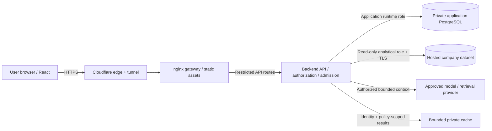

# Approved target architecture and session-abuse boundary

October 20, 2026. The user's architecture sketch is the target direction.
This records the necessary trust boundaries; it does not mark future phases done.

## Meaning of the boundaries

React executes on the user's device. Its code, requests and client state are
inspectable and cannot store secrets or enforce database permissions. The browser
calls an API exposed through the gateway. That API must authorize every operation
even when someone bypasses the UI or uses their own HTTP client. The Python
listener itself is loopback/private; public traffic must always enter nginx.

Only the backend connects to databases. Account/session/chat/preferences storage
is separate from analytical company data, with different credentials and grants.
No app DB port is published publicly; runtime cannot do migrations/DDL. The AI
analytical reader cannot access account/session records. Cloud location does not
make a database private: restrict its network clients, require verified encrypted
connections, and use least-privilege credentials and bounded queries. Changes to
the existing hosted database and connection modules remain outside P01 scope.

The database's security comes from authorization, network restrictions, grants,
safe query execution, credentials and monitoring, not from the number of boxes
between it and the browser. A backend compromise still matters; separate roles,
bounded worker access and recoverable backups reduce its reach. Multi-customer
dataset selection must be resolved from server-owned grants, never a browser DSN.

Cloudflare may cache public static assets. Authenticated API responses, sessions,
prompts, results and exports must not enter a public/CDN cache. The private result
cache stays behind authorization and is partitioned by canonical identity,
dataset/grant, policy/schema and conversation revision as those phases arrive.
Credentials and session tokens are never cache keys exposed to the client.

## Session ownership does not provide admission control by itself

The user explicitly requires that one person cannot acquire extra server capacity
by creating many sessions, and cannot read or mutate another person's session.
Treat this as a mandatory P03/P07 security gate before public signup.

Historical P01 baseline: verified Google identity, signed expiring stateless cookies,
host-bound Secure/HttpOnly cookies, CSRF and dataset allowlists. Logout clears the
browser cookie but cannot revoke a copied cookie before expiry. There is no
durable account/session table, active-session ceiling or durable account quota
yet. P01's corrected gateway uses one socket-peer aggregate budget behind the
tunnel; forged headers and cookie churn do not create fresh budgets. It does not
claim per-user fairness or durable multi-worker quotas.

P03 must implement opaque unpredictable session tokens with only digests stored
server-side, canonical account ownership, absolute/idle expiry, rotation and
revocation. Never treat a browser-supplied account/session identifier as authority.
Lookups, listing and revoke-one operations must be owner-scoped. Logout must
revoke server state before clearing the cookie; reset, disablement and revoke-all
must invalidate copied cookies and existing streams. Reject the old stateless
format at cutover so it cannot bypass durable checks. A stolen bearer cookie is
still a credential: cookie protections, short bounds, detection and revocation
reduce risk; session records alone cannot prove the caller is the original device.

Add a small server-controlled active-session ceiling per canonical account.
Choose/document its numeric policy in P03; an atomic account lock/transaction must
prevent parallel logins from exceeding it. Reject excess issuance safely and
provide an authenticated session-management/revoke flow. Do not silently grant
fresh quotas per device or evict legitimate sessions based on unauthenticated
claims. Limit Google challenge/session creation by trusted network and global
budgets before provider calls; apply verified-account issuance limits afterward.
Do not key an unauthenticated quota on an attacker-supplied email address alone.

P03/P04/P07 admission must share account/operation budgets across all that
account's sessions, plus trusted anonymous-network budgets and global work/cost
ceilings. Bound the number of keys and their retention. Reserve work atomically
across workers, with bounded timeouts and safe behavior on storage failure.
Account caps alone do not protect against many accounts; network/global caps do
not replace account fairness. Start from the handoff's proposed two active costly
jobs per user and benchmark numeric global concurrency/queue/memory limits in
P12; enforce explicit limits before enabling the relevant capability.

## Required adversarial and defensive evidence

- A and B cannot substitute session IDs, list/revoke each other's sessions or
  receive each other's cached results. N has an account without a dataset grant.
- Parallel logins/challenge replay cannot exceed the session ceiling, duplicate
  identity records or mint multiple sessions from a single-use challenge.
- Cookie clearing, new devices, reconnects and parallel sessions do not refresh
  account/global budgets. Key cardinality remains bounded under random identities.
- Copied cookies fail after logout/reset/disable/revoke-all, including in-flight
  and replayed result streams; expiry/revocation races cannot publish private data.
- Rejected requests do not invoke a model, hash passwords, send mail, enqueue work
  or modify another user's state. Exercise store outage, worker restart and queue
  saturation using isolated fixtures and work counters; prove cooldown recovery.
- Legitimate B traffic retains intended capacity during A's abuse. Alerts/logs
  record category/action and bounded identifiers without cookies, tokens or data.

Use the same phase red/blue/fix/retest and CI process as P01, with exact scope and
budgets. A signed cookie, a request counter or a 429 alone is insufficient evidence.

## References

- [OWASP REST API security](https://cheatsheetseries.owasp.org/cheatsheets/REST_Security_Cheat_Sheet.html)
- [OWASP database security](https://cheatsheetseries.owasp.org/cheatsheets/Database_Security_Cheat_Sheet.html)
- [Cloudflare ingress validation and routing](https://developers.cloudflare.com/cloudflare-one/networks/connectors/cloudflare-tunnel/do-more-with-tunnels/local-management/configuration-file/)

## P02 networking implementation checkpoint

The private app storage implementation is prepared for human migration/PR review.
Its DB container has network `none`, PostgreSQL `listen_addresses` empty and no
published ports. A socket volume is attached read-only only to approved runtime
and migration containers; SCRAM/role privileges still apply. Installer tests
prove this topology with synthetic resources. P02 does not install the persistent
DB, enable signup or replace current stateless cookies. See
`../implementation/P02.md` and `../../ops/appdb/README.md`.

## Current implementation checkpoint: P02 deployed, P03 prepared

P02 PR #38 is merged/deployed at `5ac90fc` and its private schema-1 storage is
active. Network-none, empty listen_addresses, no port bindings, runtime DDL and
ledger-write denials, and post-denial readiness are verified. This supersedes
the prepared-only P02 status above; the analytical database is unchanged.

P03 code/checks implement durable canonical identity, one-use challenges,
revocable opaque sessions, current status/epoch/grants, a five-session atomic
cap and shared durable authentication budgets. Re-login never restores a revoked
grant. Default idle/absolute bounds are 1800/3600 seconds; background GET polling
does not renew them. Cookie/header churn creates no new trusted capacity.
The frontend keys private state by canonical UUID and locks rather than discards
an unresolved logout. P03 remains uncommitted for PR and schema-2 cutover review;
see `../implementation/P03.md` for evidence and scoped limitations.

P07 must still implement AI operation/global admission and revalidation of
in-flight jobs/streams; P04/P10 provide password-reset/revoke-all and owned session
management. The P03 core checks epoch/status changes, but those future endpoints
are not advertised as working. These boundaries remain mandatory before public
launch; isolated red/blue checks are not a claim of zero breaches or a full live
penetration assessment.

## P04 review checkpoint

P03 is deployed at c25a333 with private schema 2. Prepared P04 source adds
password-only authentication alongside Google and requires explicit schema 3.
Email-first registration never accepts an attacker-preselected password; reset
cannot add a first password to a Google-only identity. Reset invalidates epochs,
all usable sessions and outstanding proofs transactionally. Corrupt/unknown
credential rows receive bounded real dummy hashing. Two durable hash slots span
processes; no DB connection is held while hashing. Crash cleanup requires every
hash worker to be stopped first. The corpus is pinned, licensed and fail-closed.

AEAD-encrypted mail, a separately keyed explicit worker, purpose-reserved queues,
volume limits, stable retries and replay fencing bound message work. Registration
cannot spend recovery's POST or mail allocation; shared anonymous bootstrap and
aggregate tunnel-peer quotas can still throttle legitimate visitors during abuse.
These are documented availability tradeoffs, not production capacity guarantees.
P04 does not enable registration/mail or deliver P05's browser forms. See
`../implementation/P04.md` for final scoped red/blue evidence and later gates.
